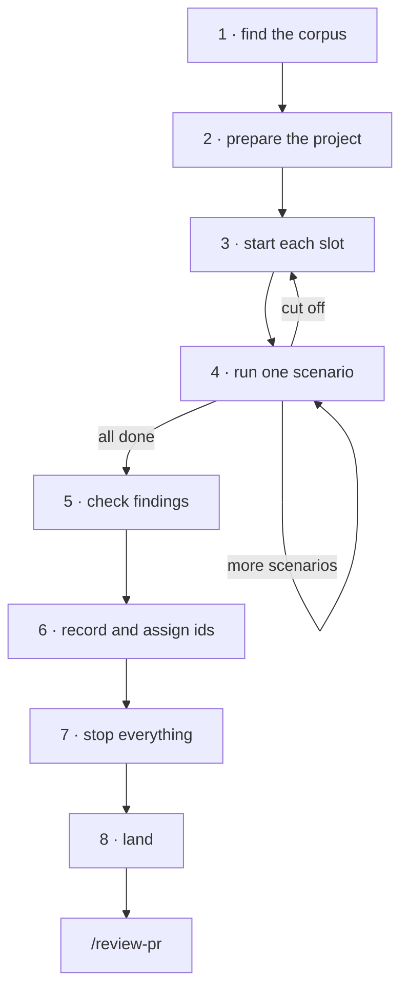

<!-- Generated by agent-pants from plugins/craft/skills/scenario-run/scenario-run.md; do not edit. -->

# `/scenario-run`

Usage:

- `/scenario-run <scenario id>...` runs those scenarios on origin's default branch, as
  fetched at the start of the round.
- `/scenario-run <build sha> <scenario id>... [--slots N]` runs them on that build, N at a
  time.

Scope: one round of written scenarios, from setup to a draft PR of the records. Not in scope:
writing scenarios (`/scenario-author`), fixing them beyond small edits the round shows are
needed, and fixing the product.

Inputs: the scenario ids, a build, and the project's scenario README. Output: one trial
record per scenario, one round record, register entries, and a draft PR.

A trial is one persona attempting one scenario. A round is one batch of trials against one build.
A legacy corpus may call them sessions and runs; use its names there.

A scenario is an end-to-end test written in prose, carried out by a simulated user: see
[scenario-format.md](references/vault/plugins/craft/references/scenario-format.md). The project's scenario README is the contract. It owns its fields,
personas, the trial template, the round record's shape and where findings go. This skill points to
it and never restates it.

## Steps

1. **Find the corpus.** Find the scenario README (search for the folder that holds the
   scenario ids), or ask for it. Read its sections on running a scenario, running one without
   the user, and filing findings, and follow them.
2. **Prepare the project.** Read the setup from the checkout you work in, where the corpus
   is, and run its commands in each build copy; an older build may lack the setup keys. Use
   the first source that answers, and say in the round record which one you used:
   1. The `sdlc.yaml` closest to the corpus, walking up from the corpus folder, if one
      exists: the `workflows:` keys in [Workflow keys](#workflow-keys).
   2. The project's own docs and manifests: the scenario README, README, CLAUDE.md or
      AGENTS.md, package.json scripts, justfile, Makefile, compose files.
   3. A scan of the code. Record each guess in the round record as a skill gap.
3. **Start each slot.** A slot is one build copy, one port range, one driver and one data
   copy. Pick the number of slots with [parallel-slots.md](references/vault/plugins/craft/references/parallel-slots.md) unless `--slots` names it. See
   [Slots and servers](#slots-and-servers).
4. **Run one scenario** in a slot. See [Trials](#trials). Repeat until every scenario
   has run, and restart the slot when a trial is cut off.
5. **Check the findings.** Before calling something a bug, read the code when that is cheap.
   Check each bug against origin's default branch; a bug only on an unmerged branch goes on
   that branch's PR as a comment.
6. **Record.** Write each trial record and the round record as the README says. In a corpus on
   the Known kinds in [scenario-format.md](references/vault/plugins/craft/references/scenario-format.md), they are `trial` and `round` records, written as that
   table says; never invent your own. Pick the round's id when the round starts, so each trial
   record can name it in its `round` field. Then assign register ids, once, for the whole round. See
   [Records](#records).
7. **Stop everything** you started, by PID, and check with `lsof -i :<port>` that no port in
   any slot still listens.
8. **Land.** Commit the records with explicit paths, push, and open a draft PR whose body
   opens with a plain summary of every change. Have an independent agent, given only the PR
   URL, review it with `/review-pr`, and answer every finding.

## Workflow keys

Named workflows under `workflows:` in `sdlc.yaml`. Any name is allowed. Each is a list of
steps; a plain string is a shell command, run from the folder that holds that `sdlc.yaml`, and
`run: <name>` splices in another workflow's steps.

- `scenario-setup`: builds one build copy. Run it once per copy, from that folder in the copy.
- `scenario-serve`: starts the app for one slot, in the foreground. `{name}` tokens, such as
  `{port}` or `{data}`, are the slot's values. The comment above the key says what each token
  means and which URL to open.

Substitute the tokens yourself and run the command under your own process control, so you
hold its PID. `sdlc run <name> --dry-run`, run from that folder, prints the resolved steps
when `run:` steps make them hard to read.

## Slots and servers

- **One copy per slot.** Fetch first, then make a detached worktree of the build for each slot
  (`git worktree add --detach <dir> <sha>`), or `git archive <sha> | tar -x -C <dir>` when you
  may not write to the repo. Dev servers write into the source tree, so slots never share a
  copy. Install dependencies in each; copies share nothing.
- **Reuse build caches.** A cold compile in each copy can take minutes. Copy an existing
  build cache into the copy first when the file system makes that cheap (`cp -c` on APFS).
- **One port range per slot.** Split the range into one block per slot. In a block, the
  first port is `{port}`, the next ones go to the other port tokens in the order the
  workflow lists them, and the last is the driver's debug port, if it has one. Check each is
  free first.
- **Start by PID.** Start each server in its own process group, write its PID to a file, and
  log to a file: `bash -c 'set -m; <command> >server.log 2>&1 & echo $! >server.pid'`. Stop
  it with `kill -TERM -- -$(cat server.pid)`. Never stop a server by a name pattern
  (`pkill -f`): it reaches other slots.
- **Use scratch data.** Copy the fixture or data the scenario names into the slot's scratch
  folder. Never point the app at checked-in fixtures or a real user's data. When the server
  copies the data again at launch, the live copy is the one it names in its log: snapshot,
  edit and commit that one.
- **Warm up.** Before the first trial, open every main view once, including views that load
  heavy code such as an editor or a canvas. Dev servers otherwise rebuild and reload in the
  middle of a trial. A first-load error that a reload clears is not a finding.
- **Drive the app as the persona would.** Each step runs one action and saves what the
  persona would see: a screenshot, the terminal output or the response body. Never pipe a
  step's output through `head`.
  - **Web:** a browser through Playwright. The worked case is below.
  - **Desktop GUI:** a GUI driver: the app's WebDriver (for example `tauri-driver`), or OS
    accessibility scripting with screenshots.
  - **CLI:** a shell, typing the commands the persona would type, with the output saved per
    step.
  - **API:** HTTP requests (`curl` or a script), with the status and body saved per step.

For a web app:

- **Drive one browser.** Start one headless browser per slot that stays up, and connect to it
  per step over its debug port (Playwright `connectOverCDP`). Use the Chromium that the
  build's own Playwright installs (`playwright install chromium`), and run the scripts with
  `node`; other pairings can hang on screenshots. Each step saves a screenshot and writes the
  page text to a file.
- **Wait for `load`.** Wait for the `load` event and a short pause, never `networkidle`; dev
  servers keep a socket open. Give long actions, such as a bulk fix or a big scan, a step
  timeout of several minutes, or poll across steps.
- **Click what is visible.** Pages keep hidden copies of text. Filter to visible elements, and
  check the screenshot when a folded pane may cover them.

## Trials

- **Stay in the persona.** Act on what the persona knows and how they work, as the corpus
  defines them. When the persona would not know the next step, record that as a finding
  instead of using what you know of the code.
- **Read blind.** Print the top sections of one scenario at a time, for example
  `sed '/^## Things to watch/,$d' <file>`. Never run a command that prints several scenarios.
  Read the rest only after the attempt.
- **Setup or attempt.** What the Starting point says is already true is setup, even when it
  means causing a failure or running a first scan. Do it before the attempt and note it in the
  record. What the person tries to do is the attempt. Friction met during setup is still a
  finding, rated the same way and marked as setup.
- **Snapshot the data** before the attempt (`find <dir> -type f -print0 | xargs -0 shasum`, and
  `git log` for a git repo) and compare it after.
- **Chained scenarios.** When a Starting point follows another scenario, run the two in order in
  one slot and reuse its end state. Otherwise rebuild that state by hand and say so.
- **Two variants.** When a Starting point offers two variants, run both as separate attempts.
  If time runs out, run the first and list the second as not run.
- **Faking time.** When a scenario needs time to pass, change only the timestamps the app
  reads from its own data, and record how. If that is not possible, record a harness limit.
- **Cut off midway.** If the server dies or the driver hangs, note the last step reached.
  Restart the slot on a fresh copy of the data, redo the setup, and run the attempt again from
  its start. The record says it restarted and which findings came from which attempt.
- **Label each finding** as one of three:
  - **product finding**: friction in the app; it goes where the README says.
  - **skill gap**: something this skill or the project's setup should have said; it goes
    in the round record's process section.
  - **harness limit**: a check the harness cannot make, such as a restart that wipes temp data; it
    goes in the round record's limits section.

## Records

- **Dates.** Use the round's local start date for every record and folder name, even when the
  round crosses midnight.
- **Register ids.** When the README names a findings register with numbered ids, assign them
  last, once per round. Start after the highest id in the
  register on the records branch's base (origin's default branch, or the parent branch when
  the records branch is stacked) and in any open PR that adds register entries. Give each new
  finding the next free id in order, and write each mapping in its trial record. Check the
  open PRs' entries for duplicates of your findings too.
- **Existing entries.** When an entry already covers a finding, add the trial to it. Raise
  the entry's severity when the new trial shows worse harm, say so in the entry, and never
  lower it.
- **Wall time.** Put each trial's wall time in its record.

## Grading

- Every scenario was read blind, one at a time.
- Every server was started and stopped by PID, and no port in any slot listens at the end.
- The round record names the build, the source of the setup, and each guess.
- Every finding carries one of the three labels and sits where its label says.
- Register ids, when the project uses them, are unique and follow the last id on the base branch and
  in open PRs that add entries.
- The PR was reviewed by an agent that saw only its URL.

## Test environment

A project with a scenario README, one persona, one scenario, a fixture and an `sdlc.yaml` beside the
corpus with `scenario-setup` and `scenario-serve`. Give a fresh agent only this skill, the repo
root, one scenario id, a scratch folder and a port range, and tell it to write nothing into the
repo. Its list of guesses is the list of skill gaps.
