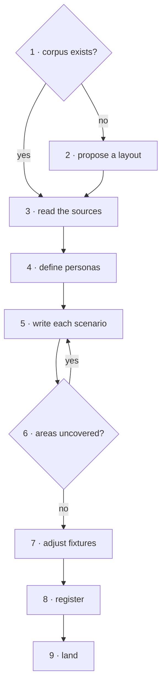

<!-- Generated by agent-pants from plugins/craft/skills/scenario-author/scenario-author.md; do not edit. -->

# `/skill:craft-scenario-author`

Usage:

- `/skill:craft-scenario-author <area or feature>` writes scenarios for that part of the product.
- `/skill:craft-scenario-author <corpus folder>` checks the corpus's coverage and fills the gaps.

Scope: writing scenarios, personas and fixture changes, up to a PR. Not in scope: running them
(`/skill:craft-scenario-run`) and fixing the product.

Inputs: the product, and the area to cover. Output: new or updated scenario files, personas
and fixtures, each scenario in the corpus index, and a PR.

The format is [scenario-format.md](references/vault/plugins/craft/references/scenario-format.md). The project's scenario README holds its own fields, ids,
personas and fixtures; follow it where it differs.

## Steps

1. **Find the corpus.** Search for the scenario README, its personas, its templates and its id
   scheme, or ask for the folder. Read the README's section on adding a scenario and follow it.
2. **Propose a layout** when there is no corpus: a README with an index table, a `templates/`
   folder, and the folders of the Known kinds in [scenario-format.md](references/vault/plugins/craft/references/scenario-format.md). Use those kinds, prefixes
   and fields as written; never invent your own. Get the user's agreement before writing it.
3. **Read the sources.** Read the product's design docs and requirements, its existing UX findings
   and user reports, and use the app itself. In a project with sdlc planning records
   (`docs/planning/`), read its products, drivers, capabilities, decisions, principles, standards,
   notes (research and analysis among them) and frictions. List the product's areas as you go.
4. **Define personas first.** Reuse a persona the corpus has. Add one only when no persona
   fits, and give it what it knows, how it works and what limits it.
5. **Write each scenario** from the template. Name the persona, the Starting point (fixture or
   data) and what done looks like. Describe the goal and the outcome, never a button, screen,
   command or endpoint. Write Things to watch as questions with no answers. Add `needs` only for
   a feature that a task says is not built.
6. **Check coverage.** Map each scenario to an area, and write one for each area with none.
   Add at least one consistency scenario whose goal crosses two or more features.
7. **Adjust fixtures.** Make the smallest change to the fixture data that the new scenarios
   need, and say in the fixture's docs what it now holds.
8. **Register.** Add each scenario to the corpus index with its id and title. Known kinds take
   random ids as [scenario-format.md](references/vault/plugins/craft/references/scenario-format.md) says. A legacy scheme gives ids in order after the highest
   one in the corpus and in open PRs that add scenarios.
9. **Land.** Commit with explicit paths, push, and open a PR whose body opens with a plain
   summary of every change.

## Grading

- No scenario names a button, screen, command or endpoint.
- Every scenario names a persona the corpus defines, a Starting point and at least one
  checkable outcome.
- Every Things to watch item is a question with no answer.
- No `needs` entry lacks a task id.
- Every area listed in step 3 has a scenario, and one scenario crosses features.
- Every new scenario is in the corpus index, and no id repeats.

## Test environment

A small app with a design doc and no corpus. Give a fresh agent only this skill and one area.
Check that it proposes a layout before writing, defines personas before scenarios, and passes
the grading checks.
