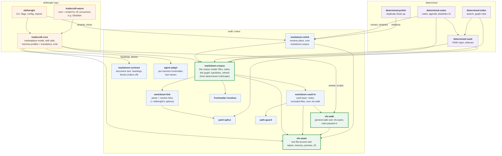

# Crate dependencies

Who depends on whom across skillwright, osdlc and determined, and what each
crate does. Only osdlc-family crates are shown; `serde`, `thiserror` and the
like are left out. The target follows
[D-YRKH](../decisions/D-YRKH-one-implementation-per-vault-concept.md): one implementation per
concept.

How the osdlc markdown crates depend on each other is in
[markdown-ecosystem.md](markdown-ecosystem.md).

## Today

Dashed boxes are code that skillwright core keeps itself instead of using
the shared crate the dashed arrow points to.

```mermaid
%%{init: {"flowchart": {"htmlLabels": false, "wrappingWidth": 400}}}%%
flowchart TB
  classDef sw fill:#fff3e8,stroke:#d9822b
  classDef det fill:#f3eefc,stroke:#7c5cc4
  classDef osdlc fill:#eef4ff,stroke:#5b7fc7
  classDef dup fill:#ffffff,stroke:#c0392b,stroke-dasharray:4 3,color:#c0392b

  subgraph SW[skillwright repo]
    CLI["<b>skillwright</b><br/>CLI: flags, config, reports,<br/>harness install"]:::sw
    CORE["<b>tradecraft-core</b><br/>discover, compile, build,<br/>publish, adopt, Vfs"]:::sw
    WASM["<b>tradecraft-wasm</b><br/>core for JS consumers,<br/>e.g. Obsidian"]:::sw
    DUP1["5 vault walks"]:::dup
    DUP2["wikilink scanner<br/>+ VaultIndex resolver"]:::dup
    DUP3["heading / block<br/>extraction"]:::dup
  end

  subgraph OS[osdlc crates]
    AA["<b>agent-adapt</b><br/>per-harness frontmatter,<br/>tool names, skill paths"]:::osdlc
    ML["<b>markdown-link</b><br/>parse links, LinkIndex<br/>resolution, code spans"]:::osdlc
    MR["<b>markdown-relink</b><br/>rename/move a note,<br/>rewrite inbound links"]:::osdlc
    MVF["<b>markdown-vault-fs</b><br/>vault walk, excluded files,<br/>_system rules (std::fs)"]:::osdlc
    MC["<b>markdown-contract</b><br/>document tree (comrak),<br/>contract checks"]:::osdlc
    FL["<b>frontmatter-lossless</b><br/>split frontmatter / body"]:::osdlc
    YS["<b>yaml-splice</b><br/>edit YAML, keep bytes"]:::osdlc
    PG["<b>path-guard</b><br/>path containment"]:::osdlc
    EW["<b>etag-write</b><br/>compare-and-swap writes"]:::osdlc
    SC["<b>slug-collate</b><br/>slugs, name matching"]:::osdlc
  end

  subgraph DET[determined]
    DV["<b>determined-vault</b><br/>re-exports walk, links,<br/>frontmatter; YAML layer"]:::det
    DN["<b>determined-notes</b><br/>LinkGraph: backlinks,<br/>tags, incremental refresh"]:::det
    DI["<b>determined-index</b><br/>search index,<br/>VaultGraph view"]:::det
    DP["<b>determined-polish</b><br/>duplicate clean-up:<br/>redirects links to the kept copy"]:::det
  end

  CLI --> CORE
  CLI --> MR
  CLI --> YS
  CLI --> PG
  CLI --> EW
  WASM --> CORE
  CORE --> AA
  CORE --> ML
  CORE --> FL
  CORE --> YS
  CORE --> PG
  ML --> YS
  ML --> SC
  MR --> ML
  MR --> MVF
  MR --> FL
  MR --> EW
  MVF --> PG
  DV --> MVF
  DV --> ML
  DV --> FL
  DV --> YS
  DN --> DV
  DN -- moves, renames --> MR
  DP -- redirects --> MR
  DI --> DV

  DUP1 -.duplicates.-> MVF
  DUP2 -.duplicates.-> ML
  DUP3 -.duplicates.-> MC
```

As an image: [crate-dependencies-today.svg](img/crate-dependencies-today.svg).

Three more copies of a vault link model exist besides core's: `LinkGraph`
in `determined-notes`, `VaultFacts` in `markdown-relink`, and the walk behind
`VaultGraph` in `determined-index`.

## Target

New crates are bold-bordered. Every vault concept has one home; tools add
only what is their own.

As an image: [crate-dependencies-target.svg](img/crate-dependencies-target.svg).
