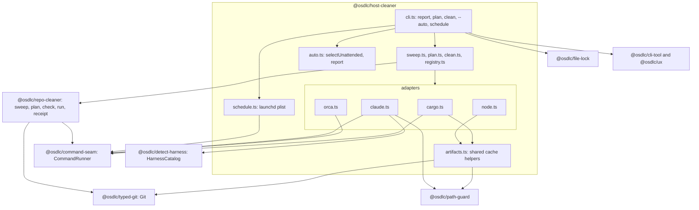
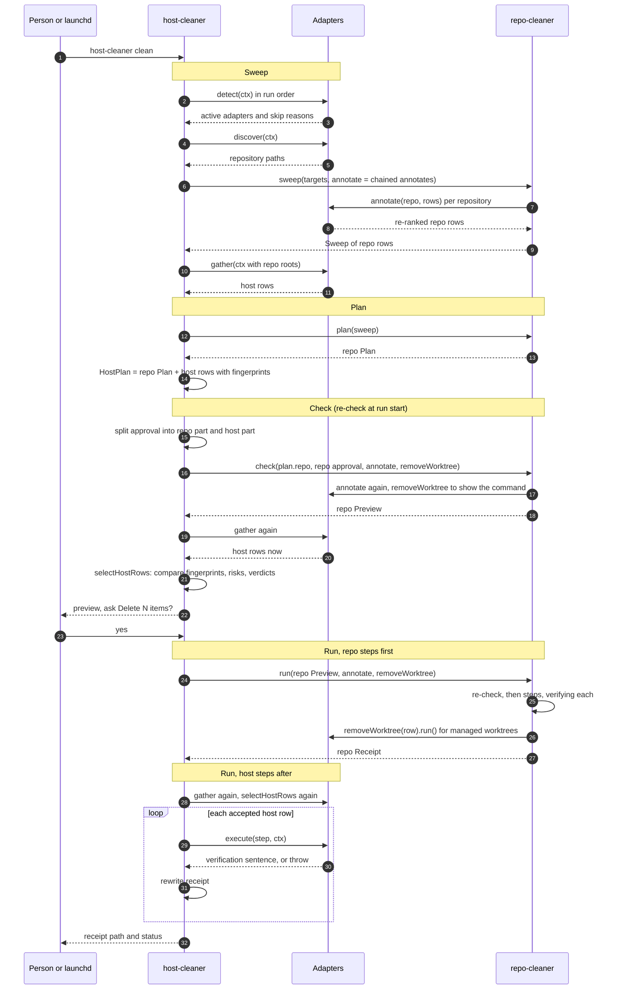
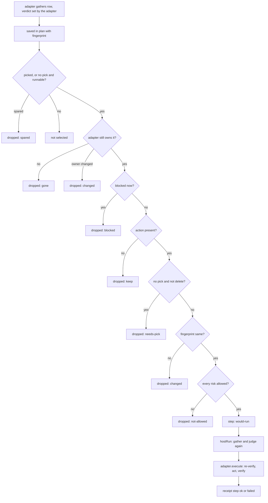

# host-cleaner

How `@osdlc/host-cleaner` is built: what it adds to
[repo-cleaner](../../packages/ts/repo-cleaner/README.md), how a sweep, plan, check and run
flow through it, and what each adapter does.

> **Status.** This describes the stack of PRs 943 to 948 (branch
> `sksizer/issue-666-scheduled-run` holds all six). They are not merged, so
> `packages/ts/host-cleaner/` is not on `main` yet and the code references below
> are paths inside that package (`src/...`). The decisions that remain open are in the
> design review, [host-cleaner-design](../parley/host-cleaner-design.html). The decision
> record is [D-L7N5](../decisions/D-L7N5-host-cleaner.md); where it differs from the code, the
> code wins and the differences are listed in "Where the code and the decision record differ".

repo-cleaner's own model (plan, fingerprint, check, run, receipt, risks) is in its
[README](../../packages/ts/repo-cleaner/README.md) and its
[D-RSWP](../../packages/ts/repo-cleaner/docs/planning/decisions/D-RSWP-standalone.md). This page
does not repeat it.

## Overview
### The problem

A machine that runs coding agents fills up with things git cannot see:
- **Build caches.** Rust `target/` and `node_modules` per worktree. One machine held 366 GB of
  `target/` directories across worktrees, and nothing found them (PR 945).
- **Orca worktrees.** Orca keeps its own record of some worktrees and holds terminals open in them.
  Removing one with `git worktree remove` leaves the record and the terminals behind (PR 946).
- **Stray agent sessions.** Claude Code processes outlive their work: they sit in deleted or
  temporary folders, or two resume the same conversation. They hold memory and keep worktrees
  busy (PR 947).

### What it is
`@osdlc/host-cleaner` is a library and a `host-cleaner` command that runs repo-cleaner and lets
optional, self-detecting **adapters** add what git cannot know:
- rows of their own (a `target/` directory, a session), and
- verdicts on repo-cleaner's rows (a worktree Orca still manages).

Both kinds of row go through **one plan, one re-check and one receipt**, under repo-cleaner's
safety model.

### Who owns what
| Concern | Owner |
| --- | --- |
| Branches, worktrees, remotes, PRs, "has it landed" | repo-cleaner |
| Plan, fingerprint, check, run and receipt for those rows | repo-cleaner |
| Build caches, terminal apps, agent sessions | host-cleaner adapters |
| Composing both into one plan, check, run and receipt | host-cleaner |
| Unattended run, lock file, launchd schedule | host-cleaner |

Rule of thumb: repo-cleaner owns git and the forge. host-cleaner owns the machine.
With no adapter active, host-cleaner's result is repo-cleaner's, row for row (`src/index.ts`).

### What it never does
- It never deletes without a plan, a re-check and a verified step.
- It never grants a risk on its own. `--auto` passes no `--allow` (`src/cli.ts`, `autoWork`).
- It never closes a session unless a person names the row (`--pick session:<pid>`) and grants
  `close-session`. Session rows have `unattended: false` (`src/claude.ts`).
- It never sends SIGKILL. A session that ignores SIGTERM fails its step (`src/claude.ts`).
- It never removes a path that resolves outside its checkout (`src/artifacts.ts`, `inside`).
- It never removes a `target/` or `node_modules` a build is working in.
- It never falls back to plain git removal for a worktree that may be Orca's while Orca is
  unreachable (`src/orca.ts`).
- It never touches remote branches. `--only remote` is refused: "remote branches are repo-cleaner's"
  (`src/cli.ts`, `sweepWith`).
- It never opens a shell. Every shell-out goes through `@osdlc/command-seam`; git goes through
  `@osdlc/typed-git`. The cache removal itself is `fs.rmSync` (`src/artifacts.ts`).

### Where the code and the decision record differ
| Topic | Decision record | Code on this branch |
| --- | --- | --- |
| Adapter run order | `orca`, `claude-code`, `cargo`, `node` | `cargo`, `node`, `orca`, `claude-code` (`src/bin.ts`) |
| Selection flags | `--adapter` and `--no-adapter` | `--adapter` and `--skip-adapter` (`src/cli.ts`). The library option is `noAdapter` |
| Contract | five hooks; "no hook that runs before the sweep yet" | six hooks. `discover` is that hook, added in PR 946 (`src/adapter.ts`) |
| `--auto` threshold | idle "longer than" the threshold | `>=` the threshold: `idleHoursSince(...) >= threshold` (`src/cargo.ts`, `src/node.ts`) |
| `discard-archived` risk and archive-before-delete | in repo-cleaner | not on this branch. repo-cleaner's `RISKS` is `abandon-unmerged`, `discard-changes`, `confirm-open-pr`. The branch predates repo-cleaner PR 941 on `main`. The README still says `--auto` "never grants `discard-archived`", which is true by construction |

## Package map


### Modules
| File | Responsibility |
| --- | --- |
| `src/adapter.ts` | `HostAdapter`, `HostContext`, `HostRow`, `HostStep`, `HostConfig`, `HostCleanerError` |
| `src/options.ts` | `HostOptions`: adapters, selection, config, injectable runners, probe, clock |
| `src/registry.ts` | `makeContext`, `resolveAdapters` (detect and select), `chainAnnotate`, `chainRemoveWorktree`, `AdapterReport` |
| `src/sweep.ts` | `hostSweep`: discover, sweep with chained `annotate`, then `gatherHostRows`. Validates host rows |
| `src/plan.ts` | `HostPlan` (zod schema), `hostPlan`, `hostFingerprint`, read and write |
| `src/clean.ts` | `hostCheck`, `hostRun`, `selectHostRows`, the approval split, `HostReceipt` |
| `src/artifacts.ts` | Shared by `cargo` and `node`: `checkoutsOf`, `sizeOf`, `newestMtime`, `inside`, `artifactRow`, `refusedRow`, `holdersIn`, `removeArtifact` |
| `src/cargo.ts` | The `cargo` adapter |
| `src/node.ts` | The `node` adapter |
| `src/orca.ts` | The `orca` adapter: `createOrcaAdapter`, `orcaAdapter` |
| `src/claude.ts` | The `claude-code` adapter: `parseSession`, `resumeIdOf`, `projectSlug`, `createClaudeAdapter` |
| `src/auto.ts` | `selectUnattended` (pure), `measureRows`, `leftForReview`, `cleanedIds`, `failedIds`, `renderAutoReport` |
| `src/schedule.ts` | `renderPlist`, `installSchedule`, `uninstallSchedule`, `scheduleStatus`, `parseEvery` |
| `src/config.ts` | `ConfigSchema`, `readConfig`, `hostDirs` (tiered dirs), `hostConfigOf` |
| `src/cli.ts` | `main(argv, ctx, deps)`: the four commands, flags, refusals, exit codes, lock |
| `src/bin.ts` | The bin: passes the four shipped adapters to `main` |
| `src/index.ts` | Public exports |
| `tests/` | `host.test.ts`, `cli.test.ts`, `artifacts.test.ts`, `orca.test.ts`, `claude.test.ts`, `auto.test.ts`, `smoke.mjs` |

## Core concepts
### Vocabulary

| Term | Meaning |
| --- | --- |
| **Row** | One thing that could go. Repo rows (`worktree`, `branch`, `remote`) come from repo-cleaner. Host rows (`artifact`, `session`, any other kind) come from adapters |
| **Row id** | `<kind>:<name>`. Host kinds must not be repo-cleaner's `KINDS`. Ids are unique across adapters |
| **Verdict** | `delete`, `review`, `keep` or `blocked` |
| **Action** | What deleting the row does (`remove`, `close`, ...). `null` means it can never be acted on |
| **Risk** | A named hazard a person must grant (`--allow <risk>`) before the action runs |
| **Blocker** | A condition that rules the row out whatever is granted |
| **Fingerprint** | The evidence a verdict rests on, saved in the plan and compared again at check and run |
| **Plan** | One JSON file: repo-cleaner's plan plus the host rows with fingerprints |
| **Check** | `hostCheck`: re-judge every selected row against the machine now. Deletes nothing |
| **Receipt** | One JSON file, rewritten after every step, for both kinds of row |

### Risks and blockers
| Name | Kind | Where |
| --- | --- | --- |
| `abandon-unmerged`, `discard-changes`, `confirm-open-pr` | risk | repo-cleaner (`RISKS`), granted to repo rows |
| `close-session` | risk | host-cleaner, `CLOSE_SESSION` in `src/claude.ts`. Any risk not in `RISKS` is a host risk |
| `host:orca-unreachable` | blocker | `ORCA_UNREACHABLE` in `src/orca.ts`. repo-cleaner's `Blocker` type accepts any `host:<name>` (`HostBlocker`), added in PR 946 |
| `live-process`, `locked-worktree`, ... | blocker | repo-cleaner's own |
| free-text strings | blocker | Host rows carry `blockers: string[]`, e.g. `running in the checkout: cargo (pid 123)` |

### Fingerprint
A fingerprint is a plain JSON record. Two are the same when every key matches after treating a missing key as `null`
(`sameFingerprint`, from `repo-cleaner/src/plan.ts`).

| Row | Fingerprint |
| --- | --- |
| Repo worktree | `head`, `branch`, `dirtyFiles`, `unpushedCommits`, `staleLock`, `onDisk`, `submodules` |
| Repo branch | `sha`, `prNumber`, `prState` |
| Host row | its whole `evidence` object, deep-copied with `structuredClone` (`hostFingerprint`) |

An adapter must therefore put everything its verdict rests on into `evidence`.

### Plan
`HostPlan` (`src/plan.ts`, `HOST_PLAN_VERSION = 1`):

Fields: `version`, `createdAt`, `adapters` (the adapters that were active; the re-check runs those and no others), `repo` (repo-cleaner's plan) and `rows` (`{ id, adapter, verdict, action, risks, fingerprint }` per host row).

A plan of a different version is refused: "Sweep again to make a new plan".

### Check
`hostCheck(plan, approval, opts)` returns a `HostPreview`: repo-cleaner's preview, the host steps
(`would-run`), the dropped rows with reasons, unused allows and the adapter reports.
A host row is dropped as one of:

`gone` (no adapter owns it now), `changed` (fingerprint moved, or another adapter owns it), `blocked`, `keep` (no action now), `needs-pick` (not `delete` and not picked), `not-allowed` (a risk was not allowed), `spared`.

### Receipt
`HostReceipt` (`src/clean.ts`, `HOST_RECEIPT_VERSION = 1`):

Fields: `version`, `plan` (source), `status` (`running`, `complete`, `failed`), `startedAt`, `finishedAt`, `repo` (repo-cleaner's receipt) and `host: { dropped, steps }`.

A `HostStepRecord` is `{ adapter, row, action, command, result, error, verification }` with `result` one of
`pending`, `would-run`, `ok`, `failed`. `verification` is the sentence `execute` returned.

### The adapter contract
The real interface, from `src/adapter.ts`:

```ts
export interface HostAdapter {
  /** Lower-case, unique; what `--adapter` and `--no-adapter` select. */
  name: string
  /** Cheap check: a binary on PATH, an app bundle, a config directory. */
  detect(ctx: HostContext): boolean
  /** Re-rank repo-cleaner's rows with what this host knows. Chained into every sweep and re-check. */
  annotate?: Annotate
  /** Rows this host owns. Read again at every re-check. */
  gather?(ctx: HostContext): HostRow[]
  /** Run one approved step, then verify it. Returns the sentence the receipt records; throws when it failed or could not be verified. */
  execute?(step: HostStep, ctx: HostContext): string
  /** Repositories this host knows that the sweep should read too, as absolute paths. Added to the targets unless the caller named its own. */
  discover?(ctx: HostContext): string[]
  /** Run in place of `git worktree remove` for the worktrees this host manages. */
  removeWorktree?: RemoveWorktree
}
```

(The doc comment on `name` says `--no-adapter`; the flag is `--skip-adapter`.)

| Hook | When it runs | Rule |
| --- | --- | --- |
| `detect(ctx)` | Once per run, in the order given. At sweep, `ctx.targets` is what the caller named | Return false or throw and the adapter is skipped (`not-detected` or `detect-failed`). It adds nothing |
| `annotate(repo, rows)` | Inside repo-cleaner's sweep, and again inside every `check` and `run` | Re-rank rows: change a verdict, add a note, drop a row. Chained in run order (`chainAnnotate`), so each adapter sees the previous one's output. Because it runs on every re-check, its verdicts survive |
| `gather(ctx)` | After the repo sweep, and again at `hostCheck` and `hostRun` | Returns the rows this adapter owns. `ctx.targets` is now the repository roots the sweep read. A throw gives no rows and sets `error` on the adapter's report. A bad row throws `bad-row` |
| `execute(step, ctx)` | Once per approved host row, in `hostRun` | Do the work, verify it, return one sentence. Throw on failure. The first failure stops the run |
| `discover(ctx)` | Before the sweep | Absolute repository paths added to the targets. Skipped when `discover: false`; the CLI passes that when targets are named on the command line |
| `removeWorktree(row, {repo, force})` | Inside repo-cleaner's `check` (to show the command) and `run` (to do it) | Return `{ command, run() }` to take over removal of a worktree, or `null` to leave it to git. First adapter that returns non-null wins (`chainRemoveWorktree`) |

Row validation (`checkRow` in `src/sweep.ts`) refuses a gathered row when:
- its `adapter` is not the gathering adapter,
- its `kind` is `worktree`, `branch` or `remote`,
- its `id` is not `<kind>:<name>`, or
- two adapters gather the same id.

`HostContext` (`src/adapter.ts`):

| Field | Holds |
| --- | --- |
| `git` | The git `CommandRunner` repo-cleaner sweeps with |
| `command(binary)` | A runner for any other binary. Every shell-out goes through here |
| `probe` | repo-cleaner's `ProcessProbe`: `alive(pid, startedAt?)` and `holders(path, {fresh?})` |
| `now()` | The clock |
| `config` | `{ adapters: { [name]: {...} } }`. An adapter reads only its own entry |
| `targets` | The targets (at detect) or the repository roots (at gather and execute) |
| `harnesses` | The detect-harness catalog, or `null` |

## The lifecycle, end to end
### Sequence



### Step by step
1. **Sweep** (`hostSweep`, `src/sweep.ts`). `resolveAdapters` detects each adapter in order and applies `--adapter` and `--skip-adapter`; an unknown name is refused (`bad-input`). Active adapters' `discover` adds repositories (de-duplicated by real path). repo-cleaner's `sweep` runs with the `annotate`s chained in. `gatherHostRows` then collects host rows, with `ctx.targets` set to the repository roots the sweep read. Result: `{ repo, adapters, rows }`.
2. **Plan** (`hostPlan`, `src/plan.ts`). `repo` is repo-cleaner's plan. Each host row is saved as `{ id, adapter, verdict, action, risks, fingerprint }`. `adapters` lists only the active ones; the re-check runs those and no others.
3. **Check** (`hostCheck`, `src/clean.ts`). `split` sends host row ids to the host and everything else to repo-cleaner. A risk in repo-cleaner's `RISKS` goes to its rows; any other risk to host rows. `--allow risk=row` naming a row not in the plan is refused. repo-cleaner's `check` runs with `annotate` and `removeWorktree` chained from the adapters, detected again now. If the approval picks only host rows, that check is skipped: with no repo pick it would mean every repo `delete` row. `gather` runs again and `selectHostRows` judges each row (see Safety model).
4. **Run** (`hostRun`, `src/clean.ts`). The receipt starts `running` and is rewritten after every step. repo-cleaner's `run` goes first and re-checks; a refusal finishes the receipt as `failed` before it rethrows. If the repo part failed, host steps do not start. Host rows are gathered and judged again, and only rows the preview showed can run. Each goes to its adapter's `execute`; the first throw marks the step `failed` and stops.
5. **Receipt.** One file holds both kinds of step and both lists of drops. A row inside a worktree the same run removed is dropped as `gone`; that is not an error.
### Two kinds of row, one pipeline
| Stage | Repo row | Host row |
| --- | --- | --- |
| Found by | repo-cleaner `sweep`, re-ranked by `annotate` | adapter `gather` |
| Saved in | `plan.repo` | `plan.rows` |
| Fingerprint | repo-cleaner's `fingerprint(row)` | `row.evidence` |
| Compared by | repo-cleaner `check` | `selectHostRows`, using repo-cleaner's `sameFingerprint` |
| Executed by | repo-cleaner `run`, or the `removeWorktree` hook | the owning adapter's `execute` |
| Receipt part | `receipt.repo` | `receipt.host` |
| Order | first | after, in plan order |

## The adapters
`src/bin.ts` passes `[cargoAdapter, nodeAdapter, orcaAdapter, claudeAdapter]`, in that order.

| Adapter | Detects | Hooks |
| --- | --- | --- |
| `cargo` | `cargo --version` exits 0, or a swept checkout has `Cargo.toml` | `detect`, `gather`, `execute` |
| `node` | A swept checkout has `package.json` | `detect`, `gather`, `execute` |
| `orca` | The Orca CLI runs | `detect`, `annotate`, `removeWorktree`, `discover` |
| `claude-code` | detect-harness reports Claude Code, or its config folder exists | `detect`, `gather`, `execute` |

### The shared artifact layer (`src/artifacts.ts`)
`cargo` and `node` share these pieces.

- **Checkouts.** `checkoutsOf(ctx)` asks `Git(target).worktrees()` for every target. It returns
  each repository's primary checkout first, then linked worktrees. Bare and missing ones are left out.
- **Row id.** `artifact:<absolute path>`. Kind is always `artifact`.
- **Evidence (the fingerprint).** `kind` (`cargo-target`, `cargo-incremental` or `node-modules`),
  `path`, `checkout`, `sizeBytes`, `idleHours` (rounded down), `newestMtimeMs`, `unattended`.
- **Verdict.** `delete` when nothing holds the checkout, else `blocked`. Action `remove`, command `rm -r <path>`.
  The `blocked` blockers are `running in the checkout: <command> (pid N)` and, when the process
  table cannot be read, `process table unreadable: <why>`.
- **`unattended`** is true when the row is not blocked and is idle past the threshold.
- **Path guard.** `inside(checkout, rel)` is `nodeGuard.tryResolve`. A path that leads out gives
  a `refusedRow`: `blocked`, `action: null`, `sizeBytes: null`, no command.
- **Unreadable directory.** If a directory cannot be read the adapter makes no row, since it may hide a build in progress.
- **Execute** is `removeArtifact` (below).

`removeArtifact(rowsOf, step, ctx)` re-derives the checkout's rows with a fresh process table, throws if the row is gone or no longer `delete`, resolves the path through path-guard against the real checkout path (throws if it escapes or differs), measures it, `rmSync(..., { recursive: true })`, throws if it is still there, and returns `removed <path>; freed <n> bytes`.


### `cargo` (`src/cargo.ts`)
| | |
| --- | --- |
| Candidate | `<checkout>/target` that holds a `CACHEDIR.TAG` (the marker cargo writes) |
| Idle time | Age of the newest file under `target/<profile>/.fingerprint/` (profile dirs are `target/<profile>` and `target/<triple>/<profile>`) |
| `delete` row | Idle for the threshold: kind `cargo-target`, why `no build for N hours (threshold T)` |
| Also | When the whole `target/` is not idle and incremental builds are off for the checkout, each `target/<profile>/incremental` is its own `cargo-incremental` row, whatever its idle time |
| Incremental off | `CARGO_BUILD_INCREMENTAL` (`false` or `0` is off, `true` or `1` is on) wins; else `cargo config get build.incremental` printing `= false`. An unreadable answer counts as on, so no row |
| Build in progress | A process named `cargo` or `rustc` in the checkout makes the row `blocked` |
| Escapes checkout | `target` (or `incremental`) resolves outside: `refusedRow`, `blocked`, no size |
| Execute | `removeArtifact` |

Worked example. `~/dev/alpha/target` holds `CACHEDIR.TAG`; its newest `.fingerprint` file is 72 hours old; no
`cargo` process runs in `~/dev/alpha`; the threshold is 24.

```
delete  artifact:/Users/me/dev/alpha/target
        no build for 72 hours (threshold 24)
        rm -r /Users/me/dev/alpha/target
evidence: { kind: "cargo-target", path: ".../target", checkout: "/Users/me/dev/alpha",
            sizeBytes: 3328599654, idleHours: 72, newestMtimeMs: ..., unattended: true }
```

If a `cargo build` were running in `~/dev/alpha`, the same row would be
`blocked` with blocker `running in the checkout: cargo (pid 5120)` and `unattended: false`.
If `target` were a symlink to `/Volumes/big/cache`, it would be a `blocked` row with
`why: resolves outside its checkout`, no size and no command.

### `node` (`src/node.ts`)
| | |
| --- | --- |
| Candidate | `node_modules` in a **linked** worktree that has a `package.json`. The primary checkout's is never a row |
| Idle time | Newest file in the worktree, skipping entries named `node_modules`, `.git` and `target` |
| `delete` row | Idle for the threshold. Kind `node-modules`, why `nothing changed in the worktree for N hours (threshold T)` |
| Build in progress | Any holder but an idle shell makes it `blocked`. Uses repo-cleaner's `busyHolders` |
| Note | A `.pnpm` tree adds: "mostly hard links into the pnpm store; deleting it frees less than the size shown" |
| Escapes checkout | `refusedRow` as above |
| Execute | `removeArtifact` |


### `orca` (`src/orca.ts`)
**Detect.** `cli()` tries `/Applications/Orca.app/Contents/Resources/bin/orca` first (only when that file exists),
then `orca` on `PATH`. The first one whose `--version` exits 0 is used and remembered. If none works,
the adapter is skipped.

**Reads** (all `--json`, with `--limit 100000`): `orca worktree list`, `orca terminal list`,
`orca repo list`. Output is parsed with zod. A truncated list, a non-zero exit or a parse
failure counts as "Orca cannot be asked" (`listing()` returns `null`). Orca's main worktrees are ignored.

| Hook | Behaviour |
| --- | --- |
| `discover` | Every repo from `orca repo list` with `kind: "git"` and an existing directory. Added to the targets unless the caller named targets |
| `annotate` | For a non-primary `worktree` row Orca lists: add a note with the display name, Orca id and open terminal count. Other worktrees are untouched |
| `annotate`, Orca unreachable | A worktree whose `action` is `remove` and whose path matches `/orca/workspaces/` becomes `blocked`: blocker `host:orca-unreachable`, `action: null`, no commands, and a note "start Orca and sweep again". Any other worktree is judged as before |
| `removeWorktree` | For a worktree Orca lists: run `orca terminal close --worktree path:<p> --all`, then `orca worktree rm --worktree path:<p>` (with `--force` only when repo-cleaner decided the removal is forced). A failed close throws before the removal. The command line is shown in the preview and recorded in the receipt as `<close> && <rm>` |
| `removeWorktree`, Orca gone since the sweep | For a path under `orca/workspaces/` it returns a removal whose `run()` throws "Orca cannot be reached, so the worktree is not removed with git". For any other path it returns `null` (git removes it) |
| `removeWorktree`, Orca does not list it | `null`: git removes it, as before |

Orca adds **no rows** and has no `execute`. It works only through repo-cleaner's rows, so its
removal still passes through repo-cleaner's checks: live-process and force checks before the removal
and "directory gone, git no longer lists it" after.

Worked example. Worktree `~/orca/workspaces/alpha/feat-x` (branch merged, clean) is a repo `delete` row.
Orca lists it with 2 open terminals.

- Sweep note: `Orca manages this worktree (feat-x, id repo1::/Users/me/orca/workspaces/alpha/feat-x) and has 2 open terminals in it; removing it closes them and removes it through Orca.`
- Preview command: `orca terminal close --worktree path:/Users/me/orca/workspaces/alpha/feat-x --all && orca worktree rm --worktree path:/Users/me/orca/workspaces/alpha/feat-x`
- If Orca is closed at sweep time: the row is `blocked` with `host:orca-unreachable`; `clean` would drop it as `blocked`.

### `claude-code` (`src/claude.ts`)
**Detect.** If `ctx.harnesses` has a `claude` report, installed means `status !== 'absent'` and the
transcripts live in `<config dir named "config">/projects`. With no report, detect-harness'
`resolveConfigDir('claude', ...)` is used (so `CLAUDE_CONFIG_DIR` moves it) and installed means that folder exists.

**Finding sessions** (`gather`):
1. `ps -axo pid=,lstart=,command=` through `ctx.command('ps')`. A non-zero exit or empty output throws; the adapter then adds no rows and its report carries the error.
2. `parseSession` keeps lines whose executable is `claude` or `claude.exe`, or `node` running a `claude` script.
   A shell wrapper (`sh`, `bash`, `zsh`, `fish`, `dash` running `.bin/claude`) is not a session; its child is.
3. `lsof -n -P -a -d cwd -Fpn -p <pids>` reads each working directory. Without `lsof` the cwd is `null`.
4. For each: `resumeId` (from `--resume <uuid>`, `--resume=<uuid>`, `-r <uuid>`), `lastWrite` (mtime of
   `<resumeId>.jsonl`, else the newest `.jsonl` in `projects/<cwd with non-alphanumerics as ->`),
   `duplicateOf` (other pids with the same `resumeId`), `orphan` (cwd gone or under the OS temp
   directory), and `worktree` (the most specific swept checkout containing the cwd).

**The row.**

| Field | Value |
| --- | --- |
| `id` | `session:<pid>` |
| `verdict` | always `review` |
| `action` | `close`; command `kill -TERM <pid>` |
| `risks` | `['close-session']` |
| `evidence` | `SessionEvidence`: `kind`, `pid`, `startedAt`, `command`, `cwd`, `resumeId`, `lastWrite`, `duplicateOf`, `orphan`, `worktree`, `unattended: false` |

Because the row is `review`, it never runs unpicked, and because it needs `close-session`, it never runs without that risk.
`--auto` never selects it.

**Execute** (`--pick session:<pid> --allow close-session`):
1. `probe.alive(pid, startedAt)`: throw if the pid is gone or was reused.
2. `ps -o pid=,lstart=,command= -p <pid>` and `parseSession`: the start time and command must equal the plan's.
3. `kill -TERM <pid>` through the command seam.
4. Poll every 200 ms for up to 10 s (`waitMs`). Return `sent SIGTERM to pid N; it exited`.
5. Still alive: throw `pid N is still running 10000 ms after SIGTERM; it was not killed`. Nothing sends SIGKILL.

Worked example. Session pid 41822, started `Wed Nov 18 23:37:21 2026`, cwd `/Users/me/orca/workspaces/alpha/feat-x`, transcript last written 9 days ago.

```
review  session:41822
        Claude Code session started Wed Nov 18 23:37:21 2026, in /Users/me/orca/workspaces/alpha/feat-x;
        last wrote 2026-11-10T08:12:44.000Z
        kill -TERM 41822
        risks: close-session
```

Without `--allow close-session` it is dropped as `not-allowed: needs close-session`. If the session wrote to its transcript
between plan and run, `lastWrite` moves and it is dropped as `changed`.

## Safety model
### How a host row reaches deletion



The order of tests is the order in `selectHostRows` (`src/clean.ts`). A spared row is dropped first, before any check.

### Granted risks
- A risk is a name. A person grants it with `--allow <risk>` for every row that carries it, or `--allow <risk>=<row id>` for one row.
- A row is accepted only when every risk it carries is allowed (`a.row === null || a.row === row.id`).
- repo-cleaner's risks are granted to repo rows; host risks (any name not in `RISKS`) to host rows.
  A repo risk given without a row is also recorded for host rows, which is harmless because no host row carries one.
- An allow that no accepted row used is reported as `unused: --allow <risk>`.
- `--auto` grants nothing. By construction its rows carry no risk.

### Why there is a re-check
A plan is a snapshot: a build starts, a session writes, a worktree gets a lock. So `hostCheck` judges again (repo-cleaner re-sweeps; host rows are re-gathered), `hostRun` judges once more at its start, and each `execute` verifies with the freshest facts (fresh process table; pid start time and command). A row that moved is dropped with a reason. It is not guessed at.

The fingerprint of a host row is its whole `evidence`. For artifacts that is size, idle hours (rounded down), newest mtime, path, checkout and `unattended`. For sessions it is pid, start time, command, cwd, transcript time, duplicates, orphan flag and worktree. So a `target/` that grows, or whose `idleHours` ticks over, is `changed`; the README notes a plan older than an hour is dropped as `changed` at `clean`. `--auto` plans and runs within seconds, so it is unaffected.

### What the receipt records
- `status`: `running`, then `complete` or `failed`. A refusal during the run finishes it as `failed`.
- `repo`: repo-cleaner's receipt: steps (command, result, verification) and drops.
- `host.steps`: per step `adapter`, `row`, `action`, `command`, `result`, `error`, `verification`.
- `host.dropped`: per row `row`, `reason`, `detail`.
- It is rewritten atomically (`writeJsonAtomic`) after every step, so a crash leaves a true partial record.
- Location: `--receipt <file>`, else `<state>/receipts/receipt-<timestamp>.json`.
- `clean` also appends one JSON line to `<logs>/host-cleaner.log`: `at`, `source`, `receipt`, `status`.

## Unattended runs
### `--auto`

`host-cleaner --auto [target...]` is a flag of the report command (`runAuto`, `autoWork` in `src/cli.ts`).
It rejects `--all`.

Steps:
1. Create the state directory and claim `<state>/host-cleaner.lock`.
   If another run holds it, print `another run holds <lock> (pid N); exiting without work` and exit 0.
2. Sweep as usual. If nothing was swept, exit 10.
3. `selectUnattended(sweep)` picks ids (below).
4. `measureRows` records sizes before anything is removed.
5. If any id was picked: `hostCheck(hostPlan(sweep), { pick: ids })` with no allow, then `hostRun` with source `(auto)`.
   An empty selection **runs nothing**, because an empty pick would otherwise mean every `delete` row.
6. Write the report to `<state>/reports/report-<timestamp>.json` and a log line, print the report, release the lock.

### The safe subset (`selectUnattended`, `src/auto.ts`)
| Row | Selected when |
| --- | --- |
| `artifact` host row | `verdict === 'delete'`, `action !== null`, no risks, and `evidence.unattended === true` (idle for the threshold, nothing building) |
| `worktree` repo row | `verdict === 'delete'`, `action !== null`, no risks |

Never selected: branch rows (even `delete`), `review` rows, any row with a risk, every session, any host row of another kind.
A worktree with a live holder is already `blocked` by the sweep, so it cannot qualify.
Orca-managed worktrees that qualify are removed through Orca (the `removeWorktree` hook is in effect for `--auto` too).
`selectUnattended` is pure: it reads rows and nothing else.

### The lock
`@osdlc/file-lock` `claimLock` on `<state>/host-cleaner.lock`, content `{ pid, startedAt }`. A lock is stale when
its pid is gone (`holderGone`), and a stale lock is taken over. The lock is released in a `finally`.

### Report and receipt
`AutoReport` (`src/auto.ts`):

`AutoReport` (`src/auto.ts`) holds `startedAt`, `finishedAt`, `status` (`complete`, `failed` or `nothing-to-clean`), `receipt` (path or `null`), `cleaned` (`{ id, bytes }`, measured before removal), `failed` (picked and not cleaned, with a reason; a row dropped as `gone` is not listed because an earlier step removed its parent), `left` (every row not `keep` and not cleaned: id, verdict, why, risks) and `bytesFreed`. It is printed as text (`renderAutoReport`) or, with `--format json`, as `{ reportPath, report }`.

| What | Where |
| --- | --- |
| Receipt | `<state>/receipts/receipt-<timestamp>.json` |
| Report | `<state>/reports/report-<timestamp>.json` |
| Lock | `<state>/host-cleaner.lock` |
| Log line | `<logs>/host-cleaner.log` |
| launchd stdout and stderr | `<logs>/host-cleaner-schedule.log` |

Exit codes for `--auto`: 0 ok (also when the lock is held), 1 unreadable repo or unwritable report,
10 nothing to sweep, 11 a failed step, 2 usage.

### `schedule` (`src/schedule.ts`, `runSchedule` in `src/cli.ts`)
macOS only: any other platform is refused with "schedule is macOS only: it installs a launchd agent".
Every `launchctl` call goes through the command seam.

| Command | Does |
| --- | --- |
| `host-cleaner schedule install [--every <hours>]` | Writes `~/Library/LaunchAgents/dev.osdlc.host-cleaner.plist`, boots out a loaded one, then `launchctl bootstrap gui/<uid> <plist>` |
| `host-cleaner schedule uninstall` | `launchctl bootout gui/<uid>/dev.osdlc.host-cleaner` if loaded (a failure keeps the plist), then removes the file. Prints `uninstalled` or `not installed` |
| `host-cleaner schedule status` | Prints the plist path (present or absent) and whether launchd has it loaded. Uses `launchctl print` |

The plist:
- `Label` `dev.osdlc.host-cleaner` (`SCHEDULE_LABEL`).
- `ProgramArguments`: this `node`, this script (real path), `--auto`.
- `StartInterval`: `every * 3600` seconds. **Default interval 6 hours** (`DEFAULT_EVERY_HOURS`). `--every` must be a positive whole number.
- `RunAtLoad` false, so installing does not run it at once.
- `EnvironmentVariables`: `PATH` from the installing shell (launchd's is minimal, and the run needs `git` and `gh`), plus every `HOST_CLEANER_*` variable, so the agent reads the same config and state.
- `StandardOutPath` and `StandardErrorPath`: `<logs>/host-cleaner-schedule.log`.
- `--every` with `uninstall` or `status` is a usage error.

## CLI and config
### Commands

| Command | Does |
| --- | --- |
| `host-cleaner [target...]` | The report. Deletes nothing. Repo rows, then `host rows`, then `adapter <name>: active` or `skipped (<reason>)` |
| `host-cleaner plan` | Sweep and save the plan |
| `host-cleaner clean` | Sweep (or read `--plan`), re-check, show steps, ask, delete, write a receipt |
| `host-cleaner --auto` | Unattended clean (see Unattended runs) |
| `host-cleaner schedule install\|uninstall\|status` | The launchd agent |

`target` is a checkout or a directory of checkouts. Default: the config's `targets`, else the current directory.
When no target is typed, adapters' `discover` also adds repositories (Orca's).

### Flags
Shared by the report, `plan` and `clean` (`SWEEP_FLAGS`):

| Flag | Meaning |
| --- | --- |
| `--only <kinds>` | Only these repo-cleaner kinds: `worktree`, `branch`. Default `worktree,branch`. `remote` is refused |
| `--adapter <names>` | Run only these adapters |
| `--skip-adapter <names>` | Never run these adapters |
| `--config <file>` | Read this config file instead of the one in the config directory. The file must exist |
| `-h`, `--help` | Help |

Report only: `--all` (also show `keep` rows, text format), `--auto`, `--format text` or `json`.

`plan`: `-o`, `--out <file>` (default `-`, stdout).

`clean`:

| Flag | Meaning |
| --- | --- |
| `--pick <row>` | Work on exactly these rows. A `review` row runs only when picked. Repeatable |
| `--spare <row>` | Leave this row alone. Repeatable |
| `--allow <risk[=row]>` | Accept a risk for every row, or for one. Repeatable |
| `--plan <file>` | Run a saved plan. `-` reads stdin |
| `-y`, `--yes` | Delete without asking |
| `--dry-run` | Check and show the steps; delete nothing |
| `--receipt <file>` | Where to write the receipt |
| `--format text` or `json` | How steps and outcome are shown |

Rows are named `worktree:<path>`, `branch:<name>`, `<kind>:<name>` for a host row (such as `artifact:<path>` or `session:<pid>`), or a bare name.

Refusals (exit 2):

Refused with exit 2: `--plan` with targets, `--only`, `--adapter` or `--skip-adapter`; `--plan -` without `--yes` or `--dry-run`; `--yes` with `--dry-run`; `--receipt` with `--dry-run`; no terminal and no `--yes`; `--auto` with `--all`.

### Exit codes
| Code | Meaning |
| --- | --- |
| 0 | Swept, or clean ran, was declined or had nothing to do |
| 1 | Failed against the state it found (for instance an unreadable repository) |
| 2 | Cannot run as typed |
| 10 | Nothing to sweep |
| 11 | `clean` or `--auto` stopped at a failed step; the receipt says which |

### Config file
`<config dir>/config.json`, strict (unknown keys are refused):

```json
{
  "targets": ["/Users/me/dev"],
  "adapters": {
    "cargo": { "idleHours": 48 },
    "node": { "idleHours": 12 }
  }
}
```

| Key | Meaning |
| --- | --- |
| `targets` | Checkouts and directories of checkouts, swept when none is named. Default `[]` |
| `adapters` | Settings by adapter name. An adapter reads only its own entry through `HostContext.config`. Default `{}` |
| `adapters.cargo.idleHours`, `adapters.node.idleHours` | Idle threshold in hours; positive number; default 24 |

`orca` and `claude-code` read no settings. A missing config file is an empty config (unless `--config` named it).
An unreadable or invalid one is refused (`bad-input`).

### Directories
`hostDirs` (`src/config.ts`) uses `@osdlc/cli-tool`'s `systemDirs(...).standalone('host-cleaner')` tier.
`HOST_CLEANER_*` variables move them (`HOST_CLEANER_ROOT` moves all, per the README).

| Directory | Holds |
| --- | --- |
| config | `config.json` |
| state | `receipts/`, `reports/`, `host-cleaner.lock` |
| logs | `host-cleaner.log`, `host-cleaner-schedule.log` |

## Worked walkthrough
### The machine

| Thing | State |
| --- | --- |
| `~/dev/alpha` and `~/dev/beta` | Two repos, both in the config's `targets`. beta has a merged branch `old-fix` and an unmerged `topic` |
| `~/dev/alpha/target` | Rust target with `CACHEDIR.TAG`, 3.1 GB, newest `.fingerprint` file 72 hours old, no cargo running |
| `~/orca/workspaces/alpha/feat-x` | Linked worktree of alpha: branch merged, clean. Orca lists it with 2 open terminals. `node_modules` 800 MB, last edit 30 hours ago |
| Claude session pid 41822 | cwd is `feat-x`; transcript last written 9 days ago |

All four adapters detect.

### The report
`host-cleaner` sweeps, deletes nothing and prints (abbreviated):

```
delete  worktree:/Users/me/orca/workspaces/alpha/feat-x     (note: Orca manages it, 2 open terminals)
delete  branch:old-fix
review  branch:topic                                         risks: abandon-unmerged
host rows
  delete  artifact:/Users/me/dev/alpha/target                no build for 72 hours (threshold 24)
  delete  artifact:/Users/me/orca/workspaces/alpha/feat-x/node_modules
  review  session:41822                                      kill -TERM 41822   risks: close-session
adapter cargo: active    adapter node: active    adapter orca: active    adapter claude-code: active
```

### `host-cleaner clean`
1. **Sweep and plan.** Same rows. The plan holds repo-cleaner's rows plus three host rows, each with its evidence as fingerprint.
2. **Check.** With no pick, every runnable `delete` row is selected. `worktree:feat-x` gets Orca's command (`orca terminal close ... --all && orca worktree rm ...`). Both artifacts are re-gathered with equal fingerprints and are accepted. `branch:topic` and `session:41822` are dropped as `needs-pick`.
3. **Ask.** The preview ends `would delete: 4 item(s)` and the prompt is `Delete 4 items?`. `--yes` skips it; `--dry-run` stops here.
4. **Run, repo steps.** repo-cleaner re-checks, then removes `feat-x` (process and force checks, Orca closes both terminals and removes it, repo-cleaner confirms the directory is gone and git forgot it) and deletes `old-fix`.
5. **Run, host steps.** Rows are gathered and judged again. `node_modules` is dropped as `gone`: its checkout no longer exists. `target` is executed by `cargo`: fresh process table, still `delete`, path-guard passes, removed, confirmed gone. The receipt says `removed /Users/me/dev/alpha/target; freed 3328599654 bytes`.
6. **Receipt.** Written after each step to `<state>/receipts/receipt-<timestamp>.json`. One line goes to the log. `receipt: <path> (complete)`. Exit 0.

### `host-cleaner --auto`
Selected: `worktree:feat-x` (repo `delete`, no risk), and the two artifacts (`unattended`). Not selected: `branch:old-fix` (a branch), `branch:topic` and `session:41822` (`review`, risk). The report lists `feat-x` and `target` as cleaned with sizes, does not list `node_modules` as failed (it was `gone`), and lists `branch:old-fix`, `branch:topic` and `session:41822` under "left for review".

## Extending it
An adapter is an object. To add one:
1. Create `src/<name>.ts` that exports a `HostAdapter` (and a `create<Name>Adapter(options)` factory if tests need injected runners, as `orca` and `claude-code` do).
2. Pick the hooks (below).
3. Export it from `src/index.ts`.
4. Add it to the list in `src/bin.ts`. The order is the run order, so it decides `annotate` chaining and `gather` order.
5. Add `tests/<name>.test.ts` using fake runners, not the real machine.

Rules:
- `detect` is cheap and returns false when absent. A throw is reported as `detect-failed`.
- Put everything the verdict rests on into `evidence`: plain JSON, it is the fingerprint.
- `gather` runs at every re-check, so it must be repeatable and must not throw on a normal machine.
- `execute` verifies again with fresh facts, acts, verifies the result, returns a sentence, and throws on any doubt.
- When an action is not clearly safe, use `review` plus a named risk, and `unattended: false`.
- Resolve any path that may lead out of its directory with `@osdlc/path-guard`. Shell out only through `ctx.command(binary)` or `ctx.git`.
- A `kind` must not be `worktree`, `branch` or `remote`, and `id` must be `<kind>:<name>`. `--auto` selects only `artifact` rows with `verdict: 'delete'`, no risks and `evidence.unattended: true`.

The README has a runnable example of this pattern, checked by `examples/readme.test.ts`.

## Which PR adds what
The stack is linear: each PR depends on the one before. Branch `sksizer/issue-666-scheduled-run` is PR 948 and holds all six.

| PR | Adds | Main files |
| --- | --- | --- |
| 943 | The library: adapter contract, `hostSweep`, `hostPlan`, `hostCheck`, `hostRun`, one plan and one receipt. In repo-cleaner: the `removeWorktree` hook on `check` and `run`, and exports `fingerprint`, `sameFingerprint`, `PlanSchema`, `writeJsonAtomic`. No adapter and no command line | `src/adapter.ts`, `registry.ts`, `sweep.ts`, `plan.ts`, `clean.ts`; `repo-cleaner/src/hooks.ts`, `clean.ts`, `index.ts` |
| 944 | The `host-cleaner` command: report, `plan`, `clean`, flags, exit codes, the config file, state and log directories, the bin | `src/cli.ts`, `config.ts`, `bin.ts`, `bin/host-cleaner.js`, `tests/cli.test.ts`, `tests/smoke.mjs` |
| 945 | `cargo` and `node` adapters and the shared artifact layer; `@osdlc/path-guard` dependency; exports `busyHolders` from repo-cleaner | `src/artifacts.ts`, `cargo.ts`, `node.ts`, `tests/artifacts.test.ts` |
| 946 | The `orca` adapter; new optional hook `discover`; repo-cleaner's `Blocker` accepts `host:<name>` | `src/orca.ts`, `adapter.ts`, `sweep.ts`, `tests/orca.test.ts` |
| 947 | The `claude-code` adapter: session rows, `close-session` risk, SIGTERM `execute` | `src/claude.ts`, `tests/claude.test.ts` |
| 948 | `--auto`, the lock file, the report, and `schedule install`, `uninstall` and `status` (launchd); `@osdlc/file-lock` dependency | `src/auto.ts`, `schedule.ts`, `cli.ts`, `tests/auto.test.ts` |

D-L7N5 will be updated from the answers to the design review.
