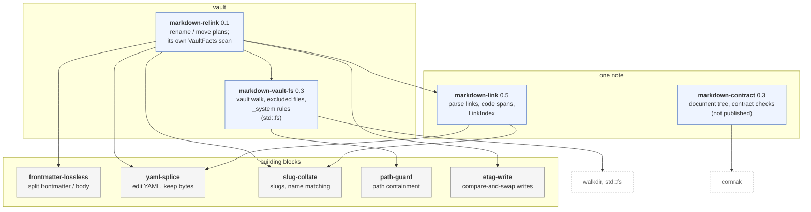
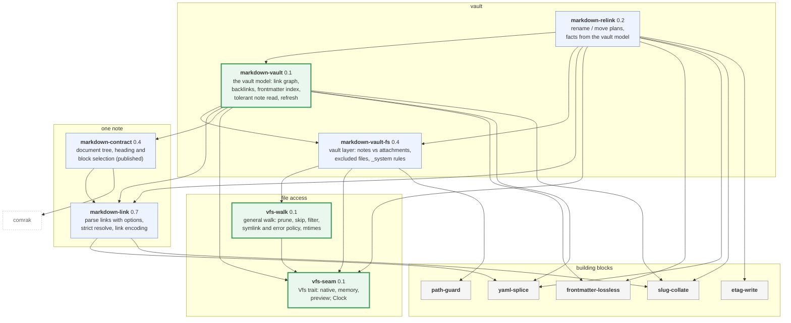

# The osdlc markdown crates

How the osdlc markdown crates fit together, before and after
[osdlc#618](https://github.com/osdlc/osdlc/pull/618), including the planned
split of the general walk into `vfs-walk`. Arrows point from a
crate to what it depends on. Versions are the ones in each `Cargo.toml`.
The [decisions](../decisions/README.md) give the reasons, and
[crate-dependencies.md](crate-dependencies.md) shows how skillwright and
determined use these crates.

## Before (osdlc `main`)

There is no shared vault model. `markdown-vault-fs` walks with `std::fs` and
`walkdir`, `markdown-relink` builds its own link facts from that walk, and
`markdown-contract` doesn't depend on any other osdlc crate and isn't
published. Each tool builds its own vault graph: determined has `LinkGraph`
and skillwright has `VaultIndex`.



As an image: [markdown-ecosystem-before.svg](img/markdown-ecosystem-before.svg).

## After (osdlc#618)

New crates have a thick green border. File access goes through one trait,
`vfs-seam`, so the same code runs on disk, in memory, as a preview and in
the browser. `vfs-walk` walks any tree through it and knows nothing about
Markdown or vaults. `markdown-vault-fs` is the vault layer on top: it reads
the vault's excluded files (Obsidian's `userIgnoreFilters`, for example) and
passes them to the walk as a filter. `markdown-vault` is the one vault model, built from
determined's `LinkGraph`. Everything that needs a vault graph uses it.



As an image: [markdown-ecosystem-after.svg](img/markdown-ecosystem-after.svg).

## What changed

| Crate               | Before                                              | After                                                                                   |
| ------------------- | --------------------------------------------------- | --------------------------------------------------------------------------------------- |
| `vfs-seam`          | — (lived in skillwright core)                       | New. The one file-access trait.                                                         |
| `markdown-vault`    | — (determined's `LinkGraph` and `FrontmatterIndex`) | New. The one vault model.                                                               |
| `vfs-walk`          | — (inside `markdown-vault-fs`)                      | New. The general walk, with no Markdown or vault rules.                                 |
| `markdown-vault-fs` | 0.3, walks with `std::fs`                           | 0.4, the vault layer on `vfs-walk`; reads the vault's excluded files and passes them in |
| `markdown-link`     | 0.5                                                 | 0.7, scan options, strict resolve, link encoding from skillwright                       |
| `markdown-contract` | 0.3, not published                                  | 0.4, published; heading and block selection from skillwright                            |
| `markdown-relink`   | 0.1, its own scan                                   | 0.2, facts from `markdown-vault`; plans read through `vfs-seam`                         |

`markdown-tags` is still in the dev repo, so `markdown-vault` takes a
`TagLexer` instead of depending on it.

## Regenerating the images

The SVGs in `img/` are rendered from the Mermaid blocks above. After changing
a diagram, run from `docs/architecture`:

```sh
mmdc -i markdown-ecosystem.md -o img/me.svg   # writes me-1.svg, me-2.svg
mmdc -i crate-dependencies.md -o img/cd.svg   # writes cd-1.svg, cd-2.svg
```

Then rename them over the files above. The diagrams use plain SVG text
(`htmlLabels: false`), so a viewer with a different font doesn't clip the
labels.
