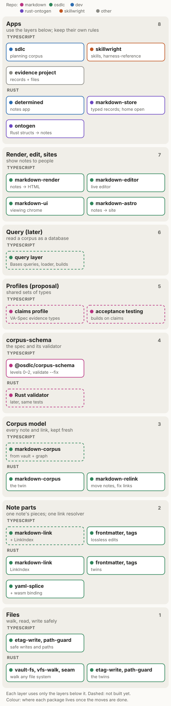
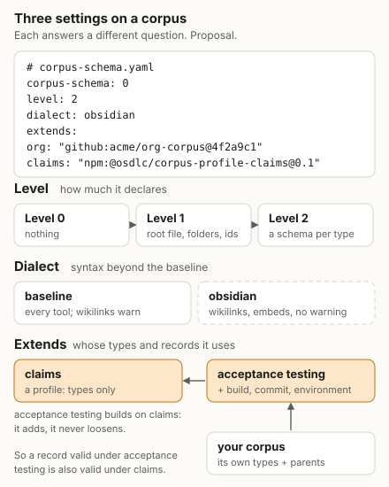

# The markdown ecosystem architecture

This is what we are building toward. The [plan](../planning/markdown/ecosystem-plan.md) says where
we are today and the order of the work. This page says what the finished shape looks like. It is a
draft, and some parts are still proposals. Those are marked. The Rust crates as they are today, and
the planned split of their walk, are in [markdown-ecosystem.md](markdown-ecosystem.md).

## What it is for

We keep a lot of knowledge as Markdown notes: planning docs, skills, research, evidence. People read
and edit these notes in Obsidian or a text editor, and programs read them as data. The ecosystem is
the set of packages that lets programs do that safely, without breaking what people wrote.

## Words

- A **note** is a Markdown file, often with YAML frontmatter at the top.
- A **corpus** is a folder of notes and the files they link to. An Obsidian vault is a corpus, and so
  is a docs folder. This is decided: we use corpus. Some older names and docs still say vault, which
  is the older synonym.
- **corpus-schema** is the spec for what a corpus can declare about itself: its types, ids and
  schemas. This name is decided.
- A **record** is one note (or YAML or JSON file) that holds data of one type.
- A **twin** is a TypeScript package and a Rust package that do the same job and are meant to pass
  the same tests. Some twins still keep their tests inside their own packages.
  A **binding** is different: it is one package built for another runtime, such as the Rust
  yaml-splice built to WebAssembly for TypeScript. A binding has no tests of its own.

## The layers



The diagram shows the top layer first. Each layer uses only the layers below it. Here they are
from the bottom up.

### 1. Files

Walking folders, reading files and writing them safely.

- It owns: the folder walk and its rules (which folders to skip, hidden files, symlinks), safe paths,
  and atomic writes that refuse to overwrite a file someone else changed.
- It does not know what Markdown is.
- Packages: etag-write and path-guard (TypeScript and Rust); markdown-vault-fs, vfs-walk and
  vfs-seam (Rust). vfs-seam lets the same Rust code run on a real disk, in memory or in a browser.

### 2. Note parts

The pieces of one note.

- It owns: finding links and resolving them to files, splitting frontmatter from the body and
  writing it back byte for byte, inline tags, tables, and checking one document's structure.
- It does not know about other notes, except through the link index it is given.
- Twins: markdown-link, frontmatter-lossless, markdown-tags, markdown-contract, and gfm-table
  (TypeScript) with gfm-pipe-table (Rust). yaml-splice is a binding: the Rust crate, built to
  WebAssembly for TypeScript.
- dev no longer has its own copy of markdown-link. markdown-vault, vault-graph-core and
  markdown-astro use the published package, `^0.8.1` (sksizer/dev 48b62783).
- Target: TypeScript markdown-link gets the same link resolver as the Rust one, called `LinkIndex`.
  Then it is the only place in each language that decides what a link points to.

### 3. The corpus model

Every note in a corpus at once.

- It owns: the list of files and notes, each note's links in both directions (what it links to and
  what links to it), frontmatter, tags, and keeping all of that up to date as files change.
- It does not know about types or schemas, and it never rejects a note. A note with broken
  frontmatter is read as body only.
- Today: markdown-corpus (Rust, osdlc) does this. markdown-relink (Rust, osdlc) moves notes and
  fixes the links that point at them. In TypeScript the same job is split between
  markdown-vault and vault-graph-core in dev, and they resolve links in two different ways.
- Target: one TypeScript package called markdown-corpus, made from those two, the twin of the Rust
  crate. The crate keeps its name. This is decided.

### 4. corpus-schema

The spec, and the validator that checks a corpus against it.

- It owns: the root file `<name>.corpus-schema.md` (or `.yaml` or `.json`) that marks a corpus, type folders,
  record ids, record folders, JSON Schemas for types, links between types (`x-ref`), other corpora
  (`extends`, `uses` and `references` in the root file, `x-extends` on a type), identity, and the
  `validate`, `validate --fix` and `sync` commands. These came in release 0.4.0 (the
  plan's task 36), built in [osdlc/markdown#12](https://github.com/osdlc/markdown/pull/12) and
  brought back here: `extends`, `uses`, `references`, `x-extends`, identity and `sync`.
- A record's id comes from its file name. A type's `x-id-pattern` cuts it: the id is the longest
  part of the name that the pattern matches, followed by `-` or the end of the name. So with
  `^P-[0-9]{4}$`, `P-0002-favor-deterministic.md` has the id `P-0002`, and the rest is a slug for
  people. A record's `id` field, when it has one, must equal it.
- It does not walk folders or resolve links itself. It reads the corpus model. (Today the validator
  still does its own walk. That changes in the plan.)
- A record folder is a folder inside a type folder that holds a file with the folder's own name:
  `<folder>.md`, `.yaml` or `.json`, or the name the type's `x-record-file` gives, such as
  `README.md`. That file is the record, with the folder's id, and it owns every other file in the
  folder. A record folder can't hold another record folder or a type folder. A test run keeps its
  script, query and results this way. A folder in a type folder whose name starts with `_`, such as
  `_attachments/`, holds narrative, not records. Record folders are part of level 1 and ship in the first published
  version. This is decided. The work is in [osdlc/osdlc#729](https://github.com/osdlc/osdlc/pull/729), merged on
  2026-11-09.
- Identity: every corpus, type and record in a package has a [Package URL](https://github.com/package-url/purl-spec)
  (purl), derived from the nearest `package.json`: `pkg:npm/%40osdlc/corpus-profile-sdlc#tasks` for
  a type, and the record id after the type for a record. A corpus's graph holds one version of each
  corpus, so a record reached through two chains of references is one record. A schema may state
  its type's identity in `x-identity`, and the validator checks it. This is the plan's D16.
- Packages: `@osdlc/corpus-schema` (TypeScript), in this repo's `packages/ts/corpus-schema`, with its
  spec and cases in `packages/conformance/corpus-schema`. It publishes from here: 0.4.0 is on npm,
  and it adds `extends`. A copy went to osdlc/markdown for a time, where that
  work was done, and the work came back here. skillwright's harness-reference uses the npm
  package. A Rust validator comes later and runs the same tests (the plan's task 32).

### 5. The model

Kinds of records, declared once, above any one way of storing them. This is the plan's D13.

- It owns: packs and model-schema. A pack declares kinds, refs, relations and their inverses, rules
  and defaults, and says nothing about storage. model-schema loads packs, checks values against
  them, and generates profiles from them.
- A kind's `document:` binding maps it to Markdown: its folder, how refs are written, and the file
  of a record kept in a folder. `model-schema corpus` turns packs into a profile: a kind becomes a
  type folder, an id pattern becomes `x-id-pattern`, a ref becomes `x-ref` with `x-ref-form`, and
  `document.recordFile` becomes `x-record-file`. The sdlc profile is built this way from
  `@osdlc/pack-intent` and `@osdlc/pack-sdlc`. See
  [sksizer/dev#4069](https://github.com/sksizer/dev/pull/4069) and
  [sksizer/dev#4163](https://github.com/sksizer/dev/pull/4163).
- corpus-schema stays usable on its own, with no packs. Named relations, augments and bindings to
  other stores belong here, not in corpus-schema.
- Packages: `@osdlc/model-schema`, `@osdlc/pack-intent` and `@osdlc/pack-sdlc`, in dev today on a
  branch that is not on main yet. They stay in sksizer/dev for now (the plan's D19, task 62). A
  claims pack comes later (task 76).

### 6. Profiles

Shared sets of types, and shared corpora of records. How a corpus names them is decided (the plan's
D4, D11 and D15) and built in corpus-schema 0.4.0 (the plan's task 36). Refine
and waive are still proposals.

- A profile is a set of types and rules that many corpora can use. It is a corpus that has only
  types. A corpus can use more than one, next to its own types.
- The claims profile follows VA-Spec, GA4GH's Variant Annotation spec, which is a JSON Schema model
  for claims backed by evidence. Its types are Statement, Study Result, Method and Document. A
  statement holds its evidence lines, and Contribution is a field on records. It starts as an
  example corpus, `profiles/claims/example/` in osdlc/markdown, with a README that maps each type to
  VA-Spec. Until 0.4.0 shipped `extends`, a corpus copied the type folders from the example. Next the
  profile is published as the npm package `@osdlc/corpus-profile-claims`. It is a general starting
  profile that research corpora use or extend. Later it may be written as a pack.
- The profiles, the claims example and the starter come to osdlc/osdlc in phase 4 of the move back
  (the plan's D19), and publish from here. Their place is not decided: the proposal is
  `packages/profiles/*` and `packages/corpora/*`.
- The planning profile, `docs/planning/markdown/profile/`, holds the task, milestone and decision
  types. This repo's plan extends it by path. It is private and not on npm. Task 53 removes it,
  when the plan moves to the sdlc profile.
- The sdlc starter, `@osdlc/corpus-sdlc-starter`, is a corpus with records: principles and
  standards any project can reference and cite (the plan's D14). It lives beside the profiles.
- The sdlc profile, `@osdlc/corpus-profile-sdlc`, holds sdlc's fourteen planning types. It is
  generated, not written by hand (see 5. The model). The packs and the generator stay in dev, so
  until they move (task 62) it is regenerated by hand in dev and copied in. The npm name does not
  change.
- Shared types are authored as packs, and the type folders of a shared profile are generated
  output. A corpus's own local types stay hand-written, next to their schemas. Each type's schema
  stands alone: there is no `$ref` across type schemas (the plan's D17).
- A corpus names other corpora in its root file, under three keys (the plan's D15):
  - `extends` names parents, whose types it builds on. A parent gives types only, not records. A
    profile is a parent.
  - `uses` names parent types that local folders hold as they are, such as `uses: [sdlc/*]`. A
    folder at the corpus root named after the type, with no schema file, holds its records.
  - `references` names corpora whose records it links to and cites, such as an org's principles.
    `corpus-schema sync` copies each into `_references/<prefix>/`, and the copy is committed, so
    links work in Obsidian and on GitHub. The validator checks that the copy matches the installed
    corpus. A parent under `extends` gets no copy.
- Each key maps a short prefix to a source. A source that starts with `./` or `../` is a path from
  the corpus root. Anything else is a package name, found the way Node finds packages from the
  corpus folder. npm or pnpm installs it, `package.json` holds the version range and the lockfile
  pins it. A corpus package lists the corpora it names as `peerDependencies`, so a project holds one
  version of each. A private org corpus can be a git dependency, such as
  `github:acme/principles#v3`, so it needs no registry. The spec does not depend on npm. It says
  only that each source resolves to a folder that holds a corpus.
- Types are plain JSON Schema. A type builds on another with `x-extends`, for example
  `x-extends: claims/statements`. A record must pass its own schema and every schema above it. A
  child can add rules or tighten them, never loosen them. A record that is valid under the child is
  also valid under the parent. VA-Spec and FHIR profiles work this way. dev's model-schema packs
  don't promise this yet: a record's own property replaces the one it inherits, and `strict` can be
  overridden. Packs could compile to JSON Schema later.
- The prefix is always required, so adding a second parent later breaks nothing. An unknown prefix
  is an error.
- Example: an acceptance-testing profile built on the claims profile. Requirements or acceptance
  criteria are what statements are about. A test is a method. A test run is a study result, kept as
  a record folder with its script, query and CSV results. Pass or fail is the direction: whether the
  run supports or disputes the statement. The words come from OSLC Quality Management and the ISTQB
  glossary.
- A corpus can rename a profile's folders. It gives a type its own folder name and maps it to its
  parent type with `x-extends`. Field names stay the profile's, so tools and exports work everywhere. This
  is the plan's task 24, name overrides.
- An org's principles reach team and project corpora through `references`, read-only. A local
  record cites a referenced one by id or by link. Narrowing it with `refines` or setting it aside
  with `waives` are proposals. See the plan's
  [Sharing across corpora](../planning/markdown/ecosystem-plan.md#sharing-across-corpora) (tasks 27 to 30 and 70).

### 7. Query (later)

Reading a corpus as a database.

- It owns: loading records into memory, queries, and building other forms from them, such as JSON or
  SQLite files.
- It reads the corpus model and corpus-schema. It does not have its own file walk or link rules.
- Today: markdown-vault-query (dev) runs Obsidian Bases queries over a vault. It stays in
  sksizer/dev; no move is planned. Target: it sits on top of the corpus model and becomes the one
  query layer. We keep the word "db" for this layer.

### 8. Render, edit, sites

Showing notes to people.

- It owns: turning notes into HTML, the live editor, viewing chrome, and building sites.
- Packages: markdown-render, markdown-render-vue and markdown-vault-astro are in osdlc and on npm
  at 0.8.0 ([osdlc/osdlc#719](https://github.com/osdlc/osdlc/pull/719) and
  [osdlc/osdlc#720](https://github.com/osdlc/osdlc/pull/720) merged). markdown-editor, markdown-ui
  and dev's own markdown-render and markdown-astro stay in sksizer/dev; no move is planned.

### 9. Apps

sdlc, skillwright, harness-reference, determined, and the evidence project. They use the layers
below and keep only app-specific rules. markdown-store and ontogen in rust-ontogen also sit here:
they write typed records from Rust code. In the target they write the corpus-schema layout and use
the shared note parts.

## Three settings on a corpus



A corpus says three separate things about itself in its root file:

```yaml
# my-corpus.corpus-schema.yaml
corpus-schema: 0
level: 2
dialect: obsidian
extends:
  claims: "@osdlc/corpus-profile-claims"   # a package name
uses: [claims/*]
references:
  org: "../org-principles"                 # or a relative path
```

As `my-corpus.corpus-schema.md`, the same keys go in YAML frontmatter between `---` lines. Today only
`corpus-schema: 0` is required. Version 0 has `level`. `extends`, `uses` and `references` came in
corpus-schema 0.4.0 (the plan's task 36). `extends` and `uses` need `level: 2`. `extends` replaces
`profiles`, which stays reserved and unused.
`dialect` is reserved too: a validator says it does not check it. The `dialect` setting is still a
proposal.

- The **level** says how much the corpus declares. Level 0 declares nothing: any folder of linked
  notes. Level 1 adds the root file, type folders, ids and record folders. Level 2 gives each type a
  JSON Schema.
- The **dialect** says which syntax it uses beyond the baseline. The baseline is what every tool
  supports. It has relative Markdown links, and it already allows wikilinks: they resolve by a unique
  path ending inside the corpus, the validator warns about them, and `--fix` rewrites them as
  relative links. The `obsidian` dialect would make wikilinks normal (no warning), let them reach
  outside the corpus, and add embeds. A tool that knows the dialect checks it. A tool that doesn't
  checks the baseline and says what it skipped. There is no promise that every tool handles every
  dialect.
- The **extends** key says which profiles it builds on. A profile is a parent that has only types.
  Each parent has a short prefix and a source (a package name or a path). A type builds on a parent
  type as `x-extends: prefix/type`, or a folder takes it as it is through `uses`. A profile that
  builds on another, such as testing on claims, names it under its own `extends`.

These are separate on purpose. A profile is not a higher level, and a dialect is not a profile.
`references` is not a setting of this kind: it names corpora whose records the corpus cites.

## Twins and shared tests

When a job has a TypeScript and a Rust package, they share one set of test cases, so they behave the
same. osdlc keeps these cases in `packages/conformance/<name>/`, as its conformance-suites standard
describes. Each folder has a README, a SPEC.md when there is a format to state, and the cases. Every
implementation runs them.

- Already there: frontmatter-lossless, markdown-tags, config-layers, intersect, path-guard and
  tiered-dirs. The corpus-schema spec (TypeScript only for now) keeps the same layout in this repo's
  `packages/conformance/corpus-schema/`.
- Planned: markdown-link (with the resolver), markdown-corpus, markdown-contract and gfm-table, whose
  cases still live inside their packages.
- yaml-splice is not a twin. It is one crate and its WebAssembly binding.

A twin can have extras the other doesn't need. It just has to pass the shared cases.

## Rules between layers

- Each layer uses only the layers below it.
- There is one link resolver in each language, in markdown-link. Nothing else decides what a link
  points to. Today there are more: markdown-vault and vault-graph-core each have one, the
  corpus-schema validator checks links itself, markdown-store has its own wikilink code, and dev's
  markdown-astro has its own too (`resolveRef`, which takes the first match and finds embeds by file
  name).
- Writes never lose what a person wrote. Frontmatter is rewritten with frontmatter-lossless or
  yaml-splice, and files are saved with etag-write.
- General code lives in the osdlc org. osdlc/osdlc holds the Markdown libraries, the corpus-schema
  spec and validator, and examples, beside the general libraries
  ([D-SM4K](../decisions/D-SM4K-markdown-ecosystem-home.md)). The profiles and the starter corpus
  come there too. osdlc/markdown and osdlc/models are holding pens. dev's markdown packages,
  model-schema and the packs stay in sksizer/dev for now. Apps use the packages and keep only their
  own rules.

## Where things live

| Job | Today | Target |
|---|---|---|
| Note parts | osdlc; dev also has a private copy of markdown-tags | osdlc, used from npm and crates.io |
| Corpus model, TypeScript | markdown-vault and vault-graph-core in dev | markdown-corpus in osdlc |
| Corpus model, Rust | markdown-corpus in osdlc | the same |
| corpus-schema | osdlc; 0.2.1 is on npm, published from osdlc | the same |
| Profiles, packs, starter corpora | model-schema and packs in dev, merged to a branch that is not on main yet; the claims and sdlc profiles and the starter are in open pull requests (osdlc/markdown#15, #16 and #19, osdlc/models#1); the planning profile is in osdlc, with the plan | profiles and the starter in osdlc, place not decided (proposed `packages/profiles/*` and `packages/corpora/*`); model-schema and the packs stay in dev for now |
| Query | markdown-vault-query in dev | dev for now; no move is planned |
| Render, edit, sites | markdown-render, markdown-render-vue and markdown-vault-astro in osdlc; the rest in dev | the same; no move out of dev is planned |
| Typed records from Rust | markdown-store in rust-ontogen | on the shared parts; it stays in rust-ontogen for now |

The order of the moves is in the plan's [tasks and milestones](../planning/markdown/README.md).

## Open questions

- Do we adopt the word profile, and the dialect setting?
- Which words go in the first tested name override set (task 24)?
- What exactly is in the baseline, and what goes in the obsidian dialect?
- Does markdown-store stay in rust-ontogen, or move to osdlc?
- When does the query layer start, and what does it build first?
