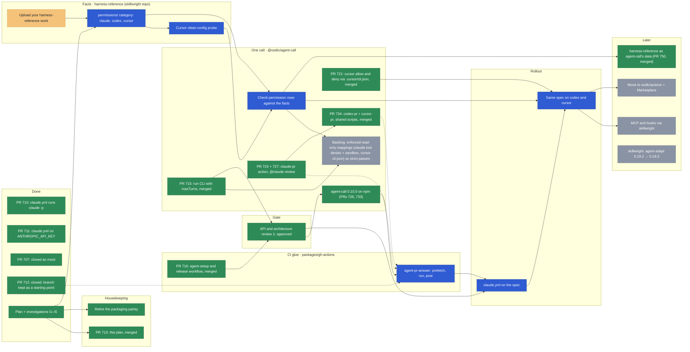
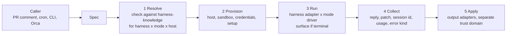

# Coding agents in CI

Plan for running headless coding agents (claude, codex, cursor and later
others) from GitHub Actions, starting with answering `@claude` on pull
requests. Started 2026-11-08.

## Where it stands

- `.github/workflows/claude.yml` answers `@claude` on pull requests by
  running `claude -p` directly (#710). anthropics/claude-code-action was
  dropped: the API refused its comment-mode runs with `billing_error` while
  the same credential worked from the CLI.
- #711 switched it to `ANTHROPIC_API_KEY`.
- #712 (claude-setup and claude-pr-answer composite actions) was closed
  unmerged in favour of the generic layout below. Its branch,
  `sksizer/actions-package`, is the starting point for `agent-pr-answer`
  (`post.sh`, the prompt, the README and license layout).
- A parley, agent-gh-actions-design, discussed packaging first. It was
  retired unanswered on 2026-11-08; this plan supersedes it.

## Roadmap

Arrows mean "needs"; a dotted arrow means "reuses code from".

| Colour       | Status                                                        |
| ------------ | ------------------------------------------------------------- |
| Green        | Done                                                          |
| Purple       | PR ready to merge (approved, checks green)                    |
| Teal         | PR in review                                                  |
| Red          | Blocked on sksizer: a decision or input is needed             |
| Pink         | Blocked by something external (conflict, failing CI, another team) |
| Amber        | In progress by the agent                                      |
| Light orange | In progress by sksizer                                        |
| Blue         | Next                                                          |
| Grey         | Later                                                         |

Update the classes at the bottom as items move.



## Review queue

What is next for your review, in order; blocked items say what unblocks them. Rewritten as PRs
move; merged PRs drop off.

| Order | PR | What | Why this order | Status |
| --- | --- | --- | --- | --- |
| 1 | [#785](https://github.com/osdlc/osdlc/pull/785) | ts-packages-release: inputs for packages with no code | Small shared-CI change, ready now; the only PR waiting on your review | waiting on your review since 01:47 UTC; clean and green |
| 2 | [#764](https://github.com/osdlc/osdlc/pull/764) | feat(gh-actions): run any skill from a PR comment, read-only or with `--apply` | Next to be ready, after 785 | draft: needs your choice of how `--apply` changes land, the `pr-agent` environment and the token fix, then the gate reruns; CI green; behind main again |

## PR tracker

Checked 2026-11-12 02:17 UTC. A periodic check refreshes this table and the graph.

| PR   | Title                                    | State | Review | Merge          | Blocker                                                              | Plan                     |
| ---- | ---------------------------------------- | ----- | ------ | -------------- | -------------------------------------------------------------------- | ------------------------ |
| [#785](https://github.com/osdlc/osdlc/pull/785) | ts-packages-release: inputs for packages with no code | open | none | clean; green | waiting on your review | related (shared-CI work; touches gh-actions/ts-packages) |
| [#787](https://github.com/osdlc/osdlc/pull/787) | feat(gh-actions): fall through to the next key when one is out of credit | open | none | — | pre-review gate | keys (see "Next: execution modes") |
| [#749](https://github.com/osdlc/osdlc/pull/749) | ci: shared reusable workflows for TypeScript package CI and release | merged | — | — | — | merged 2026-11-10 (shared-CI work) |
| [#748](https://github.com/osdlc/osdlc/pull/748) | package-checks: move the package checks into @osdlc/package-checks | merged | — | — | — | merged 2026-11-09 |
| [#747](https://github.com/osdlc/osdlc/pull/747) | ci: codex and cursor answer PR mentions | merged | — | — | — | merged 2026-11-10; next: live codex and cursor mentions (needs OPENAI_API_KEY, CURSOR_API_KEY) |
| [#764](https://github.com/osdlc/osdlc/pull/764) | feat(gh-actions): run any skill from a PR comment, read-only or with --apply | draft | none | behind main; green | pre-review gate (draft) | new; touches gh-actions |
| [#760](https://github.com/osdlc/osdlc/pull/760) | pr-update: one PR identity across repositories, per-repository verify, --restack | merged | — | — | — | merged 2026-11-10 (pr-update work) |
| [#759](https://github.com/osdlc/osdlc/pull/759) | ci(pr-update): run once a night instead of on every push to main | merged | — | — | — | merged 2026-11-09; ends the CI storms from merges to main |
| [#750](https://github.com/osdlc/osdlc/pull/750) | feat(harness-knowledge): compiled harness facts, read by agent-call and detect-harness | merged | — | — | — | merged 2026-11-11 07:55 UTC; phase 5 of the harness-knowledge plan; packages-publish failed: owner runs `package-checks stage packages/ts/harness-knowledge` once, then reruns |
| [#741](https://github.com/osdlc/osdlc/pull/741) | fix: kill the agent's process group when its host is interrupted (command-seam, agent-call, pr-update) | merged | — | — | — | merged 2026-11-10; releases with the next Version Packages PR |
| [#734](https://github.com/osdlc/osdlc/pull/734) | feat(gh-actions): codex-pr and cursor-pr, shared pr-common scripts, multi-marketplace plugins | merged | — | — | — | merged 2026-11-09; next: live test with caller workflows |
| [#733](https://github.com/osdlc/osdlc/pull/733) | Version Packages (corpus-schema; unblocked the agent-call 0.10.0 publish) | merged | — | — | — | merged 2026-11-09; agent-call 0.10.0 on npm |
| [#731](https://github.com/osdlc/osdlc/pull/731) | chore(conformance): drop markdown-tags from CATCHING_UP in the version PR | merged | — | — | — | merged into #726's branch 2026-11-09 |
| [#726](https://github.com/osdlc/osdlc/pull/726) | Version Packages (agent-call 0.10.0) | merged | — | — | — | merged 2026-11-09; published after #733 |
| [#721](https://github.com/osdlc/osdlc/pull/721) | feat(agent-call): enforce allow and deny tools on cursor | merged | — | — | — | merged 2026-11-09 |
| [#723](https://github.com/osdlc/osdlc/pull/723) | fix(agent-call): follow-ups from the codex review of #715 | merged | — | — | — | merged 2026-11-09 |
| [#716](https://github.com/osdlc/osdlc/pull/716) | feat(gh-actions): add the agent-setup action | merged | — | — | — | merged 2026-11-09 |
| [#727](https://github.com/osdlc/osdlc/pull/727) | feat(gh-actions): claude-pr action; claude.yml calls it | merged | — | — | — | merged into #724's branch 2026-11-08 |
| [#724](https://github.com/osdlc/osdlc/pull/724) | ci(claude): claude-pr action with @claude review, key list and done markers | merged | — | — | — | merged 2026-11-08 |
| [#715](https://github.com/osdlc/osdlc/pull/715) | feat(agent-call): agent-call run command | merged | — | — | — | merged 2026-11-08 |
| [#717](https://github.com/osdlc/osdlc/pull/717) | docs(planning): status and API review 1 | merged | — | — | — | merged 2026-11-08 |
| [#713](https://github.com/osdlc/osdlc/pull/713) | docs(planning): plan coding agents in CI | merged | — | — | — | merged 2026-11-08 |
| [#712](https://github.com/osdlc/osdlc/pull/712) | gh-actions: claude-setup, claude-pr-answer | closed | none  | —              | —                                                                    | closed 2026-11-08; branch kept as a starting point |
| [#711](https://github.com/osdlc/osdlc/pull/711) | claude.yml: ANTHROPIC_API_KEY            | merged | none  | —              | —                                                                    | merged 2026-11-08        |
| [#622](https://github.com/osdlc/osdlc/pull/622) | Proposal: transcripts in agent-call and observe | draft | none   | —              | CI: verify failing on every leg | related to agent-call, not on this plan's path |
| [#707](https://github.com/osdlc/osdlc/pull/707) | claude: hide full output again           | closed | none   | —              | —                                                                    | closed as moot 2026-11-08 |

## Principle

Each kind of harness difference has one owner, and the facts behind all of
them live in one place.

| Layer        | Owner                                         | Owns                                                                                                   |
| ------------ | --------------------------------------------- | ------------------------------------------------------------------------------------------------------ |
| Facts        | harness-reference (osdlc/skillwright)         | Cited, dated data on how harnesses differ. Gains a `permissions` category.                             |
| Files        | skillwright, over agent-adapt's renderers     | Skills, plugins, MCP config, hooks, and installing them into a harness (`skillwright harness install`) |
| One call     | `@osdlc/agent-call` (`packages/ts/agent-call`) | Prompt, model, permissions, turns, output parsing. Gains a `run` CLI over a spec file.                 |
| CI glue      | the actions (`packages/gh-actions/`)          | Fetch the pull request's context, call the two tools, post the answer. Translates nothing itself.     |

## The job, as a reviewed spec

A spec file in the calling repository, for example
`.github/agents/pr-answer.yml`, says what the agent gets. The setup half goes
to skillwright, the run half to `agent-call run`.

```yaml
setup:
  harness: claude # the workflow may override: claude | codex | cursor
  plugins: [craft@osdlc]
run:
  model: claude-sonnet-5-5
  strict: true # fail instead of approximating a permission
  permissions: { mode: read-only, allowTools: [Read, Grep, Glob] }
  prompt:
    - file: .github/agents/prompts/pr-answer.md
    - input: request
  context:
    - input: pr-context
```

Rules:

- Prompt and spec files are read from the default branch's checkout, never
  the pull request's: a pull request must not change the instructions that
  run with the secret.
- The agent gets no shell and no `gh`. The action fetches the description,
  comments and diff first and passes them as context.
- Prose is the default prompt. A skill is either referenced as prose with
  `file:` or installed as a plugin when it bundles scripts.
- `agent-call run --explain` prints the exact command line in the run log.
- Credentials reach the harness through the step's `env`, never the spec.

## Investigations

I1–I5 are answered; the findings follow the sections below. I6 is open.

| Id  | Question                                                                                                      | Status |
| --- | ------------------------------------------------------------------------------------------------------------- | ------ |
| I1  | How far do agent-adapt and skillwright / tradecraft-core overlap, and which should own asset rendering?       | answered: layered, not rivals |
| I2  | What permission controls does cursor's headless CLI really have (read-only, allowlist, sandbox)?              | answered: `--mode ask` plus `.cursor/cli.json` denies |
| I3  | Does `claude -p` expand a leading `/plugin:skill` the way an interactive session does?                        | answered: yes |
| I4  | Does `codex exec` pick a skill from prose, and does `$plugin:skill` work in exec mode?                        | answered: yes (project skill; plugin namespace not run) |
| I5  | What does harness-reference need in a `permissions` category, and does agent-call's capability map agree with it? | answered: subjects proposed; one agent-call note contradicted |
| I6  | Prior art before building `agent-run`: the Claude Agent SDK, the Codex SDK, ACP (Agent Client Protocol) and GitHub Agentic Workflows (gh-aw). Which harnesses and modes does each cover, and should agent-call build on any of them? | open: time-boxed spike, see "Next: execution modes" |

## API and architecture review

An ongoing gate, not a one-off. Before a library change merges, and before
any significant refactor, review:

- **Dependencies**: which package depends on which, and whether each
  dependency points the right way (facts ← files ← call ← actions; nothing
  in agent-call depends on skillwright or agent-adapt).
- **Public APIs**: the `agent-call run` CLI and spec format, the
  `agent-setup` and `agent-pr-answer` inputs and outputs, and anything
  exported for other packages.
- **Duplication**: harness facts encoded in more than one place.

The first round covers `agent-call run` and `agent-setup` while they are
built, and gates `agent-pr-answer` and the move of `claude.yml` to the
spec. Its output is a review document with a decision per question.

Review 1 ([agent-ci-review-1](../parley/agent-ci-review-1.json)) was
approved on 2026-11-08. Decisions:

| Question | Decision |
| --- | --- |
| strict | Keep as built: fail, the caller relaxes with `strict: false`. Enforced read-only mappings are backlogged. |
| Turn limit | Add `limits.maxTurns` to `AgentCallSpec` (#715). |
| Cursor allow and deny rules | agent-call writes `.cursor/cli.json` for the length of the call, then restores it. |
| `yaml` dependency | Keep it in `@osdlc/agent-call`, loaded only by the CLI. |
| Cursor install | The pinned build tarball from Cursor's download server, checked against SHA-256. |
| Cursor plugins | Fail when plugins are requested on cursor. |
| `v1` release | Add a release workflow now (#716). |
| `marketplaces` input | Keep `name=url [ref]`. |
| Order | Merge #715 with these decisions, release agent-call, then build `agent-pr-answer`. |

## Known issues

- Project settings from the pull request load in the agent job. The PR
  actions check out the PR head and run the harness there, so a pull
  request's own `.claude/settings.json` (hooks included) applies while the
  API keys are in the environment. Only the owner can trigger the actions
  and forks are refused when changes are pushed, so today it is limited
  to the owner's own pull requests, but it breaks the spec rule that a
  pull request must not change the instructions that run with a secret.
  Fix after [#764](https://github.com/osdlc/osdlc/pull/764): load project
  settings from the default branch, or project settings without hooks
  (`--setting-sources` or a settings override), and keep user settings
  out (`CLAUDE_CONFIG_DIR`, `CODEX_HOME`). See "Ambient configuration".

## PR process

Every PR opens as a draft. Before it is marked ready for review it goes
through /simplify and /code-review, and every finding gets a response (fixed,
or declined with a reason) in one PR comment. Then it moves out of draft.

## Work, in order

1. Add the `permissions` category to harness-reference for claude, codex
   and cursor (I5).
2. `agent-call run`: spec file, `file` / `text` / `input` prompt parts,
   `--explain`. `strict` follows once its capability map is checked against
   harness-reference.
3. Generic actions in `packages/gh-actions/`, one shared `v1`:
   `agent-setup` over skillwright's install, `agent-pr-answer` as fetch,
   `agent-call run`, post, starting from #712's branch.
4. Move `claude.yml` to the spec; then run the same spec on codex and
   cursor.
5. Later: MCP and hooks through skillwright; move the actions to
   `osdlc/actions` with a Marketplace listing once something outside osdlc
   uses them.

## Findings

Run 2026-11-08 with claude 2.1.319, codex-cli 0.162.0 and cursor `agent`
2026.10.19. Each skill test used a throwaway skill, `probe-marker`, whose
body says to reply `PROBE-7Q3` plus its arguments.

### I1: agent-adapt and skillwright are layered, not rivals

- agent-adapt (`packages/rust/agent-adapt`, 0.19.3) is the rendering
  library: model in, files out. It renders skills, plugin manifests,
  commands, subagents, hooks and MCP config (claude JSON, codex TOML,
  antigravity JSON) for ten runtimes, and holds the skill-call table
  (`src/skill_call.rs`).
- tradecraft-core (osdlc/skillwright, 0.45.0) is the vault and marketplace
  layer on top. It depends on agent-adapt (`packages/rust/tradecraft-core/Cargo.toml:35`),
  takes skill-call syntax from it, and adds harness profiles, translators,
  marketplaces, publish, adopt and `harness install`. tradecraft-wasm gives
  it a JS binding.
- skillwright's decision D-FDLQ already settles the split: harness profiles
  and translators in tradecraft-core, "frontmatter dialects and tool names
  stay in agent-adapt". It rejected generating the profile from
  harness-reference; tests check the profile against it instead.
- agent-adapt's skill-call table agrees with every
  `skills/user-invocation` fact in harness-reference (claude, codex, cursor,
  pi). It does not read the corpus; it cites its own survey.
- Gaps: skillwright pins agent-adapt 0.19.2 from crates.io while osdlc is at
  0.19.3. Nothing in osdlc depends on agent-adapt directly.

**Consequence:** no merge. The files layer is agent-adapt (rendering) under
skillwright (vaults, marketplaces, install). The CI work uses skillwright
for setup and adds nothing to agent-adapt. "Checked against
harness-reference" (D-FDLQ's rule) replaces "generated from" in this plan.

### I2: cursor has real permission controls

| Test (`agent -p --trust`)                                     | Result                                   |
| ------------------------------------------------------------- | ---------------------------------------- |
| `--mode ask`, asked to write a file                           | refused, nothing written                 |
| `--mode ask`, asked to run `touch`                            | refused, nothing written                 |
| no mode, asked to write a file                                | file written                             |
| no mode, asked to run `touch`                                 | ran it, file written                     |
| project `.cursor/cli.json` denying `Write(**)` and `Shell(*)` | write and shell both refused             |
| the same deny file with `--force`                             | still refused: denies beat `--force`     |

- `--mode ask` is a working read-only mode, not just a hint.
- `.cursor/cli.json` `permissions.allow` / `deny` (`Read(...)`,
  `Write(...)`, `Shell(cmd)`) is a real allowlist. agent-call drops
  `allowTools` and `denyTools` on cursor today; it could write this file
  instead.
- Plain `-p` runs shell commands. agent-call's cursor adapter says print
  mode "rejects shell commands" (`src/adapters/cursor.ts:143`); that did not
  hold here. The local user config has the sandbox disabled, which may
  explain it; check under a clean config before fixing the note.
- For CI: run cursor with `--mode ask` and a deny file written by setup, so
  read-only holds even if one of the two is bypassed.

### I3: `claude -p` expands skill calls

- `/probe-marker hello` (project skill) and `/probeplug:probe-marker hello`
  (plugin loaded with `--plugin-dir`) both answered `PROBE-7Q3 hello` in one
  turn: the harness expands the skill before the model runs.
- Prose ("Use the probe-marker skill with the argument hello") also worked,
  in three turns: the model called the `Skill` tool itself. It needs `Skill`
  allowed.

### I4: codex and cursor pick skills from prose too

- codex (`codex exec --sandbox read-only`, skill in `.agents/skills/`):
  `$probe-marker hello` and the prose request both answered correctly.
- cursor (`agent -p --mode ask`, same `.agents/skills/` folder):
  `/probe-marker hello` and the prose request both answered correctly.
- Not run: a plugin-namespaced call on codex (`$plugin:skill`).
  harness-reference cites codex's source for it.

**Consequence:** prose is a reliable default on all three harnesses. An
explicit call guarantees the skill loads; its syntax comes from agent-adapt's
table, which matches the corpus.

### I5: a `permissions` category for harness-reference

harness-reference has no permissions facts. agent-call's capability map holds
them, uncited, and I2 found one of its notes wrong. Proposed subjects:

- `permissions/read-only`: the flag or mode, and what it blocks (writes,
  shell, network).
- `permissions/tool-allowlist` and `permissions/tool-denylist`: flags or
  config files, and their rule syntax.
- `permissions/config-file`: where per-project rules live (cursor
  `.cursor/cli.json`, claude `settings.json` `permissions`, codex
  `config.toml`).
- `permissions/precedence`: whether denies beat force or bypass flags.
- `permissions/print-mode-default`: what a headless run may do with no
  flags.

agent-call's permission rows should then be checked against these facts the
way tradecraft-core's profile is (D-FDLQ).

## Architecture: running an agent from a spec

Status: target design, 2026-11-12. Nothing here is built beyond what the
"Today" column of the plugin table says. I6 (prior art) can still change it.

### The idea in one paragraph

A **spec** says what an agent run needs: which harness, which skills,
which permissions, which keys, what it may change. A **caller** hands the
spec to **agent-call**, which **resolves** it against harness-knowledge,
**provisions** an execution context, **runs** the harness, **collects** a
typed result and **applies** the allowed outputs. Every step that differs
between places (your laptop, Orca, a GitHub runner) is a plugin, so the
same spec runs everywhere.

### Terms

| Term | Means | Answers | Examples |
| --- | --- | --- | --- |
| Spec | A reviewed file describing one kind of run | What should happen? | `.github/agents/simplify.yml` |
| Caller | Whatever starts the run | Who asked? | a PR comment, cron, `agent-call run` in a shell, Orca, another agent |
| Harness | The coding agent program | Which agent? | claude, codex, cursor |
| Mode | How agent-call drives the harness process | How do we talk to it? | `cli` (`claude -p`), `sdk` (a library), `acp` (JSON-RPC), `terminal` (a live session) |
| Host | The machine and workspace the run lives in, and who owns its lifecycle | Where do the files live and the processes run? | `local` (a folder on your machine), `orca` (an Orca worktree), `github-actions` (a runner), later `container` |
| Sandbox | Hard walls inside the host | What can it touch even if it misbehaves? | `none`, `harness` (codex `--sandbox`, Claude Code's sandbox), later `container` |
| Credentials | How keys reach the harness | How does it authenticate, and can it see the key? | `env`, ordered key list ([#787](https://github.com/osdlc/osdlc/pull/787)), later `proxy`, OIDC |
| Surface | Where a `terminal`-mode session is shown and typed into | Where can a person watch or step in? | `tmux` (agent-seat), `orca` terminal, `cmux` pane |
| Output | An effect applied after the run, outside the agent's reach | What may change in the world? | a comment, a patch on the PR branch, a new branch and draft PR, a run summary |

**Execution context** = host + sandbox + credentials (+ surface in
`terminal` mode). It is everything about *where and under what walls* the
run happens, and nothing about *which agent* or *what it is asked*. The
same spec can run in different execution contexts; agent-call picks the
context from the caller (or the spec's override) and checks that it can
honour the spec.

A quick way to tell host from surface: the host owns the files and the
processes; the surface only displays a terminal. Orca can be both (it makes
the worktree and shows the terminal); tmux and cmux are only surfaces;
a GitHub runner is only a host.

### The pipeline



1. **Resolve.** Merge the spec with caller overrides; look up what this
   harness supports in this mode on this host (harness-knowledge). With
   `strict`, refuse anything that would only be approximated, such as
   `network: none` on a host and sandbox that can't block the network.
   `--explain` prints the plan and the exact commands.
2. **Provision.** The host makes a workspace (a checkout, a worktree, a
   container); the sandbox walls it; credentials are made available in
   the chosen way; setup (skillwright) installs the harness, plugins and
   skills.
3. **Run.** The harness adapter turns the spec into this harness's flags,
   settings and permission rules; the mode driver starts and drives it.
   In `terminal` mode the session lives on a surface where a person can
   attach.
4. **Collect.** One typed result for every harness and mode: reply text,
   a patch of file changes, session id, usage, and an error kind (auth,
   out of credit, refused, failed) instead of text to grep.
5. **Apply.** Output adapters turn the result into effects. This step
   holds any write token and never runs agent code (in CI it is [#764](https://github.com/osdlc/osdlc/pull/764)'s
   separate push job).

### Plugin types

| Type | Interface (sketch) | Today | First version | Later |
| --- | --- | --- | --- | --- |
| Host | `provision(spec) → workspace; exec(cmd, env); attach?; cleanup()` | hard-coded in the gh-actions | `local`, `orca`, `github-actions` | `container`, remote VM, GitLab CI |
| Sandbox | `wrap(exec, policy) → exec` | harness flags only | `none`, `harness` | `container`, gh-aw's runtime |
| Credentials | `provide(keyNames) → env`; `next(errorKind) → bool` | env; rotate on auth failure | ordered list with fall-through ([#787](https://github.com/osdlc/osdlc/pull/787)) | `proxy` (agent gets a dummy key), OIDC, subscription token |
| Setup | `install(harness, marketplaces, plugins)` | agent-setup over skillwright | same | translate packs per harness ([skillwright#94](https://github.com/osdlc/skillwright/issues/94)) |
| Harness | `plan(spec, mode) → invocation; classify(result) → errorKind` | agent-call adapters (9 harnesses), cli only | claude, codex, cursor | the rest |
| Mode | `start(invocation, host, surface?) → session; wait(); send?()` | `cli` | `cli`, `terminal` | `sdk`, `acp` |
| Surface | `open(session); read(); send(keys); notify()` | agent-seat's tmux | `tmux`, `orca` | `cmux` |
| Output | `apply(result, policy)` | comment; patch to PR branch ([#764](https://github.com/osdlc/osdlc/pull/764)) | same | new branch and draft PR, summary, file |

### How enforcement stacks

Each control in the spec is enforced by the strongest layer that can:

1. Harness permissions (allow-lists, a `canUseTool` callback): soft. They
   stop the agent asking, but an allowed tool like `node` can do a lot.
2. Sandbox (no network, read-only files, empty environment): hard. It
   stops whatever the agent manages to run.
3. Credentials (a proxy or OIDC): hardest. No real key exists where the
   agent runs.
4. Trust split: only the apply step holds write tokens.

Resolve reports which layer enforces each control; `strict` fails the run
when none can.

### Three runs of the same spec

The spec is `/craft:simplify` with edits allowed and `changes: patch`.

| | PR comment `/craft:simplify --apply` | You, in Orca: "simplify this with cursor" | Nightly cron |
| --- | --- | --- | --- |
| Caller | GitHub `issue_comment` | Orca | GitHub `schedule` |
| Harness | claude (the action's default) | cursor (override) | codex |
| Host | `github-actions` runner, PR head checkout | `orca`: a new worktree of the repo | `github-actions`, default branch |
| Sandbox | `harness` | `none` (you're watching) | `harness` |
| Credentials | ordered key list from secrets | your local env | ordered key list |
| Mode | `cli` (later `sdk`) | `terminal` | `cli` |
| Surface | none | Orca terminal you can attach to | none |
| Outputs | reply comment; patch, applied to the PR branch by the push job | changed files left in the worktree for you to review | new branch and draft PR |

### Ambient configuration

"Ambient" means anything a run picks up that is in neither the spec nor
the repository. By default a run gets none of it, so a spec behaves the
same on every machine.

| Source | Examples |
| --- | --- |
| User harness config | `~/.claude/settings.json` (hooks, permissions), user plugins, user MCP servers, `~/.claude/CLAUDE.md`; `~/.codex/config.toml`, the global `AGENTS.md`; `~/.cursor/cli-config.json` |
| Environment | `ANTHROPIC_*` and `OPENAI_*` overrides, proxy variables, `BASH_ENV`, anything the shell exports |
| Tool config | global git config (hooks, aliases, signing), shell rc files, npm and pnpm config |
| Managed policy | Claude Code's managed settings. It is admin policy: it can't be switched off, only reported |

The repository's own config (`.claude/`, `CLAUDE.md`, `AGENTS.md`) is not
ambient; it has its own switch, `project`.

How each harness is isolated (to confirm in harness-knowledge, beside the
existing `config/config-dir-env` fact):

- claude: `CLAUDE_CONFIG_DIR` pointed at an empty temporary folder;
  `--setting-sources` to choose layers (`project` without `user`);
  `--strict-mcp-config`; in `sdk` mode, the SDK's explicit setting
  sources.
- codex: `CODEX_HOME` pointed at a temporary folder; `-c` for single keys.
- cursor: no known config-folder variable; fall back to a temporary
  `HOME`, which also hides its login, so the key must come from the
  environment. Unverified.
- Any harness, from the host: start from an empty environment plus an
  allowlist, `HOME` and `XDG_CONFIG_HOME` pointed at a temporary folder,
  `GIT_CONFIG_GLOBAL=/dev/null`. A `container` host gives this for free.

In the spec:

```yaml
run:
  ambient: none # none | user | all; default none
  # or per source:
  # ambient:
  #   user-settings: false
  #   user-instructions: false
  #   user-plugins: false
  #   user-mcp: false
  #   env: [PATH, LANG, TERM]   # allowlist; the rest is dropped
  #   git-config: false
  project: settings-from-default-branch # true | false | settings-from-default-branch | no-hooks
```

- Resolve decides how to enforce each item for this harness and host.
  `strict` refuses the run when an item can't be isolated; `--explain`
  lists what was isolated, how, and any managed policy still in force.
- Defaults: `none` in CI. `none` in `terminal` mode on your machine too,
  with `ambient: user` as one switch when you want your normal setup.
- Ambient isolation is part of the execution context, set up in Provision
  by the harness adapter (config folders, flags) and the host
  (environment, `HOME`).

### Callers

Anything can be a caller: the gh-actions (`agent-pr`, `agent-run`), a
shell (`agent-call run spec.yml --harness codex --host local`), Orca (run
a spec in a worktree, hand off between agents), or another agent. Callers
choose the spec, the overrides and the host; they never pass keys in the
spec.

### Where existing pieces sit

- `@osdlc/agent-call`: the core, harness adapters and the `cli` mode.
- `@osdlc/harness-knowledge` ([#750](https://github.com/osdlc/osdlc/pull/750)): the facts Resolve checks against.
- skillwright and `agent-setup`: Setup.
- agent-seat: the `terminal` mode with the `tmux` surface.
- `packages/gh-actions`: today a hard-coded `github-actions` host with
  `env` credentials and comment and patch outputs; `pr-apply` ([#764](https://github.com/osdlc/osdlc/pull/764)) is
  the first output adapter; [#787](https://github.com/osdlc/osdlc/pull/787) the first credential behaviour.
- Orca: a host and a surface, and a caller.

### First version, deliberately small

- Hosts `local`, `orca`, `github-actions`; sandbox `none` and `harness`;
  credentials `env` with an ordered list; modes `cli` and `terminal`;
  surfaces `tmux` and `orca`; outputs comment and patch.
- Write the interfaces first so `container`, `proxy`, `sdk`, `acp` and
  `cmux` slot in later without changing the spec.

### Prior art to check (I6)

- gh-aw: frontmatter with engine, permissions, tools, network and safe
  outputs; an API proxy for keys; isolated runtimes. It may serve as a
  host and sandbox adapter for GitHub, or supply the spec's field names.
- Dev Containers for the spec's `environment`.
- The Claude Agent SDK, the Codex SDK and ACP for the `sdk` and `acp`
  modes.
- cmux's scripting API before writing its surface.

## Next: execution modes and `agent-run`

Decided 2026-11-12. Prior art first: I6 runs before any of this is built.

See "Architecture: running an agent from a spec" above for the terms and the pipeline.

**Modes, not replacements.** agent-call describes a call once (prompt or
skill, permissions, context, keys) and runs it in a mode the caller picks.
The CLI path stays; the SDK is added beside it.

| Mode       | Runs the harness as                                   | For                                                                 |
| ---------- | ----------------------------------------------------- | ------------------------------------------------------------------- |
| `terminal` | an interactive session in tmux (agent-seat)            | local work; long or steered tasks a person can attach to             |
| `cli`      | `claude -p`, `codex exec`, `cursor-agent -p`           | any harness; CI with only bash; the fallback                         |
| `sdk`      | a library: Claude Agent SDK, Codex SDK                 | CI and automation: per-tool-call permission callback, typed errors |
| `acp`      | a JSON-RPC client (Agent Client Protocol)              | one interface across vendors, if I6 finds it covers enough           |

- Each harness lists the modes it supports (claude: terminal, cli, sdk;
  cursor: terminal, cli). These are harness-knowledge facts beside the CLI
  flags.
- Callers state intent (read-only, edits, allowed tools); each mode enforces
  it its own way: allow-lists in `cli`, a `canUseTool` callback in `sdk`,
  approval prompts in `terminal`.
- Default by context: `sdk` in CI when the harness has one, else `cli`;
  `terminal` when a person is at a TTY. Callers can override.
- In `sdk` mode the permission callback can refuse reads of the
  environment, which closes [#764](https://github.com/osdlc/osdlc/pull/764)'s remaining gap (the agent job's own
  `GITHUB_TOKEN`) better than allow-lists.

**`agent-run` and `agent-pr`.** After [#764](https://github.com/osdlc/osdlc/pull/764) merges, the per-harness actions
become two, each choosing its mode through agent-call:

- `agent-run`: install the harness and plugins, run any prompt or
  `/plugin:skill`, read-only or with edits; returns output and a patch.
  Triggers: PR comments, issue comments or assignment (a new
  `agent/<issue>-<slug>` branch and a draft PR), `workflow_dispatch` with a
  `prompt` input, cron.
- `agent-pr`: parse the comment, prefetch PR context, call `agent-run`,
  post; `agent: claude|codex|cursor`. Replaces `claude-pr`, `codex-pr` and
  `cursor-pr`.
- Input text starting with `/` is a skill call; anything else is a plain
  prompt.
- Conversations: replay the PR or issue thread as context first (works
  across harnesses). Harness session resume (`--resume`, `codex exec
  resume`) is an opt-in later, with sessions kept in the Actions cache
  (not artifacts, which are public on public repos) and the session id in
  the reply's marker.
- Input names follow claude-code-action and codex-action: `prompt`,
  `prompt-file`, `branch-prefix`, `allowed-users`, `model`, `effort`.

**Keys.** Each key secret is an ordered list; the first account's credit is
used first. [#787](https://github.com/osdlc/osdlc/pull/787) falls through to the next key on an authentication failure
or when a key is out of credit or quota. A Claude subscription token
(`CLAUDE_CODE_OAUTH_TOKEN`) is a possible extra entry, not yet supported.

**I6 spike (half a day, on skillwright).** For each of the Claude Agent SDK,
the Codex SDK, ACP and gh-aw: which harnesses and modes it covers; whether
it triggers on comments; whether it installs our skill packs; how it holds
keys (gh-aw keeps them in a proxy the agent can't read); and whether
agent-call should sit on top of it. Outcome: adopt, build on, or borrow
ideas.

## Later: harness-reference as agent-call's data

agent-call's flag and permission tables could come from a compiled snapshot
of harness-reference, selected by the installed harness's version, with
output parsers and approximations staying in code. Steps: check against the
corpus first (as above), then give execution-relevant subjects
machine-usable value shapes, then generate the tables. Its probes could
double as agent-call adapter tests.

## Changes to the plan from the findings

- Files layer: skillwright over agent-adapt, no merge (I1).
- Cursor joins v1 alongside claude and codex: it has a real read-only mode
  and allowlist (I2).
- agent-call: write `.cursor/cli.json` for `allowTools` / `denyTools`
  instead of dropping them, and correct the print-mode note after a
  clean-config check (I2).
- Skills: prose by default, an explicit call when a request names a skill
  (I3, I4).
