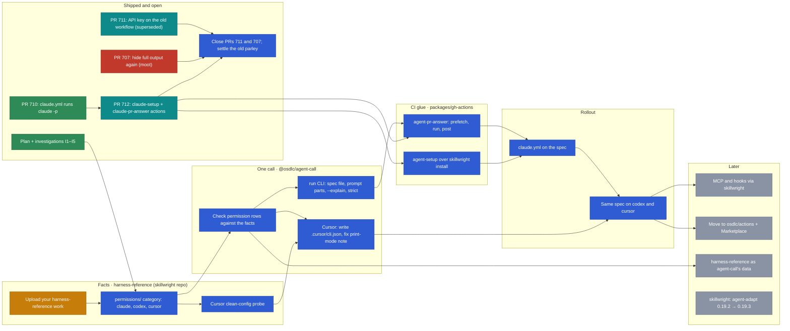

# Coding agents in CI

Plan for running headless coding agents (claude, codex, cursor and later
others) from GitHub Actions, starting with answering `@claude` on pull
requests. Started 2026-11-08.

## Where it stands

- `.github/workflows/claude.yml` answers `@claude` on pull requests by
  running `claude -p` directly (#710). anthropics/claude-code-action was
  dropped: the API refused its comment-mode runs with `billing_error` while
  the same credential worked from the CLI.
- #712 moves those steps into two composite actions,
  `packages/gh-actions/claude-setup` and `packages/gh-actions/claude-pr-answer`.
- The design discussion is the parley
  [agent-gh-actions-design](../parley/agent-gh-actions-design.json). Its
  framing (packaging first) is superseded by this plan.

## Roadmap

Arrows mean "needs". Green is done, purple a PR ready to merge
(approved, checks green), teal a PR in review, red blocked, amber in
progress, blue next, grey later. Update the classes at the bottom as items
move.



## PR tracker

Checked 2026-11-08. A periodic check refreshes this table and the graph.

| PR   | Title                                    | State | Review | Merge          | Blocker                                                              | Plan                     |
| ---- | ---------------------------------------- | ----- | ------ | -------------- | -------------------------------------------------------------------- | ------------------------ |
| #712 | gh-actions: claude-setup, claude-pr-answer | open  | none   | clean          | needs a review                                                       | merge                    |
| #711 | claude.yml: ANTHROPIC_API_KEY            | open  | none   | unknown        | superseded by #712                                                   | close after #712 merges  |
| #707 | claude: hide full output again           | open  | none   | **conflicting** | `claude.yml` was rewritten by #710; the setting it changes is gone | close, don't resolve     |

## Principle

Each kind of harness difference has one owner, and the facts behind all of
them live in one place.

| Layer        | Owner                                         | Owns                                                                                                   |
| ------------ | --------------------------------------------- | ------------------------------------------------------------------------------------------------------ |
| Facts        | harness-reference (osdlc/skillwright)         | Cited, dated data on how harnesses differ. Gains a `permissions` category.                             |
| Files        | skillwright, over agent-adapt's renderers     | Skills, plugins, MCP config, hooks, and installing them into a harness (`skillwright harness install`) |
| One call     | `@osdlc/agent-call` (`packages/ts/agent-call`) | Prompt, model, permissions, turns, output parsing. Gains a `run` CLI over a spec file.                 |
| CI glue      | the actions (`packages/gh-actions/`)          | Fetch the pull request's context, call the two tools, post the answer. Translates nothing itself.     |

## The job, as a reviewed spec

A spec file in the calling repository, for example
`.github/agents/pr-answer.yml`, says what the agent gets. The setup half goes
to skillwright, the run half to `agent-call run`.

```yaml
setup:
  harness: claude # the workflow may override: claude | codex | cursor
  plugins: [craft@osdlc]
run:
  model: claude-sonnet-5-5
  strict: true # fail instead of approximating a permission
  permissions: { mode: read-only, allowTools: [Read, Grep, Glob] }
  prompt:
    - file: .github/agents/prompts/pr-answer.md
    - input: request
  context:
    - input: pr-context
```

Rules:

- Prompt and spec files are read from the default branch's checkout, never
  the pull request's: a pull request must not change the instructions that
  run with the secret.
- The agent gets no shell and no `gh`. The action fetches the description,
  comments and diff first and passes them as context.
- Prose is the default prompt. A skill is either referenced as prose with
  `file:` or installed as a plugin when it bundles scripts.
- `agent-call run --explain` prints the exact command line in the run log.
- Credentials reach the harness through the step's `env`, never the spec.

## Investigations

Settle these before building. Findings go in the table below and the
sections after it.

| Id  | Question                                                                                                      | Status |
| --- | ------------------------------------------------------------------------------------------------------------- | ------ |
| I1  | How far do agent-adapt and skillwright / tradecraft-core overlap, and which should own asset rendering?       | answered: layered, not rivals |
| I2  | What permission controls does cursor's headless CLI really have (read-only, allowlist, sandbox)?              | answered: `--mode ask` plus `.cursor/cli.json` denies |
| I3  | Does `claude -p` expand a leading `/plugin:skill` the way an interactive session does?                        | answered: yes |
| I4  | Does `codex exec` pick a skill from prose, and does `$plugin:skill` work in exec mode?                        | answered: yes (project skill; plugin namespace not run) |
| I5  | What does harness-reference need in a `permissions` category, and does agent-call's capability map agree with it? | answered: subjects proposed; one agent-call note contradicted |

## Work, in order

1. Merge #712 as it is; close #711 and #707.
2. Add the `permissions` category to harness-reference for claude, codex
   and cursor (I5).
3. `agent-call run`: spec file, `file` / `text` / `input` prompt parts,
   `--explain`, `strict`. Check its capability map against
   harness-reference.
4. Generic actions in `packages/gh-actions/`, one shared `v1`:
   `agent-setup` over skillwright's install, `agent-pr-answer` as fetch,
   `agent-call run`, post.
5. Move `claude.yml` to the spec; then run the same spec on codex and
   cursor.
6. Later: MCP and hooks through skillwright; move the actions to
   `osdlc/actions` with a Marketplace listing once something outside osdlc
   uses them.

## Findings

Run 2026-11-08 with claude 2.1.319, codex-cli 0.162.0 and cursor `agent`
2026.10.19. Each skill test used a throwaway skill, `probe-marker`, whose
body says to reply `PROBE-7Q3` plus its arguments.

### I1: agent-adapt and skillwright are layered, not rivals

- agent-adapt (`packages/rust/agent-adapt`, 0.19.3) is the rendering
  library: model in, files out. It renders skills, plugin manifests,
  commands, subagents, hooks and MCP config (claude JSON, codex TOML,
  antigravity JSON) for ten runtimes, and holds the skill-call table
  (`src/skill_call.rs`).
- tradecraft-core (osdlc/skillwright, 0.45.0) is the vault and marketplace
  layer on top. It depends on agent-adapt (`packages/rust/tradecraft-core/Cargo.toml:35`),
  takes skill-call syntax from it, and adds harness profiles, translators,
  marketplaces, publish, adopt and `harness install`. tradecraft-wasm gives
  it a JS binding.
- skillwright's decision D-FDLQ already settles the split: harness profiles
  and translators in tradecraft-core, "frontmatter dialects and tool names
  stay in agent-adapt". It rejected generating the profile from
  harness-reference; tests check the profile against it instead.
- agent-adapt's skill-call table agrees with every
  `skills/user-invocation` fact in harness-reference (claude, codex, cursor,
  pi). It does not read the corpus; it cites its own survey.
- Gaps: skillwright pins agent-adapt 0.19.2 from crates.io while osdlc is at
  0.19.3. Nothing in osdlc depends on agent-adapt directly.

**Consequence:** no merge. The files layer is agent-adapt (rendering) under
skillwright (vaults, marketplaces, install). The CI work uses skillwright
for setup and adds nothing to agent-adapt. "Checked against
harness-reference" (D-FDLQ's rule) replaces "generated from" in this plan.

### I2: cursor has real permission controls

| Test (`agent -p --trust`)                                     | Result                                   |
| ------------------------------------------------------------- | ---------------------------------------- |
| `--mode ask`, asked to write a file                           | refused, nothing written                 |
| `--mode ask`, asked to run `touch`                            | refused, nothing written                 |
| no mode, asked to write a file                                | file written                             |
| no mode, asked to run `touch`                                 | ran it, file written                     |
| project `.cursor/cli.json` denying `Write(**)` and `Shell(*)` | write and shell both refused             |
| the same deny file with `--force`                             | still refused: denies beat `--force`     |

- `--mode ask` is a working read-only mode, not just a hint.
- `.cursor/cli.json` `permissions.allow` / `deny` (`Read(...)`,
  `Write(...)`, `Shell(cmd)`) is a real allowlist. agent-call drops
  `allowTools` and `denyTools` on cursor today; it could write this file
  instead.
- Plain `-p` runs shell commands. agent-call's cursor adapter says print
  mode "rejects shell commands" (`src/adapters/cursor.ts:143`); that did not
  hold here. The local user config has the sandbox disabled, which may
  explain it; check under a clean config before fixing the note.
- For CI: run cursor with `--mode ask` and a deny file written by setup, so
  read-only holds even if one of the two is bypassed.

### I3: `claude -p` expands skill calls

- `/probe-marker hello` (project skill) and `/probeplug:probe-marker hello`
  (plugin loaded with `--plugin-dir`) both answered `PROBE-7Q3 hello` in one
  turn: the harness expands the skill before the model runs.
- Prose ("Use the probe-marker skill with the argument hello") also worked,
  in three turns: the model called the `Skill` tool itself. It needs `Skill`
  allowed.

### I4: codex and cursor pick skills from prose too

- codex (`codex exec --sandbox read-only`, skill in `.agents/skills/`):
  `$probe-marker hello` and the prose request both answered correctly.
- cursor (`agent -p --mode ask`, same `.agents/skills/` folder):
  `/probe-marker hello` and the prose request both answered correctly.
- Not run: a plugin-namespaced call on codex (`$plugin:skill`).
  harness-reference cites codex's source for it.

**Consequence:** prose is a reliable default on all three harnesses. An
explicit call guarantees the skill loads; its syntax comes from agent-adapt's
table, which matches the corpus.

### I5: a `permissions` category for harness-reference

harness-reference has no permissions facts. agent-call's capability map holds
them, uncited, and I2 found one of its notes wrong. Proposed subjects:

- `permissions/read-only`: the flag or mode, and what it blocks (writes,
  shell, network).
- `permissions/tool-allowlist` and `permissions/tool-denylist`: flags or
  config files, and their rule syntax.
- `permissions/config-file`: where per-project rules live (cursor
  `.cursor/cli.json`, claude `settings.json` `permissions`, codex
  `config.toml`).
- `permissions/precedence`: whether denies beat force or bypass flags.
- `permissions/print-mode-default`: what a headless run may do with no
  flags.

agent-call's permission rows should then be checked against these facts the
way tradecraft-core's profile is (D-FDLQ).

## Later: harness-reference as agent-call's data

agent-call's flag and permission tables could come from a compiled snapshot
of harness-reference, selected by the installed harness's version, with
output parsers and approximations staying in code. Steps: check against the
corpus first (as above), then give execution-relevant subjects
machine-usable value shapes, then generate the tables. Its probes could
double as agent-call adapter tests.

## Changes to the plan from the findings

- Files layer: skillwright over agent-adapt, no merge (I1).
- Cursor joins v1 alongside claude and codex: it has a real read-only mode
  and allowlist (I2).
- agent-call: write `.cursor/cli.json` for `allowTools` / `denyTools`
  instead of dropping them, and correct the print-mode note after a
  clean-config check (I2).
- Skills: prose by default, an explicit call when a request names a skill
  (I3, I4).
