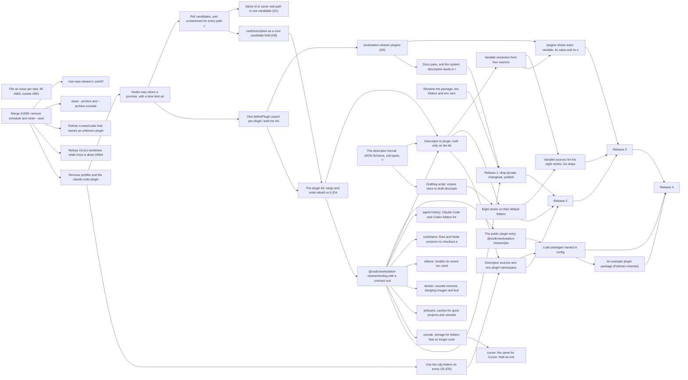

# workstation-cleaner: the plan from the first version to tier 3

Status: approved in review, 2026-11-22. It builds `docs/architecture/host-cleaner-system.md`. Each task has an issue;
the tracking issue is #669.

## Goal

Every piece of the system description built, tested and released: the first version under its new name, then
descriptors with fixed paths, then variables, then loadable code plugins.

**Done looks like:** release 4 published; every task below merged with its acceptance criteria met; #669, #991
and every task issue closed.

**Out of scope:** scheduled and unattended runs (B-0001), root-only stores (B-0002), Windows testing, cleaning
as root.

**Follows** decisions D1–D14 as made in review (the table at the end of `host-cleaner-system.md`). A task that
depends on one says so under "Assumes".

## How the work flows

Every task starts on its base branch as soon as that branch has the code it needs, as "Dispatch: stacked"
below describes. Phase 1 starts first, on #1009's branch; the contract follows k-trim, and everything after
it builds on the contract.

## Dispatch: stacked

The owner chose stacked dispatch. This section is everything an agent or system running the plan needs;
it doesn't assume the review that produced it.

### The rule

- **Every task starts as soon as its base branch has the code it needs pushed**, not when the base merges.
  That is the difference from waves, which wait for each merge. Nothing waits for review except merging.
- Each task gets its own branch, made from its base branch (the table below), and its PR targets that base
  branch, so the PR shows only its own work.
- The plugin contract is one branch and one PR, `sksizer/hc-contract`: one commit per task in plan order
  (k-async (#1023), k-define (#1024), k-ref (#1025), k-cost (#1026), k-overlap (#1027), k-kit (#1028), k-testing (#1029)).
  A task stacked on it starts once the commits it uses are pushed.
- A task whose parent isn't written yet codes to the parent's issue. If the parent's code then differs, the
  child is fixed before its own review.

### Keeping the stack current

- After any push to a parent branch, or any merge to `main`, run `pr-update update --restack --apply`. It
  rebases each child onto its parent's new head and replays only the child's own commits. Rehearse first,
  without `--apply`, when a stack is more than three deep.
- When a parent merges, GitHub deletes its branch and retargets its children to `main` (this repository
  deletes head branches on merge). A squash merge leaves the parent's old commits in each child, so rebase
  each child with `git rebase --onto origin/main <parent's last head> <child>` unless `pr-update` has
  already done it. Check the child PR's diff shows only its own work.
- When review changes a parent, push the fix, restack, and fix every child that used what changed, in the
  same pass. Most rework comes from the contract PR, since about 25 tasks build on it, so its review goes
  first.

### Merging

- A PR merges only when its base and every task under "Also on main first" have merged, its checks are
  green, and the owner has approved it. Merge parents before children, and phase 1 in its listed order.
- The owner merges #1009. Until it merges, phase 1 stacks on its branch.

### Every PR

- The body says `Closes #<issue>` and `Part of #669`, and copies the issue's "Done when" checklist, ticked.
- Tests, lint and typecheck pass on the branch. A task stays inside its issue's scope; anything else found on
  the way becomes a new issue under #669.
- Follow the repository's CLAUDE.md. No AI or tool attribution in commits or PRs.
- Owner-only steps: merging, choosing the package name, and publishing each release.

### Branches

| Task | Branch | Base branch | Also on main first | Note |
| --- | --- | --- | --- | --- |
| k-trim (#1017) | `sksizer/hc-trim` | `sksizer/host-cleaner-remove-scheduling`, from #1009 | — |  |
| k-xdg (#1018) | `sksizer/hc-xdg` | `sksizer/hc-trim`, from k-trim (#1017) | — |  |
| k-orca (#664) | `sksizer/hc-orca` | `sksizer/host-cleaner-remove-scheduling`, from #1009 | — |  |
| k-unknown (#1020) | `sksizer/hc-unknown` | `sksizer/hc-trim`, from k-trim (#1017) | — | On k-trim, since its test uses the removed `claude-code` plugin. |
| k-archive (#1021) | `sksizer/hc-archive` | `sksizer/host-cleaner-remove-scheduling`, from #1009 | — |  |
| k-sizeof (#1022) | `sksizer/hc-sizeof` | `sksizer/host-cleaner-remove-scheduling`, from #1009 | — |  |
| The plugin contract | `sksizer/hc-contract` | `sksizer/hc-trim`, from k-trim (#1017) | — | One branch and one PR for k-async (#1023), k-define (#1024), k-ref (#1025), k-cost (#1026), k-overlap (#1027), k-kit (#1028), k-testing (#1029): a commit per task, in plan order. |
| k-plugins-cmd (#1030) | `sksizer/hc-plugins-cmd` | `sksizer/hc-contract`, from the contract | — |  |
| k-docs (#1031) | `sksizer/hc-docs` | `sksizer/hc-plugins-cmd`, from k-plugins-cmd (#1030) | k-xdg (#1018), k-orca (#664), k-unknown (#1020), k-archive (#1021), k-sizeof (#1022) |  |
| k-rename (#1032) | `sksizer/hc-rename` | `sksizer/hc-docs`, from k-docs (#1031) | — | Waits for the owner to choose the name; #998 keeps the package private until then. Everything else in it can be written first, with the name as one constant. |
| k-release1 (#1033) | `sksizer/hc-release1` | `sksizer/hc-rename`, from k-rename (#1032) | — | Publishes only with the owner's go-ahead. |
| k-bi-vscode (#1034) | `sksizer/hc-bi-vscode` | `sksizer/hc-contract`, from the contract | — |  |
| k-bi-cursor (#1035) | `sksizer/hc-bi-cursor` | `sksizer/hc-bi-vscode`, from k-bi-vscode (#1034) | — |  |
| k-bi-jetbrains (#1036) | `sksizer/hc-bi-jetbrains` | `sksizer/hc-contract`, from the contract | — |  |
| k-bi-docker (#1037) | `sksizer/hc-bi-docker` | `sksizer/hc-contract`, from the contract | — |  |
| k-bi-ollama (#1038) | `sksizer/hc-bi-ollama` | `sksizer/hc-contract`, from the contract | — |  |
| k-bi-toolchains (#1039) | `sksizer/hc-bi-toolchains` | `sksizer/hc-contract`, from the contract | — |  |
| k-bi-agent-history (#1040) | `sksizer/hc-bi-agent-history` | `sksizer/hc-contract`, from the contract | — |  |
| k-schema (#1041) | `sksizer/hc-schema` | `sksizer/hc-contract`, from the contract | — | Doesn't use the contract; stacked on it to keep tier 1 one line. |
| k-draft (#1042) | `sksizer/hc-draft` | `sksizer/hc-schema`, from k-schema (#1041) | — |  |
| k-engine (#1043) | `sksizer/hc-engine` | `sksizer/hc-draft`, from k-draft (#1042) | — | Doesn't use the drafting script; stacked on it to keep one line. |
| k-load (#1044) | `sksizer/hc-load` | `sksizer/hc-engine`, from k-engine (#1043) | k-xdg (#1018) |  |
| k-stores1 (#1045) | `sksizer/hc-stores1` | `sksizer/hc-load`, from k-load (#1044) | — |  |
| k-release2 (#1046) | `sksizer/hc-release2` | `sksizer/hc-stores1`, from k-stores1 (#1045) | k-release1 (#1033) | Publishes only with the owner's go-ahead. |
| k-vars (#1047) | `sksizer/hc-vars` | `sksizer/hc-stores1`, from k-stores1 (#1045) | — |  |
| k-plugins-vars (#1048) | `sksizer/hc-plugins-vars` | `sksizer/hc-vars`, from k-vars (#1047) | k-plugins-cmd (#1030) |  |
| k-stores2 (#1049) | `sksizer/hc-stores2` | `sksizer/hc-vars`, from k-vars (#1047) | — |  |
| k-release3 (#1050) | `sksizer/hc-release3` | `sksizer/hc-stores2`, from k-stores2 (#1049) | k-release2 (#1046), k-plugins-vars (#1048) | Publishes only with the owner's go-ahead. |
| k-public-api (#1051) | `sksizer/hc-public-api` | `sksizer/hc-contract`, from the contract | — |  |
| k-loader (#1052) | `sksizer/hc-loader` | `sksizer/hc-public-api`, from k-public-api (#1051) | k-load (#1044) |  |
| k-example (#1053) | `sksizer/hc-example` | `sksizer/hc-loader`, from k-loader (#1052) | — |  |
| k-release4 (#1054) | `sksizer/hc-release4` | `sksizer/hc-example`, from k-example (#1053) | k-release3 (#1050) | Publishes only with the owner's go-ahead. |

## Summary

| Task | Phase | Gate | PR | Size |
| --- | --- | --- | --- | --- |
| k-issues: File an issue per task, fill #669, rewrite #991 | p0 | This page approved | none | S |
| k-1009 (#1009): Merge #1009: remove schedule and clean --auto | p1 | none | #1009 | — |
| k-trim (#1017): Remove profiles and the claude-code plugin | p1 | k-1009 | new | M |
| k-xdg (#1018): Use the xdg folders on every OS (D5) | p1 | k-trim (same file) | new | S |
| k-orca (#664): Refuse Orca's worktrees while Orca is down (#664) | p1 | k-1009 | new | S |
| k-unknown (#1020): Refuse a saved plan that names an unknown plugin | p1 | k-1009 | new | S |
| k-archive (#1021): `clean --archive` and `--archive-exclude` | p1 | k-1009 | new | S |
| k-sizeof (#1022): Use repo-cleaner's `sizeOf` | p1 | k-1009 | new | S |
| k-async (#1023): Hooks may return a promise, with a time limit and ctx.signal (D2) | p2 | k-trim | one contract PR | M |
| k-define (#1024): One definePlugin export per plugin; built-ins moved (D3) | p2 | k-async | one contract PR | M |
| k-ref (#1025): Ref candidates, and containment for every path candidate (D10) | p2 | k-async | one contract PR | M |
| k-cost (#1026): costDescription as a core candidate field (D8) | p2 | k-ref | one contract PR | S |
| k-overlap (#1027): Same id or same real path is one candidate (D1) | p2 | k-ref | one contract PR | S |
| k-kit (#1028): The plugin kit; cargo and node rebuilt on it (D4, D11) | p2 | k-define, k-cost | one contract PR | L |
| k-testing (#1029): @osdlc/workstation-cleaner/testing with a contract suite (D9) | p2 | k-kit | one contract PR | M |
| k-plugins-cmd (#1030): workstation-cleaner plugins (D6) | p3 | k-define | new | S |
| k-docs (#1031): Docs pass, and the system description lands in the repo | p3 | Phase 1 merged, k-plugins-cmd | new | M |
| k-rename (#1032): Rename the package, bin, folders and env vars | p3 | A name chosen | new | S |
| k-release1 (#1033): Release 1: drop private, changeset, publish | p3 | k-rename, k-docs, k-testing | new | S |
| k-bi-vscode (#1034): vscode: storage for folders that no longer exist | p-builtins | k-testing | new | M |
| k-bi-cursor (#1035): cursor: the same for Cursor, held as lost | p-builtins | k-bi-vscode | new | S |
| k-bi-jetbrains (#1036): jetbrains: caches for gone projects and uninstalled IDE versions | p-builtins | k-testing | new | M |
| k-bi-docker (#1037): docker: unused volumes, dangling images and build cache | p-builtins | k-testing | new | M |
| k-bi-ollama (#1038): ollama: models no recent run used | p-builtins | k-testing | new | S |
| k-bi-toolchains (#1039): toolchains: Rust and Node versions no checkout asks for | p-builtins | k-testing | new | M |
| k-bi-agent-history (#1040): agent-history: Claude Code and Codex folders for gone worktrees | p-builtins | k-testing | new | M |
| k-schema (#1041): The descriptor format: JSON Schema, zod types, YAML reader | p4 | nothing to use: it can be written before the contract is pushed | new | M |
| k-draft (#1042): Drafting script: corpus store to draft descriptor | p4 | k-schema | new | M |
| k-engine (#1043): Descriptor to plugin, built only on the kit | p4 | k-schema, k-kit, k-testing | new | L |
| k-load (#1044): Descriptor sources and one plugin namespace | p4 | k-engine, k-xdg | new | M |
| k-stores1 (#1045): Eight stores on their default folders | p4 | k-engine, k-draft | new (one per store is fine) | M |
| k-release2 (#1046): Release 2 | p4 | k-release1, k-load, k-stores1 | new | S |
| k-vars (#1047): Variable resolution from four sources | p5 | k-engine | new | L |
| k-plugins-vars (#1048): plugins shows each variable, its value and its source | p5 | k-vars, k-plugins-cmd | new | S |
| k-stores2 (#1049): Variable sources for the eight stores; Go ships | p5 | k-vars, k-stores1 | new | M |
| k-release3 (#1050): Release 3 | p5 | k-release2, k-stores2, k-plugins-vars | new | S |
| k-public-api (#1051): The public plugin entry: @osdlc/workstation-cleaner/plugin | p6 | k-testing | new | S |
| k-loader (#1052): Load packages named in config | p6 | k-public-api, k-load | new | M |
| k-example (#1053): An example plugin package (Podman volumes) | p6 | k-loader | new | M |
| k-release4 (#1054): Release 4 | p6 | k-release3, k-loader, k-example | new | S |

## Phase 0 · Before dispatch

**Gate:** This page approved (done)

Book-keeping I do once the plan is approved, so every task has an issue to point at.

### Issues and records

#### k-issues: File an issue per task, fill #669, rewrite #991

One issue per task below, #669's table filled with their numbers, #991 rewritten to this design.

What:

- File one issue per task in every phase, each with its acceptance criteria from this plan.
- Fill #669's work table with the new numbers; replace "to be filed with the plan".
- Rewrite #991 to the final design (per-store descriptors, `paths`, `costDescription`, `removes`, `idleHours`, vars, loading).

Files:

- `GitHub issues only`

Done when:

- Every task below links to an issue.
- #991 and the system description agree.

Gate: This page approved. PR: none. Size: S.

## Phase 1 · Finish the first version's scope

**Gate:** #1009 merged

The v1 decisions from the design review. Six small PRs after #1009, written in parallel, merged in the order listed.

### Trim

#### k-1009 (#1009): Merge #1009: remove schedule and clean --auto

Ready: checks green, mergeable.

What:

- You merge it.

Files:

- `#1009`

Done when:

- Merged.

Gate: none. PR: #1009. Size: —.

#### k-trim (#1017): Remove profiles and the claude-code plugin

The second half of the rollback; B-0001 already records both.

What:

- Delete `--profile` and the `profiles` config key.
- Delete `claude.ts` and its tests, the `claude-code` factory, settings and `PLUGIN_ORDER` entry.
- Drop the `@osdlc/detect-harness` dependency if nothing else uses it.
- README: remove the claude-code and profiles sections.

Files:

- `packages/ts/workstation-cleaner/src/config.ts`
- `packages/ts/workstation-cleaner/src/cli.ts`
- `packages/ts/workstation-cleaner/src/registry.ts`
- `packages/ts/workstation-cleaner/src/run.ts`
- `packages/ts/workstation-cleaner/src/settings.ts`
- `packages/ts/workstation-cleaner/src/claude.ts`
- `packages/ts/workstation-cleaner/tests/profiles.test.ts`
- `packages/ts/workstation-cleaner/tests/claude.test.ts`
- `packages/ts/workstation-cleaner/README.md`

Done when:

- `workstation-cleaner --profile x status` is an unknown option.
- No `claude` in `src/`.
- Tests, lint and typecheck pass.

Gate: k-1009. PR: new. Size: M.

#### k-xdg (#1018): Use the xdg folders on every OS (D5)

`~/.config/workstation-cleaner` and `~/.local/state/workstation-cleaner` on macOS too.

What:

- Pass the `xdg` convention to `systemDirs(...).standalone('workstation-cleaner')`.
- Keep `WORKSTATION_CLEANER_ROOT` and the `WORKSTATION_CLEANER_*_DIR` overrides.
- README: the folder table.

Files:

- `packages/ts/workstation-cleaner/src/config.ts`
- `packages/ts/workstation-cleaner/README.md`

Done when:

- On macOS, `workstation-cleaner config` prints `~/.config/workstation-cleaner/config.json`.
- Linux paths unchanged.

Gate: k-trim (same file). PR: new. Size: S. Assumes: D5 = xdg.

### Orca

#### k-orca (#664): Refuse Orca's worktrees while Orca is down (#664)

No fallback to git: worktrees under Orca's workspaces folder are refused `orca-unreachable`.

What:

- `detect` returns true when Orca is installed but not running, instead of throwing.
- `object` refuses every worktree whose path is under `/orca/workspaces/` with `orca-unreachable`.
- Orca running but its list failing: every worktree refused, as now.

Files:

- `packages/ts/workstation-cleaner/src/orca.ts`
- `packages/ts/workstation-cleaner/tests/orca.test.ts`
- `packages/ts/workstation-cleaner/README.md`

Done when:

- A test with Orca installed and stopped shows the refusal and no git delete.

Gate: k-1009. PR: new. Size: S.

### Command line

#### k-unknown (#1020): Refuse a saved plan that names an unknown plugin

`clean --plan` with a plugin not registered now refuses with bad-input: "sweep again".

What:

- In the plan reader, an owner not in the registry fails the run with bad-input.
- A config `plugins.<name>` for an unknown name prints a warning (today it is silently ignored, settings.ts:52; the README says error).

Files:

- `packages/ts/workstation-cleaner/src/plan.ts`
- `packages/ts/workstation-cleaner/src/settings.ts`
- `packages/ts/workstation-cleaner/src/cli.ts`
- `packages/ts/workstation-cleaner/README.md`

Done when:

- A plan naming `claude-code` refuses after k-trim.
- A misspelt plugin name in config warns.

Gate: k-1009. PR: new. Size: S.

#### k-archive (#1021): `clean --archive` and `--archive-exclude`

Passed through to repo-cleaner's archive-before-delete.

What:

- Two flags on `clean`, handed to repo-cleaner.
- README: the clean section.

Files:

- `packages/ts/workstation-cleaner/src/cli.ts`
- `packages/ts/workstation-cleaner/src/git.ts`
- `packages/ts/workstation-cleaner/README.md`

Done when:

- `clean --archive` pushes unlanded work before deleting, as `repo-cleaner clean --archive` does.

Gate: k-1009. PR: new. Size: S.

#### k-sizeof (#1022): Use repo-cleaner's `sizeOf`

Drop workstation-cleaner's own folder-size code.

What:

- Replace the local size walk in `artifacts.ts` with `sizeOf` from `@osdlc/repo-cleaner`.

Files:

- `packages/ts/workstation-cleaner/src/artifacts.ts`

Done when:

- Same sizes in tests; less code.

Gate: k-1009. PR: new. Size: S.

## Phase 2 · The plugin contract

**Gate:** k-trim merged

The API every later phase builds on. One PR, built in the task order below (each task one or more commits). Everything after waits on it, so it starts first.

### Contract (types.ts, run.ts, registry.ts)

#### k-async (#1023): Hooks may return a promise, with a time limit and ctx.signal (D2)

`survey()` and `clean()` become async; a hook that runs over its limit warns and is skipped.

What:

- Every hook returns `T | Promise<T>`; the core awaits each.
- Per-hook limit: short for detect, scope, roots, discover and object; long for delete. A plugin may ask for longer.
- Each call gets an AbortController; `ctx.signal` is its signal. A timeout is reported like a throw (`guarded`).
- Plugins still run one at a time.
- `survey`, `clean`, `recheck` and the CLI await.

Files:

- `packages/ts/workstation-cleaner/src/types.ts`
- `packages/ts/workstation-cleaner/src/run.ts`
- `packages/ts/workstation-cleaner/src/cli.ts`
- `packages/ts/workstation-cleaner/src/index.ts`
- `every plugin file (types only)`
- `packages/ts/workstation-cleaner/tests/run.test.ts`

Done when:

- A test plugin that never resolves is stopped at its limit, warned about, and the run finishes.
- A synchronous hook still works unchanged.

Gate: k-trim. PR: one contract PR. Size: M. Assumes: D2 = before-v1.

#### k-define (#1024): One definePlugin export per plugin; built-ins moved (D3)

A list of plugins replaces FACTORIES, PLUGIN_SETTINGS and PLUGIN_ORDER.

What:

- `definePlugin({ name, api, settings, create })`, with `settings` a zod schema.
- The registry is an ordered list of definitions; list order is run order.
- git, cargo, node and orca each export one definition.
- `api: 1` constant exported.

Files:

- `packages/ts/workstation-cleaner/src/registry.ts`
- `packages/ts/workstation-cleaner/src/settings.ts`
- `packages/ts/workstation-cleaner/src/run.ts`
- `packages/ts/workstation-cleaner/src/git.ts`
- `packages/ts/workstation-cleaner/src/cargo.ts`
- `packages/ts/workstation-cleaner/src/node.ts`
- `packages/ts/workstation-cleaner/src/orca.ts`

Done when:

- Adding a built-in touches one file plus one line in the list.
- Settings errors unchanged.

Gate: k-async. PR: one contract PR. Size: M. Assumes: D3 = yes.

#### k-ref (#1025): Ref candidates, and containment for every path candidate (D10)

A candidate has a `path` or a `ref`. Every path must sit inside the plugin's roots or a target.

What:

- `Candidate` is `{ path }` or `{ ref, at? }`; the core never removes a folder for a ref.
- git branches and orca records become refs (no more `<repo>:<branch>` paths).
- Remove the skip at run.ts:129: a plugin with no `roots` is held to the targets.
- Re-check containment on the real path right before delete.
- Ids stay `<kind>:<path>`; `status` shows them with `~`, and `--pick` and `--spare` accept that form.
- workstation-cleaner refuses to start as root.

Files:

- `packages/ts/workstation-cleaner/src/types.ts`
- `packages/ts/workstation-cleaner/src/run.ts`
- `packages/ts/workstation-cleaner/src/git.ts`
- `packages/ts/workstation-cleaner/src/orca.ts`
- `packages/ts/workstation-cleaner/src/plan.ts`

Done when:

- A test plugin with no roots proposing `~/Documents` is refused `outside-roots`.
- Saved plans keep working (plan format version bump if needed).

Gate: k-async. PR: one contract PR. Size: M. Assumes: D10 = yes.

#### k-cost (#1026): costDescription as a core candidate field (D8)

`lost` is always held and carries a `discard-user-data` protest.

What:

- Optional `costDescription: re-download | rebuild | lost` on every candidate (named in review; plain `cost` read as unclear).
- The core applies the `lost` rule.
- `status` shows a cost column.

Files:

- `packages/ts/workstation-cleaner/src/types.ts`
- `packages/ts/workstation-cleaner/src/run.ts`
- `packages/ts/workstation-cleaner/src/cli.ts`

Done when:

- A `lost` candidate is never in the default selection and needs `--allow discard-user-data`.

Gate: k-ref. PR: one contract PR. Size: S. Assumes: D8 = core.

#### k-overlap (#1027): Same id or same real path is one candidate (D1)

The earlier plugin's stands; nested candidates both stay, inner first; an inner refusal refuses the outer.

What:

- Merge on id or realpath; warn naming both plugins.
- Nested: the outer `requires` the inner; an inner refusal refuses the outer (the existing `requires` rule).

Files:

- `packages/ts/workstation-cleaner/src/run.ts`
- `packages/ts/workstation-cleaner/tests/run.test.ts`

Done when:

- Two plugins on one folder give one row.
- A refused `target/` refuses its worktree.

Gate: k-ref. PR: one contract PR. Size: S. Assumes: D1 = path.

#### k-kit (#1028): The plugin kit; cargo and node rebuilt on it (D4, D11)

The helpers workstation-cleaner already has, exported from workstation-cleaner and bound to the plugin's roots and ctx.signal: idle, remove, running, onPath, candidate and run. A walk that runs out of time gives an `unmeasured` protest.

What:

- `kit.idle(path)` with a time budget; out of time gives `unmeasured` (needs `--allow unmeasured`), kept out of the evidence.
- `kit.remove(path)`: real-path containment re-check, makes read-only files writable, deletes.
- `kit.running(name)`, `kit.onPath(program)`, `kit.candidate({...})`, `kit.run(argv)` through command-seam with the signal.
- The `idleHours` setting, inherited from the config.
- Reuses repo-cleaner's `busyHolders` and `sizeOf`, and `@osdlc/path-guard` for containment; nothing moves out of those packages (D4). Standalone inspection packages are possible later work.
- cargo and node use only the kit.

Files:

- `packages/ts/workstation-cleaner/src/kit.ts (new)`
- `packages/ts/workstation-cleaner/src/artifacts.ts`
- `packages/ts/workstation-cleaner/src/cargo.ts`
- `packages/ts/workstation-cleaner/src/node.ts`
- `packages/ts/workstation-cleaner/src/roots.ts`
- `packages/ts/repo-cleaner/src/processes.ts (read only)`
- `packages/ts/repo-cleaner/src/size.ts (read only)`

Done when:

- cargo and node import nothing private.
- A slow fake folder gets `unmeasured`, and plan then re-check show no `changed`.

Gate: k-define, k-cost. PR: one contract PR. Size: L. Assumes: D4 = yes, D11 = protest.

#### k-testing (#1029): @osdlc/workstation-cleaner/testing with a contract suite (D9)

fakeContext, fakeRunner, tempHome and contractSuite; every built-in runs the suite.

What:

- A `./testing` export in package.json.
- The suite checks: path candidates inside roots, stable ids and evidence across two surveys, delete refuses an escaped path, time limits honoured, and candidates and objections survive a JSON round trip (D14).
- git, cargo, node and orca run it in their tests.

Files:

- `packages/ts/workstation-cleaner/src/testing.ts (new)`
- `packages/ts/workstation-cleaner/package.json`
- `packages/ts/workstation-cleaner/tests/*`

Done when:

- Each built-in passes the suite.
- Breaking a rule in a test plugin fails the suite with a clear message.

Gate: k-kit. PR: one contract PR. Size: M. Assumes: D9 = yes, D14 = js-json.

## Phase 3 · First release

**Gate:** k-define merged; the owner names the package, for k-rename only

Runs beside phase 4. Ships the first version under its new name.

### Command

#### k-plugins-cmd (#1030): workstation-cleaner plugins (D6)

Each plugin's source, detected or why not, and its roots. Variables are added in phase 5.

What:

- New `plugins` command, with `--json`.
- `status --plugin <name>` documented as the way to test one plugin.

Files:

- `packages/ts/workstation-cleaner/src/cli.ts`
- `packages/ts/workstation-cleaner/src/run.ts`
- `packages/ts/workstation-cleaner/README.md`

Done when:

- Orca not running shows "not running" with the reason.

Gate: k-define. PR: new. Size: S. Assumes: D6 = yes.

### Docs

#### k-docs (#1031): Docs pass, and the system description lands in the repo

Every item in the docs audit, the system description as a checked-in doc, B-0002 for root-only stores, #951 closed.

What:

- D-L7N5: mark superseded by D-H3QW; move removed items to B-0001.
- D-H3QW: drop unattended, launchd and auto; add the v1 decisions; close the Orca forget spike.
- Rewrite the architecture doc.
- `packages/README.md:34`: descriptors not built yet (until phase 4).
- README: Orca refusal, --archive, plugins, xdg.
- Check in the system description under workstation-cleaner's docs.
- B-0002: root-only stores (APT, pacman, Snap), as promised in round 1.
- Close #951.

Files:

- `docs/decisions/D-L7N5-host-cleaner.md`
- `packages/ts/workstation-cleaner/docs/`
- `packages/README.md`
- `packages/ts/workstation-cleaner/README.md`

Done when:

- No doc mentions schedule, --auto, claude-code, profiles or adapters as current.

Gate: Phase 1 merged, k-plugins-cmd. PR: new. Size: M.

### Release

#### k-rename (#1032): Rename the package, bin, folders and env vars

Mechanical, once the name exists. The name is one constant.

<!-- rename:keep -->

The owner chose `workstation-cleaner`. The rename is a script, so it can be
run again after other PRs to the package merge.

What:

- Package name, bin, `standalone(...)` folder name, `HOST_CLEANER_*` env vars, docs, the descriptor schema URL: `host-cleaner` becomes `workstation-cleaner`.
- A config under the old folder name, or a `HOST_CLEANER_*` variable, is never read: every command warns, and `clean` without `--dry-run` refuses with exit 2.

Files:

- `packages/ts/host-cleaner/`, moved to `packages/ts/workstation-cleaner/`
- `docs`

Done when:

- No `host-cleaner` left except history (changelog entries, review pages, decision records) and the old-name refusals.

<!-- /rename:keep -->

Gate: A name chosen. PR: new. Size: S.

#### k-release1 (#1033): Release 1: drop private, changeset, publish

The first public version.

What:

- Remove `"private": true`; a changeset; the release workflow publishes.

Files:

- `packages/ts/workstation-cleaner/package.json`
- `.changeset/`

Done when:

- Installable from npm; `--version` matches.

Gate: k-rename, k-docs, k-testing. PR: new. Size: S.

## Built-in plugins · Seven more, beside phases 3–6

**Gate:** k-testing merged

All seven chosen in review. Each is a code plugin inside workstation-cleaner on the phase 2 contract, independent of the others except cursor on vscode. Each ships in the next release after it merges.

### Editors

#### k-bi-vscode (#1034): vscode: storage for folders that no longer exist

`workspaceStorage/<hash>/` whose `workspace.json` names a folder that is gone; objects to deleting a worktree open in a window.

What:

- Roots: `~/Library/Application Support/Code/User/workspaceStorage` (macOS), `~/.config/Code/User/workspaceStorage` (Linux).
- Candidate per storage folder whose workspace folder is gone; `costDescription: re-download`.
- `object`: refuse git's worktree candidate while a VS Code window has it open (`in-use`), from the running process's working directory or the window state file.
- An unknown `workspace.json` shape: skip the folder with a note, never guess.

Files:

- `packages/ts/workstation-cleaner/src/vscode.ts (new)`
- `packages/ts/workstation-cleaner/src/registry.ts`
- `packages/ts/workstation-cleaner/tests/vscode.test.ts (new)`
- `packages/ts/workstation-cleaner/README.md`

Done when:

- A fixture with one live and one dead workspace proposes only the dead one.
- Passes the contract suite.

Gate: k-testing. PR: new. Size: M.

#### k-bi-cursor (#1035): cursor: the same for Cursor, held as lost

vscode's code with Cursor's folders; `costDescription: lost`, since its storage holds chat history.

What:

- Share the vscode plugin's code, with Cursor's roots (`~/Library/Application Support/Cursor/User/workspaceStorage`, `~/.config/Cursor/User/workspaceStorage`).
- `lost`: held, and needs `--allow discard-user-data`.

Files:

- `packages/ts/workstation-cleaner/src/vscode.ts`
- `packages/ts/workstation-cleaner/src/registry.ts`
- `packages/ts/workstation-cleaner/tests/vscode.test.ts`

Done when:

- A dead Cursor workspace is listed as held and is deleted only with the allow.

Gate: k-bi-vscode. PR: new. Size: S.

#### k-bi-jetbrains (#1036): jetbrains: caches for gone projects and uninstalled IDE versions

Project caches keyed by name and hash, and `<IDE><version>` folders no installed IDE uses; `costDescription: rebuild`.

What:

- Roots: `~/Library/Caches/JetBrains` and `~/Library/Logs/JetBrains` (macOS), `~/.cache/JetBrains` (Linux).
- Installed versions from the Toolbox state or the application bundles; a version folder no install uses is a candidate.
- Inside a live version: project index folders whose project is gone.
- `inUse`: the IDE's process.

Files:

- `packages/ts/workstation-cleaner/src/jetbrains.ts (new)`
- `packages/ts/workstation-cleaner/src/registry.ts`
- `packages/ts/workstation-cleaner/tests/jetbrains.test.ts (new)`

Done when:

- A fixture with two versions, one installed, proposes the other.
- Passes the contract suite.

Gate: k-testing. PR: new. Size: M.

### Tools that must be asked

#### k-bi-docker (#1037): docker: unused volumes, dangling images and build cache

Refs, deleted by Docker itself. Volumes are `costDescription: lost`; images and build cache `re-download`.

What:

- `docker volume ls --filter dangling=true`, `docker image ls --filter dangling=true`, `docker builder du`.
- Delete with `docker volume rm`, `docker image rm`, `docker builder prune`; never touch Docker's data folder.
- Setting: `keepVolumes`.
- Docker not running: not detected, with the reason in `plugins`.

Files:

- `packages/ts/workstation-cleaner/src/docker.ts (new)`
- `packages/ts/workstation-cleaner/src/registry.ts`
- `packages/ts/workstation-cleaner/tests/docker.test.ts (new)`

Done when:

- With a fake runner: a dangling volume is held and needs the allow; an image in use is not proposed.
- Passes the contract suite.

Gate: k-testing. PR: new. Size: M.

#### k-bi-ollama (#1038): ollama: models no recent run used

Models are refs from `ollama list`; loaded ones (`ollama ps`) are refused; deleted with `ollama rm`. `costDescription: re-download`.

What:

- Idle from each model's modified time in `ollama list`, with the `idleHours` setting.
- A model in `ollama ps` is refused `in-use`.

Files:

- `packages/ts/workstation-cleaner/src/ollama.ts (new)`
- `packages/ts/workstation-cleaner/src/registry.ts`
- `packages/ts/workstation-cleaner/tests/ollama.test.ts (new)`

Done when:

- With a fake runner: a loaded model is refused, an old one proposed.
- Passes the contract suite.

Gate: k-testing. PR: new. Size: S.

#### k-bi-toolchains (#1039): toolchains: Rust and Node versions no checkout asks for

rustup toolchains and nvm or Volta Node versions not named by any checkout in your targets, and not the default. `costDescription: re-download`.

What:

- Read every checkout's `rust-toolchain` / `rust-toolchain.toml`, `.nvmrc`, `.node-version` and `package.json` `volta` field under `targets`.
- Never propose the default toolchain or the one in use.
- Delete with `rustup toolchain uninstall`; for nvm and Volta, remove the version folder under its root.
- With no `targets` set, nothing is proposed, since "unused" can't be known.

Files:

- `packages/ts/workstation-cleaner/src/toolchains.ts (new)`
- `packages/ts/workstation-cleaner/src/registry.ts`
- `packages/ts/workstation-cleaner/tests/toolchains.test.ts (new)`

Done when:

- A fixture with two checkouts pinning 1.80 and 1.82 keeps both and the default, and proposes 1.75.

Gate: k-testing. PR: new. Size: M.

### Agent history

#### k-bi-agent-history (#1040): agent-history: Claude Code and Codex folders for gone worktrees

Per-project history whose folder name decodes to a worktree that no longer exists. `costDescription: lost`, so held and needs the allow.

What:

- Claude Code: `~/.claude/projects/<encoded path>/`; decode the path and check it.
- Codex: confirm its layout first; if history isn't per project, it is left out and the README says so.
- A name that doesn't decode to a path is skipped, never guessed.
- Refuse a folder whose session is running.

Files:

- `packages/ts/workstation-cleaner/src/agent-history.ts (new)`
- `packages/ts/workstation-cleaner/src/registry.ts`
- `packages/ts/workstation-cleaner/tests/agent-history.test.ts (new)`

Done when:

- A fixture with a live and a gone worktree proposes only the gone one, held.
- Passes the contract suite.

Gate: k-testing. PR: new. Size: M.

## Phase 4 · Tier 1: descriptors with fixed paths

**Gate:** k-kit and k-testing merged (k-schema and k-draft can start now)

Release 2. Each descriptor is its own plugin. Stores are found at their default folders only; a store moved by an env var or config is not found, so nothing is deleted.

### Format and drafting

#### k-schema (#1041): The descriptor format: JSON Schema, zod types, YAML reader

`descriptor: 1`. YAML that also reads JSON; one schema checks both and is published in the package.

What:

- Fields: descriptor, store, detect, paths, candidates (path, glob, maxEntries, costDescription, idleHours, command, env, removes, held), inUse, project, supersededBy, system.
- `vars` is in the schema but rejected until phase 5.
- Schema at `schemas/descriptor-1.json`, shipped in `files`.

Files:

- `packages/ts/workstation-cleaner/src/descriptor/schema.ts (new)`
- `packages/ts/workstation-cleaner/schemas/descriptor-1.json (new)`
- `packages/ts/workstation-cleaner/package.json`

Done when:

- Every example in the system description validates.
- Bad examples fail with the field path.

Gate: nothing to use: it can be written before the contract is pushed. PR: new. Size: M.

#### k-draft (#1042): Drafting script: corpus store to draft descriptor

Reads #992's corpus and writes one draft per store. Never sets `idleHours` or `removes`; a person reviews each.

What:

- A script in workstation-cleaner that maps corpus fields to descriptor fields (the mapping table in the system description).

Files:

- `packages/ts/workstation-cleaner/scripts/draft-descriptor.ts (new)`
- `packages/corpora/system-cleanup-reference/ (read only)`

Done when:

- Drafts for the nine first-set stores validate against the schema.

Gate: k-schema. PR: new. Size: M.

### Engine and loading

#### k-engine (#1043): Descriptor to plugin, built only on the kit

detect, paths per OS, candidates and globs, command and removes (D12), inUse, project, supersededBy, system.

What:

- A factory that turns a parsed descriptor into a `definePlugin` value using only the kit.
- `removes: unused` with no program on PATH: listed with a `no-prune-tool` protest; `--allow no-prune-tool` removes the folder with the idle check (D12). `removes: all`: falls back to removing the folder.
- Commands run from home, and every command names the checked folder through `{path}` or an `env` entry; one that names neither fails the schema (D13).
- `system: true`: skipped with a note.
- Path checks: strictly inside home; refused `outside-roots` when it is home itself, a personal folder (`~/Documents`, `~/Library`, `~/.ssh`, `~/.config` and the rest in the system description), a target or checkout or contains one, or contains workstation-cleaner's own folders.

Files:

- `packages/ts/workstation-cleaner/src/descriptor/engine.ts (new)`

Done when:

- Each descriptor passes the contract suite.
- pnpm missing from PATH: the store is listed with `no-prune-tool` and untouched unless allowed.

Gate: k-schema, k-kit, k-testing. PR: new. Size: L. Assumes: D12 = override, D7 = hours, D13 = name-path.

#### k-load (#1044): Descriptor sources and one plugin namespace

Shipped, `<config>/descriptors/`, and `--descriptor <file>`. A user file replaces a shipped one of the same name; any other clash is an error.

What:

- Load order: built-ins, then descriptors by name.
- `plugins.<name>.enabled` and `idleHours` apply to descriptors.
- `status --descriptor <file> --plugin <name>` to test one.

Files:

- `packages/ts/workstation-cleaner/src/descriptor/load.ts (new)`
- `packages/ts/workstation-cleaner/src/registry.ts`
- `packages/ts/workstation-cleaner/src/cli.ts`
- `packages/ts/workstation-cleaner/src/config.ts`

Done when:

- A descriptor named `git` is an error.
- A user `pnpm.yaml` replaces the shipped one, and `plugins` says so.

Gate: k-engine, k-xdg. PR: new. Size: M.

### First stores

#### k-stores1 (#1045): Eight stores on their default folders

pnpm, uv, Hugging Face, Gradle, npm, pip, Yarn, Maven: drafted, reviewed, each with a fixture test.

What:

- pnpm store; uv cache; Hugging Face hub (one candidate per model); Gradle caches (GradleDaemon in use); npm cache; pip cache; Yarn cache; Maven local repository.
- Each: prune or wipe chosen in review from the corpus, costDescription, inUse, `idleHours` where it differs from the config.
- Smoke-run on a real macOS and Linux machine before release.

Files:

- `packages/ts/workstation-cleaner/descriptors/*.yaml (new)`
- `packages/ts/workstation-cleaner/tests/descriptors/*`

Done when:

- Each passes the contract suite and a fixture-home test.
- `plugins` lists all eight.

Gate: k-engine, k-draft. PR: new (one per store is fine). Size: M.

#### k-release2 (#1046): Release 2

README descriptor section; minor changeset.

What:

- README: writing a descriptor, the shipped stores, the default-folders limit.

Files:

- `packages/ts/workstation-cleaner/README.md`
- `.changeset/`

Done when:

- Published.

Gate: k-release1, k-load, k-stores1. PR: new. Size: S.

## Phase 5 · Tier 2: variables

**Gate:** k-engine merged

Release 3. Paths with `${VAR}`, resolved from four sources; moved stores are found; Go ships.

### Variables

#### k-vars (#1047): Variable resolution from four sources

config `vars`, then each var's list: env, file key (TOML, JSON, YAML), command, value. Built-ins HOME and XDG_*.

What:

- Sources in order; the first that gives a value wins.
- Commands: argv through command-seam, only when on PATH, short timeout, cwd home, every survey.
- HOME and XDG_* built in, defaulting to XDG values on every OS.
- A resolved path outside home and every root: candidates refused `outside-roots`. A value set in your config is trusted.

Files:

- `packages/ts/workstation-cleaner/src/descriptor/vars.ts (new)`
- `packages/ts/workstation-cleaner/src/descriptor/schema.ts`
- `packages/ts/workstation-cleaner/src/descriptor/engine.ts`

Done when:

- Each source has tests; a hung command times out and the next source is tried.

Gate: k-engine. PR: new. Size: L.

#### k-plugins-vars (#1048): plugins shows each variable, its value and its source

The D6 output with variables and failed sources.

What:

- One line per variable: value and the source that gave it, or why each failed.

Files:

- `packages/ts/workstation-cleaner/src/cli.ts`

Done when:

- A timed-out command shows as such, with the fallback used.

Gate: k-vars, k-plugins-cmd. PR: new. Size: S.

#### k-stores2 (#1049): Variable sources for the eight stores; Go ships

UV_CACHE_DIR, HF_HOME, GRADLE_USER_HOME, npm_config_cache, PIP_CACHE_DIR, YARN_CACHE_FOLDER, `pnpm store path`; Go's GOMODCACHE and GOCACHE.

What:

- Add the documented overrides to each store.
- Go: module cache (read-only files) and build cache, from `go env`.
- Maven: see the risks; default folder plus a command source, or left at default.

Files:

- `packages/ts/workstation-cleaner/descriptors/*.yaml`

Done when:

- With each override set in a fixture env, the moved folder is found.

Gate: k-vars, k-stores1. PR: new. Size: M.

#### k-release3 (#1050): Release 3

README variables section; minor changeset.

What:

- README: variables and their sources.

Files:

- `packages/ts/workstation-cleaner/README.md`
- `.changeset/`

Done when:

- Published.

Gate: k-release2, k-stores2, k-plugins-vars. PR: new. Size: S.

## Phase 6 · Tier 3: loadable code plugins

**Gate:** k-testing merged

Release 4. Packages named in your config are loaded as plugins, with the same kit and checks.

### Loading

#### k-public-api (#1051): The public plugin entry: @osdlc/workstation-cleaner/plugin

definePlugin, the kit, the types, `z`, and the `api` version; a guide to writing a code plugin.

What:

- A `./plugin` export; nothing else becomes public.
- Guide: writing, testing and publishing a plugin.

Files:

- `packages/ts/workstation-cleaner/src/plugin.ts (new)`
- `packages/ts/workstation-cleaner/package.json`
- `packages/ts/workstation-cleaner/docs/`

Done when:

- An outside test package builds against `./plugin` and `./testing` only.

Gate: k-testing. PR: new. Size: S.

#### k-loader (#1052): Load packages named in config

`plugins.<name>.package`; resolved beside workstation-cleaner, then the global prefix; name and api checked.

What:

- Only packages your config names (q-load-trust).
- The config key must equal the plugin's `name`; `api` must match.
- Run order: built-ins, then loaded packages by name, then descriptors by name.
- Load failure: `status` warns; `clean` exits 2 unless `--skip-plugin <name>`.
- Unknown config name: error if it has `package`, warning otherwise.
- `plugins` shows the package and version.

Files:

- `packages/ts/workstation-cleaner/src/load.ts (new)`
- `packages/ts/workstation-cleaner/src/registry.ts`
- `packages/ts/workstation-cleaner/src/settings.ts`
- `packages/ts/workstation-cleaner/src/cli.ts`

Done when:

- A fixture package loads, runs and is listed; a wrong api refuses with a clear message.

Gate: k-public-api, k-load. PR: new. Size: M.

#### k-example (#1053): An example plugin package (Podman volumes)

The tier 3 example from the system description: uses refs and `costDescription: lost`, runs the contract suite with a fake runner; the guide links it. Podman, since `docker` is a built-in name.

What:

- In workstation-cleaner's `examples/`, not published.

Files:

- `packages/ts/workstation-cleaner/examples/podman-plugin/ (new)`

Done when:

- Its tests run in CI.

Gate: k-loader. PR: new. Size: M.

#### k-release4 (#1054): Release 4

Minor changeset.

What:

- README: loading a plugin.

Files:

- `packages/ts/workstation-cleaner/README.md`
- `.changeset/`

Done when:

- Published.

Gate: k-release3, k-loader, k-example. PR: new. Size: S.

## Risks

| Risk | Why | What I would do |
| --- | --- | --- |
| Phase 2 is a bottleneck | Every later phase waits on the contract. | It starts first, as one PR reviewed commit by commit in task order. k-schema, k-draft and all of phase 1 run beside it. |
| Conflicts in cli.ts and run.ts | Phase 1's six PRs and phase 2 all touch them. | Merge in the listed order and restack with pr-update after each merge. |
| No name yet | The rename blocks only the first public release. | Everything else proceeds. The name is one constant, so k-rename is a short PR. |
| Moved stores in tier 1 | A store moved by an env var or config isn't found until phase 5. | Safe: nothing is deleted. The README says so; `plugins` shows "not detected". |
| Big caches are slow to measure | Idle walks over millions of files. | A time budget per root, and `unmeasured` needs `--allow` (D11). |
| Tool commands differ between versions | For example, what `pnpm store prune` keeps. | Fixture tests use a fake runner. A real-machine smoke run on macOS and Linux before each release. |
| A timed-out hook keeps running | JavaScript can't kill synchronous work. | The core stops waiting. Plugins pass `ctx.signal` on; the kit's `run` kills the child process. |
| Maven's folder is set in settings.xml | XML isn't a file source. | Default folder in tier 1. In tier 2, a `mvn help:evaluate` command source with a longer timeout, or leave it at the default. |
| Tool layouts change | VS Code, JetBrains and Claude Code change their folders without notice. | Each built-in checks for the layout it knows and skips anything else with a note; fixture tests per layout. |
| Loaded plugins run code | A package could delete anything. | Only packages your config names, installed beside workstation-cleaner; the core still checks containment before every delete. |

## Plan questions, as answered

- **Phase 2: how many PRs for the contract?** Chosen: One PR for the whole contract.
- **How should the work be dispatched?** Chosen: All at once: each task starts on its parent task's branch, and pr-update restacks as parents merge.
- **The first public release waits for the new name. Say that the descriptor work (tier 1) is finished and reviewed before a name is chosen. Does it merge then, or wait until the first release is out?** Chosen: Merge it when it's ready; the first release then includes descriptors.
- **Is a task missing, or in the wrong phase?** No.
