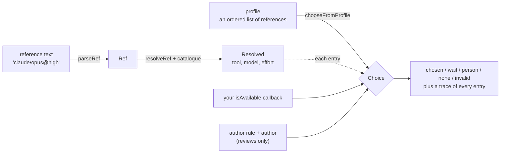

This guide walks through the library from the problem it solves to a working profile walk, one
step at a time. The [README](../../README.md) is the reference: every rule, table and edge case. Read
this first if you are new, then look things up there.

The outputs below come from the shipped model snapshot. Model names change as new models are
released, so the names you see may differ; the shapes will not.

## The problem

Say a workflow launches a coding agent to make a change, and later another one to review it. The
simplest version hard-codes a command:

```sh
claude --model opus --effort high
```

That works until it doesn't:

- **Codex is not signed in today.** The workflow should fall back to another tool, not fail.
- **A new Opus ships.** `opus` should follow it, but a pinned `opus-5.5` should not.
- **The review must not be done by the tool that wrote the change.** If Claude Code wrote it,
  Codex reviews, and the other way round.
- **Someone types `claude/opus@ultra`.** Nobody should find out an hour later, when the launch
  fails. A typo should be caught before anything starts.
- **Someone asks for `codex/sonnet`.** Codex does not serve Anthropic models. The answer should say
  so, and suggest `claude/sonnet`.

The agent router answers one question, before anything launches: **given what the workflow asked
for, which tool, model and effort should run?** It does not launch anything itself, and it does
not check what is installed: you pass that in.

## The picture



Three ideas carry the whole library:

| Idea | What it is | Example |
| --- | --- | --- |
| **Reference** | A short string naming what to run. Only the tool is required. | `claude`, `claude/opus@high`, `*/fast[local]` |
| **Catalogue** | Facts about tools, providers and models: who serves what, which efforts each takes, how much context. A snapshot ships with the package. | `claude` serves Anthropic; Opus takes `low` to `max` |
| **Profile** | An ordered list of references. The first usable one runs. | `[codex/max, claude/opus@high]` |

## Step 1: write a reference

A reference reads `tool/model[qualifiers]@effort`. The model part can be a **tier** (`fast`,
`standard`, `max`), a **family** (`opus`, which follows new releases) or an **exact model**
(`opus-5.5`, which does not).

```ts
import { parseRef } from '@osdlc/agent-router'

parseRef('claude/opus@high')
// { ok: true, value: { tool: 'claude', model: 'opus', effort: 'high' } }
```

Mistakes come back as typed errors with a message a person can act on. Nothing throws:

```ts
parseRef('Claude/max')
// { ok: false, error: { kind: 'invalid-tool',
//   message: "tool must match ^[a-z][a-z0-9-]*$ or be '*': \"Claude/max\"" } }

parseRef('claude/opus[1m]')
// { ok: false, error: { kind: 'native-bracket',
//   message: "a context size is written [ctx=1m], not a tool's own [1m]: \"claude/opus[1m]\"" } }

parseRef('claude/opus@ultra')
// { ok: false, error: { kind: 'unknown-effort', … } }   (the levels run none … max)
```

Every result in the library has this shape, the `Result` type from `@osdlc/result`: check `ok`,
then read `value` or `error`.

## Step 2: resolve it against the catalogue

Resolving turns a reference into something launchable. A tier becomes a concrete model, and the
effort and the tool-model pairing are checked.

```ts
import { BUILTIN_QUERY, parseRef, resolveRef } from '@osdlc/agent-router'

const ref = parseRef('codex/max')
if (!ref.ok) throw new Error(ref.error.message)

resolveRef(ref.value, { catalogue: BUILTIN_QUERY })
// { ok: true, value: { tool: 'codex', model: 'gpt-6-astra',
//   from: { kind: 'tier', tier: 'max' }, text: 'codex/max', … } }
```

`BUILTIN_QUERY` is the shipped snapshot, ready to query. To add your own models or tools, see
[Bringing your own catalogue](#bringing-your-own-catalogue) below.

Here is what the resolver catches before launch:

| You wrote | You get | Why |
| --- | --- | --- |
| `codex/sonnet` | error `provider-not-served`, hint `claude/sonnet` | Codex does not serve Anthropic models |
| `nope/max` | error `unknown-tool`, with the known tools listed | the catalogue has no tool `nope` |
| `antigravity@xhigh` | ok, effort **`high`**, `effortAdjusted: { requested: 'xhigh', direction: 'down' }` | one step off is moved, and the move is recorded |
| `antigravity@max` | error `unsupported-effort` | two steps from `high` is too far to guess |

The one-step rule is deliberate. Asking for `xhigh` on a tool whose top level is `high` almost
certainly means "as hard as it goes". Asking for `max` on the same tool is two steps away, which
is more likely a mistake, so it is refused.

## Step 3: a profile, and telling it what is available

A profile is a fallback list. You also pass an `isAvailable` callback. The router calls it for each
entry in turn and takes the first one you say yes to. The router never checks installs, sign-ins
or budgets itself. That is your code, because only your host knows how.

```ts
import { BUILTIN_QUERY, chooseFromProfile, parseProfile } from '@osdlc/agent-router'

const profile = parseProfile(['codex/max', 'claude/opus@high'])
if (!profile.ok) throw new Error(profile.error.message)

const choice = chooseFromProfile(profile.value, {
  catalogue: BUILTIN_QUERY,
  // Pretend Codex is not signed in today.
  isAvailable: (resolved) =>
    resolved.tool === 'codex' ? { ok: false, reason: 'not-signed-in' } : { ok: true },
})

choice.kind // 'chosen'
choice.summary // 'chosen: claude/opus@high'
choice.trace
// [ 'codex/max: skipped: unavailable (not-signed-in)',
//   'claude/opus@high: taken' ]
```

The **trace** has one line per entry, saying why it was taken or skipped. It is meant to be shown
as is in a run log or a UI, so a person can see why the run picked what it picked. The same skips
come as data in `choice.skipped` (`{ ref, reason }`) if you want to count them.

The reasons your callback can give are fixed (`AVAILABILITY_REASONS`): `not-installed`,
`not-signed-in`, `over-budget`, `cooling-down`, `provider-unreachable`, `model-not-present`,
`not-launchable`, `other-tool` and `untrusted-fork`. Add a `detail` to say more:

```ts
isAvailable: () => ({ ok: false, reason: 'cooling-down', detail: 'retry after 14:05' })
```

**Cooldowns are treated more gently than the other reasons.** If every usable entry is only
cooling down after a rate limit, the router still takes the first one and marks the choice
`allCooling: true`. A rate limit is a reason to prefer another tool, not to stop the workflow:

```ts
choice.summary
// 'chosen: codex/max (all usable entries are cooling down; first one tried anyway)'
```

## Step 4: handle every outcome

A choice is one of five kinds. Handle all of them. `invalid` in particular means the profile
itself is wrong, which is a configuration error, not a busy machine.

```ts
switch (choice.kind) {
  case 'chosen': {
    const { tool, model, effort } = choice.resolved
    // Hand these to your launcher, e.g. @osdlc/agent-call.
    for (const warning of choice.warnings) log.warn(warning)
    break
  }
  case 'wait': // only the author's tool is left and the rule says wait: retry later
  case 'person': // the same, and the rule says hand it to a person
  case 'none': // nothing is usable right now
    log.info(choice.summary)
    break
  case 'invalid': // the profile is wrong: fix the config
    for (const e of choice.errors) log.error(`${e.entry}: ${e.message}`)
    break
}
```

An invalid profile is caught before any entry is tried, so a mistake in the last entry is
reported even when the first entry would have run:

```ts
chooseFromProfile(parseProfile(['codex/max', 'codex/sonnet']).value, ctx)
// { kind: 'invalid',
//   summary: "invalid: codex/sonnet: 'codex' does not serve anthropic, the provider of 'sonnet';
//             nearest valid: claude/sonnet", … }
```

To check a profile without choosing, for example in a `doctor` command, call
`validateProfile(profile, ctx)`. It returns the same errors.

## Step 5: reviews, and the author rule

A reviewer should not be the tool that wrote the change. Pass the **author rule** and the
**author**, and entries on the author's tool are set aside:

```ts
import { authorRule } from '@osdlc/agent-router'

const review = chooseFromProfile(parseProfile(['codex/max', 'claude/opus@high']).value, {
  catalogue: BUILTIN_QUERY,
  isAvailable: () => ({ ok: true }),
  authorRule: authorRule({ not_the_author: true }),
  author: { tool: 'codex', model: 'gpt-6-astra' }, // Codex wrote this change
})

review.trace
// [ "codex/max: skipped: author's tool (author rule step 1: not_the_author)",
//   'claude/opus@high: taken' ]
```

What if only the author's tool is left? `if_only_author_left` decides:

| Setting | What happens | Outcome |
| --- | --- | --- |
| `different-model` (default) | Use the author's tool, but with a different model if one is available. | `chosen`, with `sameToolAsAuthor: true` |
| `wait` | Wait and try again later. | `wait` |
| `person` | Hand the review to a person. | `person` |

With `different-model`, when no different model is available either, the router still runs the
review and says so plainly, so you can mention it on the pull request:

```ts
review.summary
// "chosen: codex/max (same tool as author, model may match: entry's model equals the author's)"
review.modelMayMatchAuthor // true
```

Only callers whose work has an author pass the rule. An implementation run passes neither
`authorRule` nor `author`.

## Step 6: keep profiles in config

Profiles usually live in a config file, not in code:

```yaml
profiles:
  mechanical: [pi/qwen2.5-coder:7b, claude/fast, codex/fast]
  author:
    order: [claude/standard, codex/standard]
    context: 1m # every entry must reach 1,000,000 tokens of context
  reviewer: [codex/max, claude/opus-5.5@high]
```

```ts
import { parseProfiles, resolveBinding } from '@osdlc/agent-router'

const profiles = parseProfiles(config.profiles) // adds the built-in `default` and `small`
if (!profiles.ok) throw new Error(profiles.error.message)

// A workflow step names either a profile or a single tool reference.
const choice = resolveBinding({ profile: 'reviewer' }, profiles.value, ctx)
```

Two profiles are built in: `default` (`*/standard`) and `small` (`*/fast`). A `*` reference is a
**wildcard**: it expands to that tier's models across every tool, in a fixed order, so `*/fast`
means "any fast model on any tool that is available". Add a trait to narrow it: `*/fast[local]`
takes local models only.

**Routing rules** pick a profile from what the run is. The first rule that matches wins:

```ts
import { matchRule, parseRouting } from '@osdlc/agent-router'

const rules = parseRouting([
  { when: { workflow: 'review' }, profile: 'reviewer' },
  { when: { workflow: 'implement', complexity: 'small' }, profile: 'small' },
])
if (!rules.ok) throw new Error(rules.error.message)

matchRule(rules.value, { workflow: 'review', complexity: 'large' })
// { index: 0, rule: { when: { workflow: 'review' }, profile: 'reviewer' } }
```

A host that reads YAML config can mount the ready-made `profiles`, `routing` and `router` sections
from the `@osdlc/agent-router/config` subpath instead of wiring this by hand. That subpath is
experimental (see [Stability](../../README.md#stability)).

## Bringing your own catalogue

The snapshot knows the common coding-agent CLIs and the Anthropic, OpenAI and Google models. To
add a tool, a provider or a local model, pass your own **layer** on top. A layer is plain data;
reading it from a file is your job.

```ts
import { layerCatalogue, queryCatalogue, SNAPSHOT_LAYER, type CatalogueLayer } from '@osdlc/agent-router'

const mine: CatalogueLayer = {
  source: 'config',
  observed_at: '2026-11-07',
  providers: { acme: { kind: 'openai-compatible' } },
  tools: { runner: { serves: ['acme'], openness: 'closed', modes: ['headless'] } },
  models: {
    'acme/pro-1': { family: 'acme-pro', traits: ['agent'], release_date: '2026-02-01' },
  },
}

const catalogue = queryCatalogue(layerCatalogue([SNAPSHOT_LAYER, mine]), {
  // Tell the tier classifier where your family belongs.
  classify: [{ provider: 'acme', families: { 'acme-pro': 'max' } }],
  // Optionally freeze a tier on a tool, whatever newer releases do.
  pins: { 'claude/max': 'claude-opus-5-5' },
})
```

Higher layers override lower ones field by field. A row that is missing something it needs, or
that points at an unknown tool or model, is left out and listed in `catalogue.problems` rather
than failing silently. Show those to the person who wrote the config.

## What the router does not do

- **It does not launch anything.** Pass the chosen tool, model and effort to a launcher such as
  `@osdlc/agent-call`.
- **It does not check availability.** Your `isAvailable` callback does. `@osdlc/detect-harness` can
  find which tools are installed.
- **It does not read files or the network.** Catalogue layers and config arrive as data. The main
  entry runs in a browser.

## Where to go next

- The [README](../../README.md) has every rule in full: reference grammar, context sizes, wildcards,
  validity, the author rule step by step, and the skip reasons.
- The [planning folder](../planning/README.md) has the words used here, and the decisions behind the
  design.
- The [CHANGELOG](../../CHANGELOG.md) lists what changed in each release.
- Each export's TSDoc, which your editor shows on hover, is the API reference.
