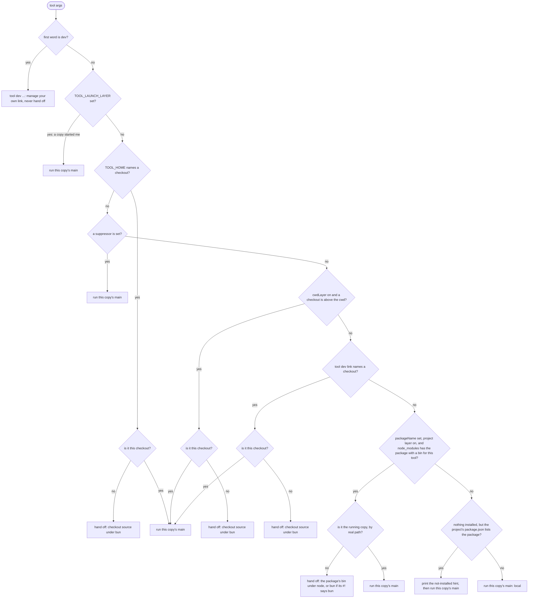
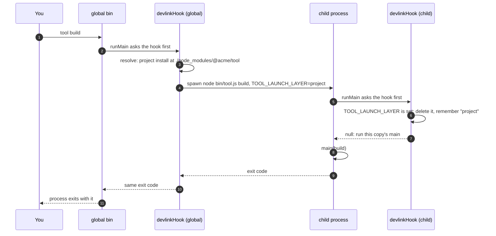

# Launch order: which copy of a tool runs

A tool built on cli-tool can exist in several places at once: the copy you
installed globally, a development checkout you are working on, and a copy a
project installed in its own `node_modules`. When you type the tool's name,
devlink decides at startup which of these runs. This page explains that
decision as it is built, with `tool` standing for the tool's name and `TOOL`
for its upper-cased stem (`pr-update` → `PR_UPDATE`).

The short version: a checkout you chose (`TOOL_HOME` or `tool dev link`) wins
everywhere. Otherwise a project that installed the tool runs its own pinned
copy. Otherwise the copy you typed runs.

## The decision at startup

The installed bin calls `runMain(main, { devlink: devlinkHook(spec) })`. The
hook runs before `main` and either answers, hands off to another copy, or
lets this copy run.



Notes on the diagram:

- `TOOL_HOME` applies even when a suppressor is set, because you set it on
  purpose. A suppressor turns off the cwd, link and project layers.
- "Is it this checkout" and "is it the running copy" stop a copy from handing
  off to itself. A project's `node_modules` entry can be a workspace symlink to
  the very checkout that is running; that counts as the running copy too.
- `tool dev …` never hands off and never looks at the project: it changes
  your own link, wherever you stand. `--version` and `--where` do hand off, so
  they describe the copy that would really run in that directory.

## One hand-off



The child deletes `TOOL_LAUNCH_LAYER` once it has read it, so anything the
child starts (a git hook, a shell, a nested run of the tool) decides for
itself again. A pinned copy from an older release does not know that
variable. It still stops after one hop, because when it resolves it finds the
project's `node_modules` copy, which is itself.

## The layers

| Order | Layer | How it turns on | How it turns off | What runs |
|---|---|---|---|---|
| 1 | env | `TOOL_HOME=<absolute checkout path>` | unset it; a relative path is ignored | that checkout's source entry under bun |
| 2 | cwd | the spec sets `cwdLayer: true` and you stand inside a checkout | `TOOL_CWD_DEV=0`, a suppressor, or the spec leaves it off (the default) | that checkout's source entry under bun |
| 3 | link | `tool dev link <checkout>` | `tool dev off`, or a suppressor | the linked checkout's source entry under bun |
| 4 | project | the spec sets `packageName` and a project above the cwd has it in `node_modules` | `TOOL_PROJECT=0`, `projectLayer: false` in the spec, or a suppressor | the package's `bin` file under node (or bun, when its `#!` line says bun), run by its path |
| 5 | local | none of the above | never | this copy |

The project copy is the nearest `<dir>/node_modules/<packageName>` above the
real cwd whose `package.json` has that name, followed through a pnpm symlink
into the store. Only folders above the cwd count: unlike `require`, the
lookup ignores `NODE_PATH` and Node's global folders, where a global copy
would pass for a project's pin. The bin is run by
its file path, never through `node_modules/.bin`, so Windows needs no `.cmd`
shim.

## Environment variables

| Variable | Meaning |
|---|---|
| `TOOL_HOME` | an absolute checkout path to run, above everything else |
| `TOOL_CWD_DEV` | `0` turns the cwd layer off for this shell |
| `TOOL_PROJECT` | `0` turns the project layer off for this shell |
| `TOOL_QUIET` | `1` silences the `running …` line and the not-installed hint |
| `TOOL_LAUNCH_LAYER` | set by the parent for the child: which layer chose it (`env`, `cwd`, `link`, `project`, or `local` from the bash launcher) |
| the spec's `suppressors` | when any is set, the cwd, link and project layers are off; a host program (such as an agent harness) names its own root variable here so your link never changes the code it runs |

## When the `running …` line prints

The line goes to stderr, before the child's own output, and looks like
`tool: running <file> (<why>)`. It prints:

- on a hand-off from the env, cwd or link layer;
- on a hand-off to a project copy only when its version differs from the
  running copy's, naming both:
  `tool: running …/bin/tool.js (project install at …/node_modules/@acme/tool, 2.0.0; this install is 1.4.0)`;
- never when this copy runs (local), and never with `TOOL_QUIET=1`.

When the project's `package.json` lists the package but nothing is installed,
this copy runs and prints one line:
`tool: this project depends on @acme/tool but it is not installed; running the global copy. Run your package manager's install.`

## What `--where` says for each layer

`tool --where` is answered by the copy that really runs, so its `chosen by`
line names the layer. The `file` and `from` lines say where that copy is.

| Layer | `chosen by` line |
|---|---|
| env | `chosen by env ($TOOL_HOME)` |
| cwd | `chosen by cwd (a checkout above the working directory)` |
| link | `chosen by link (/home/me/.config/tool/home)` |
| project | `chosen by project install (/work/app/node_modules/@acme/tool)` |
| local, an install | `chosen by this install (no devlink layer selected another)` |
| local, a checkout | `chosen by this checkout (no devlink layer selected another)` |
| bash launcher's own checkout | `chosen by local (the launcher's own checkout; no devlink layer selected another)` |

A full answer for the project layer:

```text
tool 2.0.0
file      /work/app/node_modules/@acme/tool/bin/tool.js
from      install /work/app/node_modules/@acme/tool
chosen by project install (/work/app/node_modules/@acme/tool)
```

`tool --where --json` prints the same facts as one JSON object.

## The bash launcher (sdlc)

A tool can instead commit a bash launcher rendered by `renderLauncher(spec)`.
sdlc does this. The launcher decides in bash, before any JavaScript runtime
starts, and then `exec`s bun or node. Its order is the same for the layers it
has: env, cwd (when on), link, local. The differences:

- **No project layer.** Finding the package and its `bin` means reading
  `package.json`, and the launcher does not parse JSON. For the same reason
  `renderLauncher` refuses a spec that sets `packageName`.
- **The `local` case** runs the launcher's own checkout: its built entry under
  node when one is present and the checkout is not a development checkout,
  else its source under bun. It exports `TOOL_LAUNCH_LAYER=local`.
- **The `running …` line** now follows the same rule as the hook: it prints
  only on a hand-off to another checkout, never for local.

## How other tools do it

Several tools already run a project's own copy instead of the global one. The
summaries below were checked against each tool's source or docs on 2026-10-31;
anything not confirmed there is marked unverified.

- **import-local** (used by jest-cli). Called with the running file, it finds
  the package that file belongs to, resolves `<package name>/<same file>`
  from the cwd with `resolve-cwd`, and `require()`s it in the same process. It
  skips when the result is the running file (compared with `path.relative`,
  for Windows case differences) or when the running file is already under
  `<cwd>/node_modules`. Matches our project layer. Two issues are open:
  [#7](https://github.com/sindresorhus/import-local/issues/7), it can load a
  different version from a Yarn workspace's root `node_modules`, and
  [#15](https://github.com/sindresorhus/import-local/issues/15), a
  `pkgDir.sync is not a function` error after upgrades. We copied the
  real-path "is it me" check. We spawn `node` instead of `require()`, because
  a bin may be ESM with top-level await, may expect its own runtime, and should
  not share module state with the global copy.
  [Source](https://github.com/sindresorhus/import-local)
- **webpack-cli** inlines the same logic: `realpathSync(process.cwd())`, then
  `createRequire(join(cwd, 'noop.js')).resolve('webpack-cli/bin/cli.js')`, the
  same two skip checks, and the `WEBPACK_CLI_SKIP_IMPORT_LOCAL` opt-out. Its
  comment notes that on Windows `path.relative` across drives returns the
  second path, so a root comparison is added. We copied the real-path cwd and
  the "different drive is a different copy" rule. We did not copy the
  `createRequire` lookup: it also searches `NODE_PATH` and Node's global
  folders, and fails on a package whose `exports` hides `package.json`.
  [Source](https://raw.githubusercontent.com/webpack/webpack-cli/main/packages/webpack-cli/bin/cli.js)
- **Angular CLI** (`ng`) resolves `@angular/cli` with
  `createRequire(process.cwd() + '/')` and imports it in process. It warns only
  when the global version is newer than the local one, and
  `ng config -g cli.warnings.versionMismatch false` turns the warning off. It
  force-exits local versions below 14, always uses the global copy for
  `ng new`, and on Windows sets `NoDefaultCurrentDirectoryInExePath=1`. We
  copied "the command that creates or manages things skips the local copy"
  (our `dev`). We warn on any version difference, not only a newer global.
  [Source](https://raw.githubusercontent.com/angular/angular-cli/main/packages/angular/cli/lib/init.ts)
- **ember-cli** calls `resolve.sync('ember-cli', { basedir: process.cwd() })`
  and `require()`s the result, or its own `lib/cli` when nothing resolves. The
  simplest form of our project layer, with no guard and no message.
  [Source](https://raw.githubusercontent.com/ember-cli/ember-cli/master/bin/ember)
- **liftoff, gulp-cli and grunt-cli.** Liftoff gives the CLI `env.modulePath`
  ("the full path to the local module your project relies on") and
  `env.modulePackage`. gulp-cli maps the local gulp version to an adapter in
  `lib/versioned/`, or exits with an unsupported-version error. With a
  `package.json` but no `node_modules` it prints an install hint
  (`npm install`, or `yarn install` when `yarn.lock` is there), and
  `gulp --version` prints both `CLI version` and `Local version`. Unlike ours,
  gulp-cli has no global copy to fall back to: no local gulp is an error.
  grunt-cli also `require()`s `env.modulePath`. We copied the
  declared-but-not-installed hint.
  [Liftoff](https://github.com/gulpjs/liftoff),
  [gulp-cli](https://raw.githubusercontent.com/gulpjs/gulp-cli/master/index.js)
- **turbo.** "When a local binary is installed, the global binary defers to
  it." The shim infers the repository root and looks there, not in the
  nearest `node_modules`, handling hoisted, nested, pnpm (`.pnpm/turbo@…`) and
  Yarn PnP layouts. It passes `--skip-infer` to the local binary as its loop
  guard. `TURBO_GLOBAL_WARNING_DISABLED=1` silences its global-use warning,
  and `TURBO_BINARY_PATH` turns local lookup off. Our `TOOL_LAUNCH_LAYER` is
  the same idea as `--skip-infer`, carried in the environment so it never
  reaches the child's argument parser.
  [Docs](https://turborepo.dev/docs/getting-started/installation),
  [shim](https://github.com/vercel/turborepo/tree/main/crates/turborepo-shim/src)
- **nx.** The global `nx` resolves nx from the workspace root and `require()`s
  the local copy. `nx --version` prints `Local:` and `Global:` versions. It
  warns when the global copy is at least one major version behind the local
  one, and skips that warning when `NX_CLI_SET` is set (nx invoking itself).
  `nx new`, `init` and a few others run without a local workspace.
  [Source](https://raw.githubusercontent.com/nrwl/nx/master/packages/nx/bin/nx.ts),
  [docs](https://nx.dev/docs/guides/installation/update-global-installation)
  (docs page unverified)
- **Volta** delegates to a project's `node_modules` copy only when the tool
  is a direct dependency of the project (`dependencies` or `devDependencies`,
  `has_direct_bin`) and was itself installed through Volta. Its README says
  "Volta is unmaintained" and recommends mise.
  [Repo](https://github.com/volta-cli/volta),
  [post](https://blog.volta.sh/2019/06/18/global-installs-done-right)
- **mise (npm backend), proto, asdf** pin which version of a global tool you
  get per project (`mise.toml`, `.prototools`, `.tool-versions`). They install
  that version in their own directory. They do not run the project's
  `node_modules` copy; mise's docs suggest a package script for that. asdf was
  not checked (unverified).
  [mise](https://mise.jdx.dev/dev-tools/backends/npm.html),
  [proto](https://moonrepo.dev/docs/proto/detection)
- **corepack and `yarnPath`** do this for package managers only: the
  `packageManager` field, or a Yarn binary "to use instead of the global
  one". Corepack ships with Node 14.19.0 up to, but not including, 25.0.0.
  [corepack](https://github.com/nodejs/corepack),
  [yarnPath](https://yarnpkg.com/configuration/yarnrc#yarnPath)
- **npx, `npm exec`, `pnpm exec`, bunx** use the project's installed copy
  first, but only when you type them. A bare name with no version matches
  "whatever version exists in the local project". `pnpm exec` was not checked
  (unverified).
  [npm exec](https://docs.npmjs.com/cli/v11/commands/npm-exec),
  [bunx](https://bun.com/docs/pm/bunx)
- **npm link, pnpm link, bun link, yalc** are the alternatives to our
  `dev link`. npm and bun link symlink a package folder globally and then into
  a project. pnpm link symlinks into a project and, for global bins, its docs
  say to use `pnpm add -g .` instead. yalc copies the publishable files into a
  store and then into the project; its last release is 1.0.0-pre.53, from
  April 2021. Ours makes no symlinks and no copies: a link file you can read,
  a history, `dev off`, and the checkout's source run under bun with no build.
  [npm link](https://docs.npmjs.com/cli/v11/commands/npm-link),
  [pnpm link](https://pnpm.io/cli/link),
  [bun link](https://bun.com/docs/pm/cli/link),
  [yalc](https://github.com/wclr/yalc)

| Tool | HOME env | own checkout | dev link | project install | global | loop guard | version warning | says which copy runs |
|---|---|---|---|---|---|---|---|---|
| devlink | yes | yes, opt-in | yes | yes, by spawn | yes | env var and real path | when versions differ | `--where`, `dev status` |
| import-local | no | no | no | yes, in process | yes | real path | no | no |
| webpack-cli | no | no | no | yes, in process | yes | real path | no | no |
| Angular CLI | no | no | no | yes, in process | yes | in process | global newer | warning only |
| ember-cli | no | no | no | yes, in process | yes | in process | no | no |
| gulp-cli | no | no | no | yes, required | no | in process | unsupported versions exit | `--version` |
| turbo | no | no | no | yes, by spawn, repo root | yes | `--skip-infer` | global use warning | unverified |
| nx | no | no | no | yes, in process, workspace root | yes | in process | global a major behind | `--version` |
| Volta | no | no | no | direct deps only | yes | n/a | no | unverified |
| mise, proto | no | no | no | no | pinned version | n/a | no | `mise which` (unverified) |
| npx, bunx | no | no | no | yes, when typed | fetches | n/a | no | no |
| npm/pnpm/bun link, yalc | no | no | symlink or copy | no | yes | n/a | no | no |

"In process" means the global copy `require()`s or imports the local one, so
there is no second process to guard against.
