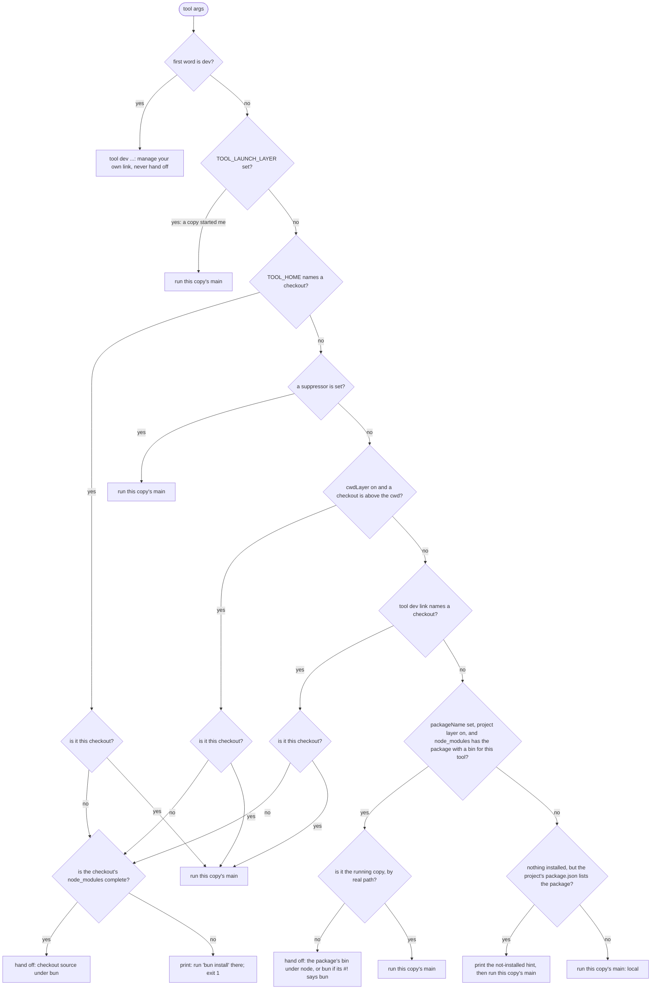
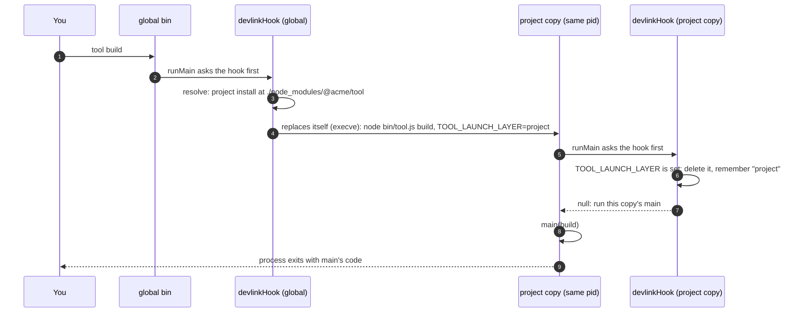

A tool built on cli-tool can exist in several places at once: the copy you
installed globally, a development checkout you are working on, and a copy a
project installed in its own `node_modules`. When you type the tool's name,
devlink decides at startup which of these runs. This page explains that
decision as it is built, with `tool` standing for the tool's name and `TOOL`
for its upper-cased stem (`pr-update` → `PR_UPDATE`).

The short version: a checkout you chose (`TOOL_HOME` or `tool dev link`) wins
everywhere. Otherwise a project that installed the tool runs its own pinned
copy. Otherwise the copy you typed runs.

## The decision at startup

The installed bin calls `runMain(main, { devlink: devlinkHook(spec) })`. The
hook runs before `main` and either answers, hands off to another copy, or
lets this copy run.



Notes on the diagram:

- `TOOL_HOME` applies even when a suppressor is set, because you set it on
  purpose. A suppressor turns off the cwd, link and project layers.
- "Is it this checkout" and "is it the running copy" stop a copy from handing
  off to itself. A project's `node_modules` entry can be a workspace symlink to
  the very checkout that is running; that counts as the running copy too.
- A checkout runs from source, so before handing off the hook checks that
  its dependencies are installed (see step 5 below). A project copy is not
  checked: it is an install, which its package manager completed.
- `tool dev …` never hands off and never looks at the project: it changes
  your own link, wherever you stand. `--version` and `--where` do hand off, so
  they describe the copy that would really run in that directory.

## One run, step by step

What happens between typing `tool build` and the shell getting its exit code
back, in order. Each step either finishes the run or passes to the next.

1. **The bin starts.** The `#!` line of the installed bin (or the
   checkout's entry, or `node path/to/bin`) starts a runtime, and the bin
   calls `runMain(main, { name, version, devlink: devlinkHook(spec) })`.
2. **runMain asks the hook first.** Nothing of `main` has run yet, not even
   argument parsing.
3. **`dev …` is answered here.** When the first word is `dev`, the hook runs
   `tool dev link`, `off`, `status` and the rest itself, and the run ends with
   their exit code. This never hands off.
4. **Was this process handed off to?** When `TOOL_LAUNCH_LAYER` is set, a
   copy before this one already chose this copy. The hook deletes the
   variable, remembers the layer for `--where`, and goes to step 7. Under
   Deno the hook also goes to step 7, as `local`.
5. **The layers, in order.** The first one that matches wins:
   - **env**: `TOOL_HOME` is an absolute path to a checkout (a folder with
     the spec's `marker` file).
   - **cwd**, only when the spec sets `cwdLayer`: a checkout of this tool is
     at or above the working directory.
   - **link**: `tool dev link` wrote a checkout path to the link file.
   - **project**, only when the spec sets `packageName`: a `node_modules`
     above the working directory holds that package with a bin for this tool.
   - **local**: none of the above. When the project's `package.json` lists
     the package but it is not installed, the hook prints a one-line hint.

   A suppressor turns off cwd, link and project. A layer that names the copy
   already running counts as local. For env, cwd and link the hook then
   checks the checkout's `node_modules`, as the bash launcher does: when a
   package listed in `dependencies` (from the entry's folder up to the
   checkout) is not in any `node_modules` at or above it, as bun looks, it
   prints
   `tool: <checkout> has no node_modules. Run 'bun install' there.` or
   `tool: <checkout> is missing package '<name>'. Run 'bun install' there.`
   and the run ends with exit 1. The first line is for a checkout with no
   `node_modules` at all. A checkout with no dependencies needs none.
6. **Hand off, or not.** For local the hook returns and runMain goes on to
   step 7. Otherwise:
   - The hook prints `tool: running <file> (<why>)` to stderr. For the
     project layer it prints only when the versions differ, and
     `TOOL_QUIET=1` silences it.
   - It sets `TOOL_LAUNCH_LAYER` to the layer's name in the environment of the
     copy it starts.
   - A checkout runs under bun: the bun that is already running when this
     process is bun, else the first `bun` on an absolute `PATH` entry. Reusing
     the running bun matters because the first `bun` on `PATH` can be a proto
     shim, and a proto shim refuses to start bun from inside bun ("re-entered
     proto … would loop"). A project copy runs under node, or bun when its
     `#!` line says bun.
   - On macOS and Linux it calls `process.execve`: this process becomes the
     other copy, with the same pid. On Windows, on Node before 22.15, or when
     `execve` fails for a reason other than a missing or unrunnable file, it
     spawns the copy, waits, and exits with its code. A missing or unrunnable
     runtime prints `could not start …` and exits 1.

   The copy that starts begins again at step 1, and at step 4 it finds
   `TOOL_LAUNCH_LAYER` set, so it never hands off a second time.
7. **`--version` and `--where`.** runMain answers these now, in the copy that
   really runs, and exits 0. `--where` names the layer found at step 4 or 5.
8. **main runs.** runMain parses the arguments and calls `main`.
9. **Exit code.** main's return value, or the exit code for a thrown
   error, becomes the process's exit code. After an `execve` hand-off this is
   the code the shell sees; after a spawn hand-off, the first process exits
   with it.

## One hand-off



On POSIX the hook calls `process.execve`, so the project copy takes over the
same process, as the bash launcher's `exec` does. Where `execve` is missing,
on Windows and on a Node before 22.15, the hook spawns the copy instead, waits
for it, and exits with its exit code.

The child deletes `TOOL_LAUNCH_LAYER` once it has read it, so anything the
child starts (a git hook, a shell, a nested run of the tool) decides for
itself again. A pinned copy from an older release does not know that
variable. It still stops after one hop, because when it resolves it finds the
project's `node_modules` copy, which is itself.

## Signals, stdin and exit codes

- **Environment.** The copy that runs gets this process's environment, plus
  `TOOL_LAUNCH_LAYER` set to the layer that chose it.
- **stdin, stdout, stderr** are the same file descriptors. Nothing is piped or
  captured, so a terminal stays a terminal.
- **Exit codes** are exact. With `execve` the exit is the program's own. With
  the spawn fallback the parent exits with the child's code, or 128 plus the
  signal number when a signal ended it.
- **Signals** are exact with `execve`: there is one process with one pid, so
  Ctrl-C and a `kill` reach the program that runs.
- **The fallback** cannot forward signals. A SIGTERM sent to the parent's pid
  stops the parent and leaves the child running, and the shell can get its
  prompt back before the child ends. Ctrl-C in a terminal reaches both,
  because they share the foreground process group.
- **The `running …` line** is written to stderr synchronously, before
  `execve`, so it is never lost in a buffer.

## Running through npx, node or deno

- **npx, `pnpm exec`, bunx** already run the project's copy. When that copy's
  hook reaches the project layer, it finds itself and runs, so there is no
  hop. An npx copy in its temporary cache, with no project copy installed,
  also runs itself.
- **The dev layers still apply under npx.** A `TOOL_HOME`, a checkout above
  the cwd, or a dev link hands off as it would from the global command.
- **`node path/to/bin`** behaves as the global command does: the hook sees the
  same script and makes the same choice.
- **The runtime for a project copy** is `process.execPath` when running under
  Node, so the Node version that started the tool carries over. Under Bun it
  is the `node` found on the absolute entries of `PATH`.
- **The runtime for a checkout** is bun: `process.execPath` when running
  under Bun, else the `bun` found on the absolute entries of `PATH`.
- **Deno** is not supported for hand-offs. When `process.versions.deno` is set,
  the hook runs the copy that started, as local, and prints nothing.

## The layers

| Order | Layer | How it turns on | How it turns off | What runs |
|---|---|---|---|---|
| 1 | env | `TOOL_HOME=<absolute checkout path>` | unset it; a relative path is ignored | that checkout's source entry under bun |
| 2 | cwd | the spec sets `cwdLayer: true` and you stand inside a checkout | `TOOL_CWD_DEV=0`, a suppressor, or the spec leaves it off (the default) | that checkout's source entry under bun |
| 3 | link | `tool dev link <checkout>` | `tool dev off`, or a suppressor | the linked checkout's source entry under bun |
| 4 | project | the spec sets `packageName` and a project above the cwd has it in `node_modules` | `TOOL_PROJECT=0`, `projectLayer: false` in the spec, or a suppressor | the package's `bin` file under node (or bun, when its `#!` line says bun), run by its path |
| 5 | local | none of the above | never | this copy |

The project copy is the nearest `<dir>/node_modules/<packageName>` above the
real cwd whose `package.json` has that name, followed through a pnpm symlink
into the store. Only folders above the cwd count: unlike `require`, the
lookup ignores `NODE_PATH` and Node's global folders, where a global copy
would pass for a project's pin. The bin is run by
its file path, never through `node_modules/.bin`, so Windows needs no `.cmd`
shim.

## Environment variables

| Variable | Meaning |
|---|---|
| `TOOL_HOME` | an absolute checkout path to run, above everything else |
| `TOOL_CWD_DEV` | `0` turns the cwd layer off for this shell |
| `TOOL_PROJECT` | `0` turns the project layer off for this shell |
| `TOOL_QUIET` | `1` silences the `running …` line and the not-installed hint |
| `TOOL_LAUNCH_LAYER` | set by the parent for the child: which layer chose it (`env`, `cwd`, `link`, `project`, or `local` from the bash launcher) |
| the spec's `suppressors` | when any is set, the cwd, link and project layers are off; a host program (such as an agent harness) names its own root variable here so your link never changes the code it runs |

## When the `running …` line prints

The line goes to stderr, before the child's own output, and looks like
`tool: running <file> (<why>)`. It prints:

- on a hand-off from the env, cwd or link layer;
- on a hand-off to a project copy only when its version differs from the
  running copy's, naming both:
  `tool: running …/bin/tool.js (project install at …/node_modules/@acme/tool, 2.0.0; this install is 1.4.0)`;
- never when this copy runs (local), and never with `TOOL_QUIET=1`.

When the project's `package.json` lists the package but nothing is installed,
this copy runs and prints one line:
`tool: this project depends on @acme/tool but it is not installed; running the global copy. Run your package manager's install.`

## What `--where` says for each layer

`tool --where` is answered by the copy that really runs, so its `chosen by`
line names the layer. The `file` and `from` lines say where that copy is.

| Layer | `chosen by` line |
|---|---|
| env | `chosen by env ($TOOL_HOME)` |
| cwd | `chosen by cwd (a checkout above the working directory)` |
| link | `chosen by link (/home/me/.config/tool/home)` |
| project | `chosen by project install (/work/app/node_modules/@acme/tool)` |
| local, an install | `chosen by this install (no devlink layer selected another)` |
| local, a checkout | `chosen by this checkout (no devlink layer selected another)` |
| bash launcher's own checkout | `chosen by local (the launcher's own checkout; no devlink layer selected another)` |

A full answer for the project layer:

```text
tool 2.0.0
file      /work/app/node_modules/@acme/tool/bin/tool.js
from      install /work/app/node_modules/@acme/tool
chosen by project install (/work/app/node_modules/@acme/tool)
```

`tool --where --json` prints the same facts as one JSON object.

## A tool with its own entry script

Most tools need nothing more than the bin's `#!` line: it names node (or
bun), and the hook does the rest. A tool needs its own entry script when the
`#!` line cannot pick the runtime, for example:

- its source uses something only one runtime or a build step understands,
  such as path aliases that bun resolves and node does not, so a checkout
  must run under bun and an install must run its built file under node;
- a plugin harness calls a fixed path, such as
  `${CLAUDE_PLUGIN_ROOT}/cli/tool`, without naming a runtime.

There are two ways to write one:

- **A hand-written runtime picker, with the layers in process.** A small
  bash script chooses the runtime and starts the tool's entry, and that entry
  calls `runMain` with `devlinkHook(spec)` as every other tool does. The
  layers, the deps check, `--where` and the hand-off are the hook's, so they
  match the other tools. sdlc moved to this in
  [sksizer/dev#3901](https://github.com/sksizer/dev/pull/3901): its picker is
  `cli/sdlc`, which runs the source under bun in a checkout and the built
  `sdlc.js` under node in a plugin pack. How sdlc launches, and what it does
  beyond cli-tool, is in
  [How sdlc launches](./sdlc-launch.md).
- **A rendered bash launcher.** `renderLauncher(spec)` still writes a bash
  script that runs the layers itself, before any runtime starts, and then
  `exec`s bun or node. It has the env, cwd (when on), link and local layers,
  checks `node_modules` the same way, and exports `TOOL_LAUNCH_LAYER`. It has
  no project layer, because finding a package's bin means reading
  `package.json`, which the launcher does not parse; `renderLauncher` refuses
  a spec that sets `packageName`. For `local` it runs the launcher's own
  checkout: the built entry under node when one is present and the checkout
  is not a development checkout, else the source under bun.
  `launcherDrift` tells a committed launcher that no longer matches its spec.

## Adopting devlink in a new CLI

1. **Write the spec**, once, in its own module (`src/devlink.ts`), with
   `validateSpec`:
   - `name`: the command you type, which also gives the variable stem
     (`TOOL_HOME` and the rest).
   - `marker`: a file, relative to the checkout root, that only this tool's
     checkout has (usually its source entry, `src/cli.ts`).
   - `packageName`: the npm name; it turns the project layer on.
   - `entry`: the source file a hand-off runs under bun, relative to the
     checkout (defaults to `marker`).
   - `launcher`: the bin, relative to the checkout.
   - `vendorDirs`: where the link file and history live, and the variables
     that move them (`{ vendor, envVars: envVars('TOOL') }`).
   - `stateDir`, only if the tool keeps its state under its own directory
     (`'~/.tool'`) rather than `~/.config/tool`. The variables still move it.
   - `aliases`, if the tool has other command names.
   - `suppressors`: variables a host program sets (such as a plugin root) so
     that your link never changes the code it runs.
   - `cwdLayer`: leave it off unless working inside the checkout without a
     link is a daily need.
2. **Call runMain with the hook** in the bin's module:
   `await runMain(main, { name, version: VERSION, devlink: devlinkHook(SPEC) })`.
3. **Stamp the version.** Add `"stamp-version": "cli-tool-stamp-version"`,
   run it first in `build`, and commit `src/version.generated.ts` (see the
   README's "The version").
4. **Write the tests:**
   - the package folder is a checkout of the tool (`isCheckout`) and its
     parent folder is not, so the `marker` is right;
   - `tool --version` prints `tool <version>` from package.json;
   - `tool dev status` runs and no test hands off: give each test its own
     `HOME`, and unset `TOOL_HOME`, so a link you set while developing never
     runs in place of the code under test.

## How other tools do it

Several tools already run a project's own copy instead of the global one. The
summaries below were checked against each tool's source or docs on 2026-10-31;
anything not confirmed there is marked unverified.

- **import-local** (used by jest-cli). Called with the running file, it finds
  the package that file belongs to, resolves `<package name>/<same file>`
  from the cwd with `resolve-cwd`, and `require()`s it in the same process. It
  skips when the result is the running file (compared with `path.relative`,
  for Windows case differences) or when the running file is already under
  `<cwd>/node_modules`. Matches our project layer. Two issues are open:
  [#7](https://github.com/sindresorhus/import-local/issues/7), it can load a
  different version from a Yarn workspace's root `node_modules`, and
  [#15](https://github.com/sindresorhus/import-local/issues/15), a
  `pkgDir.sync is not a function` error after upgrades. We copied the
  real-path "is it me" check. We start `node` (by `execve`, else a spawn)
instead of `require()`, because
  a bin may be ESM with top-level await, may expect its own runtime, and should
  not share module state with the global copy.
  [Source](https://github.com/sindresorhus/import-local)
- **webpack-cli** inlines the same logic: `realpathSync(process.cwd())`, then
  `createRequire(join(cwd, 'noop.js')).resolve('webpack-cli/bin/cli.js')`, the
  same two skip checks, and the `WEBPACK_CLI_SKIP_IMPORT_LOCAL` opt-out. Its
  comment notes that on Windows `path.relative` across drives returns the
  second path, so a root comparison is added. We copied the real-path cwd and
  the "different drive is a different copy" rule. We did not copy the
  `createRequire` lookup: it also searches `NODE_PATH` and Node's global
  folders, and fails on a package whose `exports` hides `package.json`.
  [Source](https://raw.githubusercontent.com/webpack/webpack-cli/main/packages/webpack-cli/bin/cli.js)
- **Angular CLI** (`ng`) resolves `@angular/cli` with
  `createRequire(process.cwd() + '/')` and imports it in process. It warns only
  when the global version is newer than the local one, and
  `ng config -g cli.warnings.versionMismatch false` turns the warning off. It
  force-exits local versions below 14, always uses the global copy for
  `ng new`, and on Windows sets `NoDefaultCurrentDirectoryInExePath=1`. We
  copied "the command that creates or manages things skips the local copy"
  (our `dev`). We warn on any version difference, not only a newer global.
  [Source](https://raw.githubusercontent.com/angular/angular-cli/main/packages/angular/cli/lib/init.ts)
- **ember-cli** calls `resolve.sync('ember-cli', { basedir: process.cwd() })`
  and `require()`s the result, or its own `lib/cli` when nothing resolves. The
  simplest form of our project layer, with no guard and no message.
  [Source](https://raw.githubusercontent.com/ember-cli/ember-cli/master/bin/ember)
- **liftoff, gulp-cli and grunt-cli.** Liftoff gives the CLI `env.modulePath`
  ("the full path to the local module your project relies on") and
  `env.modulePackage`. gulp-cli maps the local gulp version to an adapter in
  `lib/versioned/`, or exits with an unsupported-version error. With a
  `package.json` but no `node_modules` it prints an install hint
  (`npm install`, or `yarn install` when `yarn.lock` is there), and
  `gulp --version` prints both `CLI version` and `Local version`. Unlike ours,
  gulp-cli has no global copy to fall back to: no local gulp is an error.
  grunt-cli also `require()`s `env.modulePath`. We copied the
  declared-but-not-installed hint.
  [Liftoff](https://github.com/gulpjs/liftoff),
  [gulp-cli](https://raw.githubusercontent.com/gulpjs/gulp-cli/master/index.js)
- **turbo.** "When a local binary is installed, the global binary defers to
  it." The shim infers the repository root and looks there, not in the
  nearest `node_modules`, handling hoisted, nested, pnpm (`.pnpm/turbo@…`) and
  Yarn PnP layouts. It passes `--skip-infer` to the local binary as its loop
  guard. `TURBO_GLOBAL_WARNING_DISABLED=1` silences its global-use warning,
  and `TURBO_BINARY_PATH` turns local lookup off. Our `TOOL_LAUNCH_LAYER` is
  the same idea as `--skip-infer`, carried in the environment so it never
  reaches the child's argument parser.
  [Docs](https://turborepo.dev/docs/getting-started/installation),
  [shim](https://github.com/vercel/turborepo/tree/main/crates/turborepo-shim/src)
- **nx.** The global `nx` resolves nx from the workspace root and `require()`s
  the local copy. `nx --version` prints `Local:` and `Global:` versions. It
  warns when the global copy is at least one major version behind the local
  one, and skips that warning when `NX_CLI_SET` is set (nx invoking itself).
  `nx new`, `init` and a few others run without a local workspace.
  [Source](https://raw.githubusercontent.com/nrwl/nx/master/packages/nx/bin/nx.ts),
  [docs](https://nx.dev/docs/guides/installation/update-global-installation)
  (docs page unverified)
- **Volta** delegates to a project's `node_modules` copy only when the tool
  is a direct dependency of the project (`dependencies` or `devDependencies`,
  `has_direct_bin`) and was itself installed through Volta. Its README says
  "Volta is unmaintained" and recommends mise.
  [Repo](https://github.com/volta-cli/volta),
  [post](https://blog.volta.sh/2019/06/18/global-installs-done-right)
- **mise (npm backend), proto, asdf** pin which version of a global tool you
  get per project (`mise.toml`, `.prototools`, `.tool-versions`). They install
  that version in their own directory. They do not run the project's
  `node_modules` copy; mise's docs suggest a package script for that. asdf was
  not checked (unverified).
  [mise](https://mise.jdx.dev/dev-tools/backends/npm.html),
  [proto](https://moonrepo.dev/docs/proto/detection)
- **corepack and `yarnPath`** do this for package managers only: the
  `packageManager` field, or a Yarn binary "to use instead of the global
  one". Corepack ships with Node 14.19.0 up to, but not including, 25.0.0.
  [corepack](https://github.com/nodejs/corepack),
  [yarnPath](https://yarnpkg.com/configuration/yarnrc#yarnPath)
- **npx, `npm exec`, `pnpm exec`, bunx** use the project's installed copy
  first, but only when you type them. A bare name with no version matches
  "whatever version exists in the local project". `pnpm exec` was not checked
  (unverified).
  [npm exec](https://docs.npmjs.com/cli/v11/commands/npm-exec),
  [bunx](https://bun.com/docs/pm/bunx)
- **npm link, pnpm link, bun link, yalc** are the alternatives to our
  `dev link`. npm and bun link symlink a package folder globally and then into
  a project. pnpm link symlinks into a project and, for global bins, its docs
  say to use `pnpm add -g .` instead. yalc copies the publishable files into a
  store and then into the project; its last release is 1.0.0-pre.53, from
  April 2021. Ours makes no symlinks and no copies: a link file you can read,
  a history, `dev off`, and the checkout's source run under bun with no build.
  [npm link](https://docs.npmjs.com/cli/v11/commands/npm-link),
  [pnpm link](https://pnpm.io/cli/link),
  [bun link](https://bun.com/docs/pm/cli/link),
  [yalc](https://github.com/wclr/yalc)

| Tool | HOME env | own checkout | dev link | project install | global | loop guard | version warning | says which copy runs |
|---|---|---|---|---|---|---|---|---|
| devlink | yes | yes, opt-in | yes | yes, by execve (spawn on Windows) | yes | env var and real path | when versions differ | `--where`, `dev status` |
| import-local | no | no | no | yes, in process | yes | real path | no | no |
| webpack-cli | no | no | no | yes, in process | yes | real path | no | no |
| Angular CLI | no | no | no | yes, in process | yes | in process | global newer | warning only |
| ember-cli | no | no | no | yes, in process | yes | in process | no | no |
| gulp-cli | no | no | no | yes, required | no | in process | unsupported versions exit | `--version` |
| turbo | no | no | no | yes, by spawn, repo root | yes | `--skip-infer` | global use warning | unverified |
| nx | no | no | no | yes, in process, workspace root | yes | in process | global a major behind | `--version` |
| Volta | no | no | no | direct deps only | yes | n/a | no | unverified |
| mise, proto | no | no | no | no | pinned version | n/a | no | `mise which` (unverified) |
| npx, bunx | no | no | no | yes, when typed | fetches | n/a | no | no |
| npm/pnpm/bun link, yalc | no | no | symlink or copy | no | yes | n/a | no | no |

"In process" means the global copy `require()`s or imports the local one, so
there is no second process to guard against.
