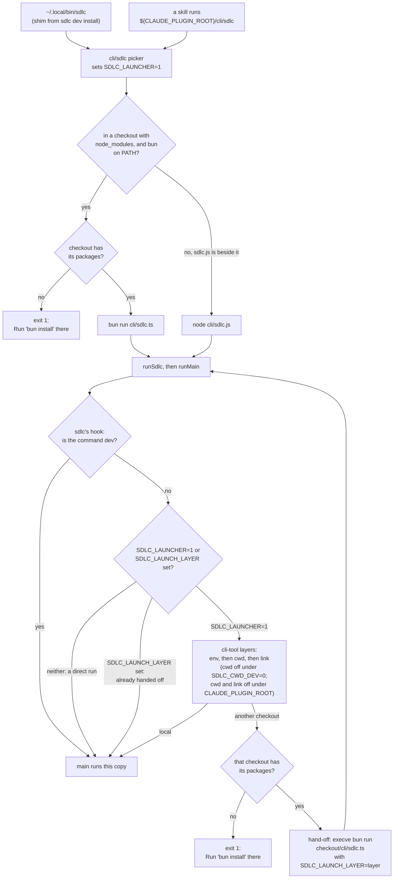

Every time you type `sdlc`, it first decides which copy of sdlc should run. This page explains how
it decides, where sdlc differs from the other cli-tool CLIs, and the tasks you will do with it.
It is the worked example for [A tool with its own entry script](./launch-order.md#a-tool-with-its-own-entry-script).
sdlc lives in [sksizer/dev](https://github.com/sksizer/dev), and the paths below are in that
repository. Short ones, such as `lib/…` and `cli/sdlc`, are under `solutions/ontological/`.

## The short version

sdlc checks these layers in order. The first one that names a checkout wins.

| Order | Layer | Set by | Turned off by |
|---|---|---|---|
| 1 | `env` | `SDLC_HOME=/path/to/checkout` | no switch; `CLAUDE_PLUGIN_ROOT` does not turn it off |
| 2 | `cwd` | standing inside an sdlc checkout | `SDLC_CWD_DEV=0`, or `CLAUDE_PLUGIN_ROOT` set |
| 3 | `link` | `sdlc dev link <checkout>` (stored in `~/.config/sdlc/home`) | `sdlc dev off`, or `CLAUDE_PLUGIN_ROOT` set |
| 4 | `project` | not used by sdlc yet | — |
| 5 | `local` | nothing matched: the copy you started runs | — |

No layer applies at all to `sdlc dev …`, to a direct run (`bun cli/sdlc.ts`), or to the compiled
binary. Those always run the copy you started.

When a layer names another checkout, sdlc hands the run to that checkout's `cli/sdlc.ts` under bun.
It prints one line to stderr first:

```text
sdlc: running /path/to/checkout/solutions/ontological/cli/sdlc.ts (linked checkout)
```

`sdlc --where` says which copy ran and why:

```text
sdlc 0.18.0
file      /path/to/checkout/solutions/ontological/cli/sdlc.ts
from      checkout /path/to/checkout
chosen by this checkout (no devlink layer selected another)
```

The copy that runs answers `--where`, after any hand-off. A checkout older than
[sksizer/dev#3893](https://github.com/sksizer/dev/pull/3893) does not know `--where` and prints its help.

## One run, step by step



1. **The shim.** `sdlc dev install` writes `~/.local/bin/sdlc` for the copy that ran it. The shim
   runs that checkout's `solutions/ontological/cli/sdlc`.
2. **The picker.** `cli/sdlc` is a bash script. It picks a runtime for its own copy only:
   - In a checkout that has `node_modules`, with `bun` on an absolute PATH entry, it runs the
     source, `cli/sdlc.ts`, under bun. It checks the packages first.
   - Otherwise, if the built `sdlc.js` sits beside it (a plugin pack, or a fresh clone), it runs
     that under node.
   - It sets `SDLC_LAUNCHER=1`, so the next step knows the picker ran.
3. **`runSdlc`.** The entry calls cli-tool's `runMain` with sdlc's hook, `sdlcDevlink`
   (`lib/services/dev/launch.ts`). `runMain` calls the hook before anything else, even before
   `--version` and `--where`.
4. **sdlc's hook.** It reads and deletes `SDLC_LAUNCHER`, then:
   - `sdlc dev …`: runs this copy, so sdlc's own `dev` ops answer.
   - Neither `SDLC_LAUNCHER=1` nor `SDLC_LAUNCH_LAYER` is set: a direct run, such as
     `bun cli/sdlc.ts`. No layer applies.
   - Otherwise it checks the packages of any checkout a layer would hand off to, then calls
     cli-tool's hook.

   On every path that goes on to run `main`, it stores the layer that chose this copy
   (`setLaunchLayer`).
5. **cli-tool's hook.** If `SDLC_LAUNCH_LAYER` is set, this process is a hand-off, so it runs its
   own code. It deletes the variable, so a process this run starts decides for itself. If not, it
   walks the layers.
6. **The hand-off.** On macOS and Linux it replaces the process with `process.execve`. The new
   process gets `SDLC_LAUNCH_LAYER=<layer>`. Under bun it uses the bun that is already running.
   Under node it uses the first `bun` on an absolute PATH entry. Where `execve` is missing (Windows,
   Node before 22.15) it starts a child with `spawnSync` and exits with its code.
7. **`main`.** The copy that runs does its work. The orchestrator reads the stored layer with
   `launchLayer()` and records it for each loop process.

## The four ways sdlc runs

| Way | Entry | Runtime | Layers that apply | `--where` says |
|---|---|---|---|---|
| Dev checkout | the shim, or `<checkout>/solutions/ontological/cli/sdlc` | bun, on the source `cli/sdlc.ts` | env, cwd, link | `from checkout …`; `chosen by` names the layer |
| Plugin pack | `${CLAUDE_PLUGIN_ROOT}/cli/sdlc` | node, on the built `cli/sdlc.js` | env only, since a skill runs it with `CLAUDE_PLUGIN_ROOT` set | `file …/cli/sdlc.js`; `chosen by this install (no devlink layer selected another)` unless `SDLC_HOME` is set |
| Compiled binary | the `sdlc` binary from `scripts/build-binary.ts` | the binary itself | none | `file … (compiled binary)`, and no `chosen by` line |
| npm install (planned, [D-0014](https://github.com/sksizer/dev/blob/main/docs/planning/decisions/D-0014-cli-primary-npm-distribution.md)) | `@sksizer/sdlc`'s `bin/sdlc.js`, a Node shim from `@osdlc/npm-binary` | node, which runs the compiled binary for your platform (`@sksizer/sdlc-<os>-<arch>`) | none, because it runs the compiled binary | as for the compiled binary |

A direct run (`bun solutions/ontological/cli/sdlc.ts`, `node cli/sdlc.js`) applies no layer either.
`--where` then says `chosen by run directly, not through cli/sdlc, so no devlink layer applies`.

## What sdlc does differently

The other cli-tool CLIs (`way`, `dfv`, `family` and the rest) use cli-tool's hook as it is. sdlc
wraps it.

| Difference | Why |
|---|---|
| Its own entry picker, `cli/sdlc` | The source uses `@lib/` path aliases that only bun or the build resolve. Skills call `${CLAUDE_PLUGIN_ROOT}/cli/sdlc` without naming a runtime, so the picker chooses bun or node. |
| The cwd layer is on | Working inside an sdlc checkout runs that checkout's code without a link. Only an sdlc checkout has the marker file, `solutions/ontological/cli/sdlc.ts`, so another repository cannot be picked. |
| Its own `dev` ops | `sdlc dev …` runs sdlc's ops (`install`, `link`, `off`, `use`, `status`, `history`), always in the copy you invoked, not cli-tool's built-in `dev`. |
| The node_modules check | A checkout without its packages would fail on the first import, far from the cause. sdlc names the checkout and says `Run 'bun install' there`. cli-tool's hook does the same from the release after 0.14 ([#592](https://github.com/osdlc/osdlc/pull/592)); sdlc keeps its copy until it takes that release. |
| The hand-off uses the running bun | The first `bun` on PATH can be a proto shim, which refuses to start bun a second time. That breaks the hand-off. cli-tool does the same from the release after 0.14 ([#592](https://github.com/osdlc/osdlc/pull/592)); sdlc keeps its copy until it takes that release. |
| A direct source run skips the layers | Without it, sdlc's tests ran the user's linked checkout. A script or test runs the file it names. |
| The launch layer is stored for the orchestrator | cli-tool deletes `SDLC_LAUNCH_LAYER` once it reads it. The orchestrator needs the layer later, to tell installed code (`local`) from dev code. |
| No project layer yet | cli-tool finds a checkout by the package name at its root. sdlc's root is the monorepo's, so sdlc sets no `packageName`. |
| The compiled entry skips the hook | A release binary is a fixed build, and runs its own code. |
| A hand-off costs more | About 0.40 s, against 0.25 s with the old bash launcher. The first process loads sdlc's modules before it hands off. |

The open decisions on these points are in [B-01](../planning/backlog/B-01-one-launch-pattern.md).

## Common tasks

| Task | Do this |
|---|---|
| Put a checkout's sdlc on PATH | Run that checkout's own picker: `<checkout>/solutions/ontological/cli/sdlc dev install`. It writes `~/.local/bin/sdlc` for the copy that ran, since `dev` commands never hand off. |
| Test a dev checkout everywhere | `sdlc dev link <checkout>`. Every `sdlc` on this machine runs it until you undo it. |
| Test a dev checkout in one shell | `export SDLC_HOME=<checkout>`. It wins over the cwd and link layers. |
| Undo a link | `sdlc dev off`. `sdlc dev history` lists past links; `sdlc dev use '#n'` picks one again. |
| See what will run | `sdlc dev status` before a run, `sdlc --where` for the run itself. Add `--json` to `--where` for a script. |
| Silence the `running …` line | `SDLC_QUIET=1`. |
| Turn off the cwd layer | `SDLC_CWD_DEV=0`. Inside a checkout, the link or `SDLC_HOME` then decides. |
| Know what a skill runs | A skill runs the pack's `cli/sdlc` with `CLAUDE_PLUGIN_ROOT` set. That turns off the cwd and link layers, so a machine-wide link never changes the code a skill runs. Only `SDLC_HOME` can. |

## Links

- [Launch order](./launch-order.md): cli-tool's full reference for the layers.
- [B-01](../planning/backlog/B-01-one-launch-pattern.md): the open decisions for one launch pattern.
- [sksizer/dev#3893](https://github.com/sksizer/dev/pull/3893): sdlc on `runMain`.
- [sksizer/dev#3901](https://github.com/sksizer/dev/pull/3901): sdlc's layers moved into the process.
- [#580](https://github.com/osdlc/osdlc/pull/580): cli-tool 0.14, the `execve` hand-off and
  the project layer.
