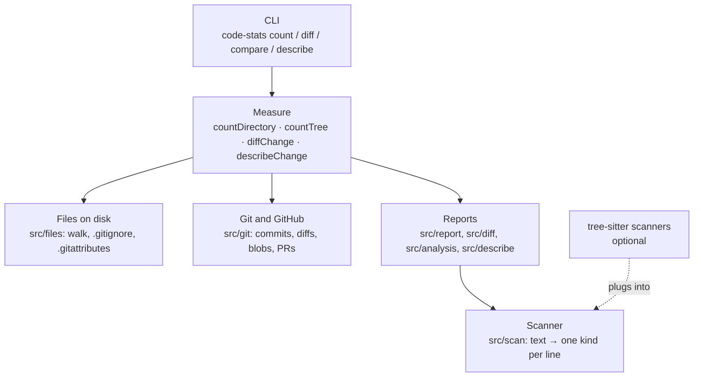

## The layers

Each layer only knows the ones below it:

- **Scanner** (`@osdlc/code-stats/scan`): pure functions. Text and a path go in, and one kind per
  line comes out. It reads no file and runs no process, and a test keeps it that way.
- **Reports**: they turn files, or a unified diff plus both sides' files, into a report. They are
  pure too: the caller supplies the content. This is where operations (added, changed, moved),
  file groups, change categories, API delta, complexity and the package map are worked out.
- **Files on disk** (`src/files`): it lists and reads a directory, applying `.gitignore` and
  `.gitattributes`. It never runs git. A test checks it imports nothing that does, apart from
  typed-git's `checkoutRoot`, which finds the repository's top from the `.git` entry on disk;
  another test proves that starts no process.
- **Git and GitHub** (`src/git`): it resolves revisions and pull requests, reads diffs and
  file contents at a commit, and edits PR descriptions. It is the only layer that runs `git` or
  `gh`, and it does so through `@osdlc/command-seam`.
- **Measure** (`src/measure.ts`, `src/files/count.ts`): it wires a source to the reports. Each
  public function names its source: `countDirectory` reads disk, and `countTree` and the change
  functions read git. For uncommitted work (`--worktree`) the change functions read the new
  side from disk, and `describeChange` reads the manifests there too. The report builders
  (`buildCountReport`, `buildDiffReport`) read nothing: the caller passes the content.
- **CLI** (`src/cli`): each command is declared once with
  [`@osdlc/cli-tool`](https://github.com/osdlc/osdlc/tree/main/packages/ts/cli-tool)'s
  `defineCommand`: its flags, its arguments and the zod schema of its output. `defineApp` parses
  the command line, calls one measure function, and prints the report as Markdown or, with
  `--json`, as JSON. It also adds `help` and `schema`, and turns errors into exit codes.

## Where git comes in

Git is needed only to read history: a commit, a diff, a pull request. Counting files on disk
reads `.gitignore` and `.gitattributes` itself, so it gives the same answer whether or not git
is installed. That matches scc, tokei and cloc, which count what is on disk.

When a history command runs without git, or outside a repository, it fails with a
`needs-git` error, and the CLI says which commands need git and that `count` does not.

## Why the numbers can be trusted

- **Deterministic:** no model, no network beyond `gh` for pull requests, and the same input gives
  the same report.
- **Counted like the familiar tools:** per line, as cloc, tokei and scc count, and a line with
  both code and a comment counts as code.
- **A table you can check:** comment and string syntax for 366 languages comes from scc's
  `languages.json`, vendored and pinned by its sha256. `pnpm run languages:check` fails if the
  generated table drifts from it.
- **Checked against a real parser:** across 1.5 million lines of TypeScript, JavaScript, Rust
  and Python in the repository code-stats was developed in, the table-driven scanner and the tree-sitter scanners disagree
  on 8.
- **Checked against git:** in the same repository, the files `count` lists from disk are the files
  `git ls-files` lists, apart from 8 committed despite a `.gitignore` rule. The linguist
  attributes it reads match `git check-attr` for all 1,640 files that set one.

Some parts are heuristics, documented so a surprising number can be traced: what counts as
boilerplate, how changed lines pair up, move detection and the `formatting` category. See
[Changes](./changes.md#moved-and-edited) for what pairing a moved and edited block can and
cannot do.

## Other tools

How code-stats compares with scc, tokei, cloc, GitClear and the rest, what it borrows from each,
and when to use them instead, is in [Tool comparison](./tool-comparison.md).

## Design records

The decisions behind the design are in [D-K7CS][d-k7cs].

[d-k7cs]: https://github.com/osdlc/osdlc/tree/main/packages/ts/code-stats/docs/planning/decisions/D-K7CS-line-kinds-operations-and-file-groups.md
