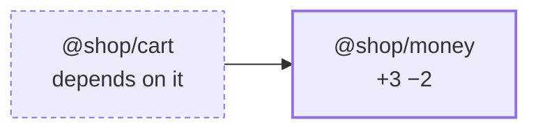

`code-stats describe` writes a pull request description: prompts for the parts only the author
can write, plus three generated blocks. It needs git, and a PR number needs `gh`.

```sh
code-stats describe 123            # print a description for PR 123
code-stats describe 123 --write    # put it into PR 123
code-stats describe main...HEAD    # any change, printed
```

Nothing in it comes from a model. The generated blocks are facts read from the change, and the
prose is left to you.

## The shape

```markdown
## Summary
<!-- What this change does, in plain language: the outcome, not the steps. -->

## Why
<!-- The problem it solves, or what it unblocks. -->

## Changes
<!-- The notable changes, in the order a reviewer should read them. -->

## Change statistics
(generated: the `code-stats diff` table)

## Packages
(generated: a map of the packages the change touches)

## Testing
<!-- What you ran, and what it showed. -->

## Risk
(generated: facts a reviewer should weigh)
<!-- Anything else a reviewer should weigh: rollout, migration, what could break. -->
```

The prompts are HTML comments, so they are invisible on GitHub until you replace them with
text.

## Packages

A [Mermaid](https://mermaid.js.org/) flowchart of the packages the change touches, with the
packages that depend on them directly. For a monorepo where `@shop/cart` depends on
`@shop/money`, and `@shop/web` on `@shop/cart`, a change to `@shop/money` draws this:



| Package | Directory | Files | Added | Removed | Logic lines |
| --- | --- | ---: | ---: | ---: | ---: |
| `@shop/money` | `packages/money` | 1 | 3 | 2 | 3 |

`@shop/web` is not drawn, because it depends on `@shop/money` only through `@shop/cart`.

- Packages are directories holding a `package.json` or `Cargo.toml`, read by
  [`@osdlc/system-model`](https://www.npmjs.com/package/@osdlc/system-model) (its `./build` entry) at the change's head commit, so the
  map is the PR's own wherever you run it. Uncommitted work (`--worktree`), or a PR whose commits
  are not in your checkout, reads the working tree's manifests instead, leaving out git-ignored
  ones.
- A file belongs to the deepest package holding it. A file under no package belongs to the
  repository root.
- A package the change deletes keeps the name its manifest had before the change.
- A file renamed from one package to another counts in both.
- The repository root is never drawn as a dependent, since a workspace root depends on most of
  its packages.
- At most 24 boxes are drawn, the packages with most lines changed first, and the map says how
  many it left out.

## Risk

A list of facts, not verdicts, so your team decides what matters. For the change above:

```markdown
- Exported API removed or changed in 1 file(s), 1 of them a package entry point: `packages/money/src/index.ts`
- Source logic changed (3 lines) with no test file changed
```

The facts it can list:

- exported API removed or changed, and whether in a package's entry point;
- files that only add exports;
- dependencies added, removed or bumped, per manifest;
- deleted files;
- the net change in cyclomatic complexity, and the function whose complexity rose most;
- source logic changed with no test file changed;
- agent instruction files changed;
- generated files changed, which should have been regenerated rather than edited.

## How `--write` keeps your text

Each generated block sits between markers:

```markdown
<!-- code-stats:start --> … <!-- code-stats:end -->
<!-- code-stats:packages:start --> … <!-- code-stats:packages:end -->
<!-- code-stats:risk:start --> … <!-- code-stats:risk:end -->
```

- An empty description gets the whole template.
- A description with text gets only the three blocks. Each one replaces its old copy in place,
  or goes under its heading if the heading is there without the block. Otherwise it is added
  before any trailing HTML-comment lines other tools use as footers.
- Markers inside code fences are ignored, so a description that quotes a marker is safe.
- Windows line endings are kept.
- Running it twice changes nothing the second time.

So the usual flow is: run `describe --write` once, write the Summary, Why, Changes and Testing
yourself, and run it again after each push to refresh the numbers. `diff --write` refreshes only
the statistics block and leaves the other two alone.
