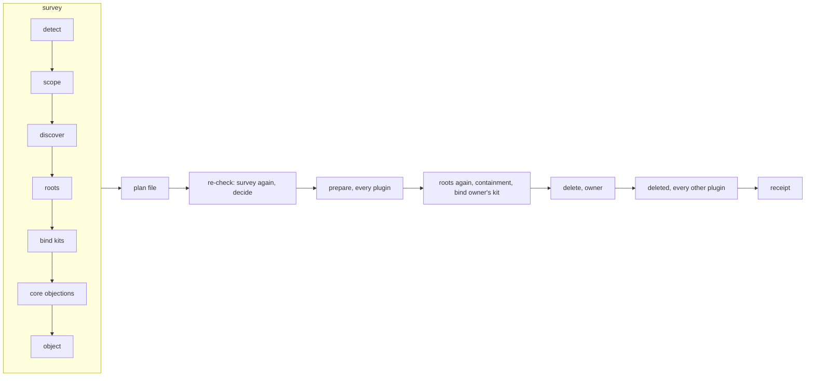

How `@osdlc/host-cleaner` is built today: the modules, one run from survey to
receipt, the rules the core applies to every plugin, and where the code still
differs from the design.

- The [README](../../README.md) says how to use the package and the command.
- The [system description](../../../../../docs/architecture/host-cleaner-system.md)
  is the whole design, descriptors and loadable plugins included, with
  decisions D1 to D15. This page describes the part built so far.
- [D-H3QW](../../../../../docs/decisions/D-H3QW-host-cleaner-plugin-model.md)
  records the plugin model. It replaced the adapter model of
  [D-L7N5](../../../../../docs/decisions/D-L7N5-host-cleaner.md), which is kept
  as history. [D-R8KM](../../../../../docs/decisions/D-R8KM-host-cleaner-v1-attended-only.md)
  records what the first version leaves out of it.
- The [plan](../../../../../docs/planning/host-cleaner-plan.md) orders the work;
  [#669](https://github.com/osdlc/osdlc/issues/669) tracks it.

repo-cleaner's own model (sweep, risks, fingerprint, archive, receipt) is in
its [README](../../../repo-cleaner/README.md). This page does not repeat it.

## What it is

A machine that runs coding agents fills up with things git cannot see: build
caches in every worktree, worktrees an app such as Orca keeps a record of, and
branches nobody needs. host-cleaner finds them, says what objects to deleting
each one, and deletes what a person approves, with one plan and one receipt.

It is a core and a set of **plugins**. A plugin proposes **candidates**
(things that could be deleted) and **objects** to candidates, its own or other
plugins'. The core decides what runs, checks again, and has each candidate's
owner delete it. It ships eleven code plugins: `git` (repo-cleaner), `cargo`,
`node`, `vscode`, `cursor`, `orca`, `docker`, `ollama`, `agent-history`,
`jetbrains` and `toolchains`, and one plugin per descriptor in `descriptors/`.
It runs only when a person runs it.

## Modules

| File | What it holds |
| --- | --- |
| `src/index.ts` | The main entry (`exports['.']` in `package.json`): re-exports, from the files below, the contract, the phase runner, the plan and receipt, `containedIn` and `PERSONAL_FOLDERS`, the kit, and every built-in plugin with `BUILT_IN_PLUGINS`. |
| `src/types.ts` | The contract: `Candidate` (a path or a ref), `Objection`, `Plugin` and its hooks, `definePlugin`, `PluginInit`, `PLUGIN_API`. |
| `src/run.ts` | The phase runner: `survey`, `plan`, `decide`, `recheck`, `clean`; hook time limits; the core's own objections; nesting. |
| `src/roots.ts` | Containment: `containedIn`, `boundBy`, `linkedCheckouts`, `linkedWorktreeOf`; which roots a plugin may have: `rootProblem`, `acceptRoots`. |
| `src/kit.ts` | The plugin kit: `pluginKit`, the helpers, and the binding the core does each run. |
| `src/plan.ts` | The plan and receipt schemas (plan version 2, receipt version 1). A plan of another version, or one the schema refuses, such as one without `targetsGiven`, is refused with an error that says to sweep again (D15). |
| `src/builtins.ts` | `BUILT_IN_PLUGINS`: the code plugins in run order (`git`, `cargo`, `node`, `vscode`, `cursor`, `orca`, `docker`, `ollama`, `agent-history`, `jetbrains`, `toolchains`). |
| `src/registry.ts` | The plugins a run knows (built in, loaded from a package, or made from a descriptor), each by one name, and `--plugin` / `--skip-plugin`. |
| `src/load.ts` | Code plugins loaded from the packages the config names. |
| `src/descriptor/` | Descriptors: the schema, where they are found, their variables, and the engine that makes each a plugin. |
| `src/settings.ts` | Each plugin's settings schema made strict, with the core's `enabled`; `idleHours` inheritance. |
| `src/config.ts` | The config file and the three folders (see [Files](#files)). |
| `src/ignore.ts` | The machine-wide `ignore` list. |
| `src/git.ts` | The `git` plugin over repo-cleaner's `candidatesOf` and `removeCandidate`. |
| `src/artifacts.ts`, `src/cargo.ts`, `src/node.ts` | Build caches: `cargo` and `node` over the shared walk in `artifacts.ts`. |
| `src/orca.ts` | The `orca` plugin. |
| `src/vscode.ts` | The `vscode` and `cursor` plugins, one code over each editor's folders. |
| `src/docker.ts`, `src/ollama.ts`, `src/agent-history.ts`, `src/jetbrains.ts`, `src/toolchains.ts` | The `docker`, `ollama`, `agent-history`, `jetbrains` and `toolchains` plugins. |
| `src/helpers.ts` | What the core and the plugins share: wording, objections, and the check a plugin makes again right before it deletes. |
| `src/cli.ts`, `src/bin.ts` | The `host-cleaner` command: `status`, `plan`, `clean`, `config`, `plugins`. |
| `src/plugin.ts` | `@osdlc/host-cleaner/plugin`: what a code plugin is written with, `z` included. |
| `src/testing.ts` | `@osdlc/host-cleaner/testing`: fakes and the contract suite. |

The package depends on its siblings as `workspace:^`: repo-cleaner,
command-seam (every program it runs), typed-git, path-guard, config-layers,
cli-tool and ux, plus zod. It is private until it is renamed and released
(k-rename, k-release1 in the plan).

## One run



1. **detect.** Each plugin says whether it applies: `true`, `false`, or
   `{ active, note }`. The survey keeps every note, whether the plugin runs or
   not (`Survey.notes`); `status`, `plan` and `clean` print each as the
   warning `<plugin>: <note>`, `status --format json` and `clean --format
   json` carry them under `notes`, and `plugins` shows it after the plugin's
   state. A throw, a time-out, or any other answer leaves it out with a
   warning; under `plugins` the error is the row's reason instead, with no
   warning. A `FatalRun` that `detect` throws stops the run. Every hook's
   `ctx.targetsGiven` says whether the targets were given (on the command
   line or in the config) or the core fell back to the current folder.
2. **scope.** Plugins add targets: `orca` adds the repositories Orca lists.
3. **discover.** Each plugin proposes candidates. The core drops, with a
   warning, a candidate whose owner is not the plugin proposing it, one that is
   misshapen (both or neither of a path and a ref, a path with an `at`), one
   with an unknown `costDescription`, and the second of two with the same id or
   the same real path (the earlier plugin's stands, D1). Candidates in an
   `ignore` folder are left out.
4. **roots.** Each plugin names the folders it may delete in besides the
   targets: a path, or `{ path, self: true }` when the folder itself may be a
   candidate. The core leaves out, with a warning, an entry that is neither and
   every root it refuses; the README lists those under
   [paths, refs and containment](../../README.md#paths-refs-and-containment).
   It asks after `discover`, so a plugin may root what it found: `git`
   declares a worktree whose folder is gone, or left without its `.git`, as a
   self root, so its record can still be pruned. It then binds every plugin's kit to its accepted roots, the targets and
   their linked worktrees.
5. **core objections.** `lost` gets a `discard-user-data` protest and is held;
   `unmeasured` gets an `unmeasured` protest; a path outside its owner's bounds
   is refused `outside-roots`. All are by `host-cleaner`.
6. **object.** Each plugin objects to any candidate. A throw refuses every
   candidate with `plugin-error`; `FatalRun` stops the run. An objection a
   plan would refuse (an unknown level, a reason that is not a string)
   refuses its candidate with `plugin-error` instead, with a warning.
7. **decide.** `refuse` blocks, `protest` needs `--allow <code>`, `note` does
   not gate. Held candidates need a pick. Spared ones are dropped.
8. **re-check.** At `clean`, the core surveys again and decides again. A
   candidate now refused is `blocked`, a protest not granted is
   `not-allowed`, a vanished one is `gone`, one whose evidence moved is
   `changed`.
9. **prepare, delete, deleted.** Per candidate, inner ones first: `prepare`
   on every plugin (a throw stops that candidate, `FatalRun` the run); for a
   path, the owner's `roots` again, containment on the real path, and the
   owner's kit bound to exactly those bounds; `delete` by the owner; then
   `deleted` on the others, best effort.

Plugins run one at a time, in the order given. Every hook may return a
promise. Each call has a limit and its own `ctx.signal`, which is aborted
when the limit passes (D2). The limit is the plugin's own for that hook when
it sets one in `limits` (`git`, `cargo` and `node` give `discover` 10
minutes), else 30 seconds, or 10 minutes for `delete`. An answer past the
limit is dropped, except `delete`'s, which counts: it has deleted by then.

## Rules every plugin is held to

### Containment

Every check of a path candidate goes through one function, `boundBy(bounds,
path)` in `src/roots.ts`. It runs at the survey, right before `delete`, and in
`kit.remove`. On real paths, through `@osdlc/path-guard`, a path is inside
when:

1. it sits strictly inside one of its owner's roots, a target, or a linked
   worktree of a repository a target sits in (`Survey.linked`), or it is one
   of its owner's self roots, not a link, that still passes the root checks;
   or
2. it is one of those linked worktrees (a target itself never is); or
3. failing both, `linkedWorktreeOf(targets, path)` finds that it is, or sits
   inside, a linked worktree whose main checkout is or sits inside a target.

The third rule is the owner's decision on linked worktrees: accept one by its
main checkout. With `targets: ["~/dev"]`, a worktree of `~/dev/app` kept in
`~/worktrees/x` is inside. For that rule, git's top-level folder must differ
from its main checkout (typed-git's `mainCheckout()`, from
`--git-common-dir`), and the worktree must be one `git worktree list` gives
for its repository. So a copied `.git` file, or a worktree moved away with a
symlink left behind, is refused. Nested repositories are looked through on
the way up. git runs only for a path that rules 1 and 2 do not already hold.

By rules 1 and 2 too, a linked worktree whose folder has become a link is no
longer one (`stillLinked`).

Still refused: a main checkout outside every target, a worktree of such a
repository, and any plain folder outside. A ref gets no folder checks; the
core never removes a folder for one.

### Nesting

A path candidate with other path candidates inside it, by real path, gets
them added to its `requires`, so the inner ones go first: `cargo`'s `target/`
before the git worktree that holds it.

The owner's decision on nesting: an outer candidate is still blocked when any
inner one does not run, since deleting it would delete the inner one too.
What changed is that it says why. Its `blocked` detail lists each such
requirement as `requires <id>, which <why>`, joined by `; `. The words are the
same at the re-check, which decides over a new survey:

| `<why>` | When |
| --- | --- |
| `needs --pick <id> when the plan is made` | the inner one is held, or not selected, as one no plugin proposed when the plan was made |
| `needs --allow <codes>` | it carries a protest not granted |
| `needs --pick <id> --allow <codes> when the plan is made` | both |
| `is refused (<by>: <reason>)` | something refuses it |
| `is spared (--spare <entry>)` | a `--spare` matched it |
| `is gone` | no plugin proposes it now, or it is in an `ignore` folder, which a survey leaves out |
| `is <reason>: <detail>` | its own dropped entry: `is blocked: requires …` down a chain, `is blocked: its requirements form a cycle`, or, at the re-check, `is changed: its evidence moved since the plan` |
| `does not run` | none of the above applies: it is selected and has no dropped entry, yet does not run |

A saved plan takes no `--pick` at `clean --plan`, so `when the plan is made`
sends the pick to `plan`, or to `clean` without `--plan`.

The detail shows in the clean preview (text and JSON), in the receipt, and in
the `clean -i` checklist as a ` (blocked: …)` suffix. A step skipped because a
requirement failed during the run says `requires <id>, which did not
complete`. The merged-worktree case is tested with real git and the real
`cargo` plugin: the worktree is blocked with `requires artifact:…/target,
which needs --allow unmeasured`, and with `--allow unmeasured` the
`target/`, the worktree and its branch are deleted in that order.

### What deleting costs, and what could not be measured

`costDescription` is `re-download`, `rebuild` or `lost` (D8). A `lost`
candidate is held and gets a `discard-user-data` protest. A candidate whose
idle time ran out of the kit's budget sets `unmeasured: true`, gets an
`unmeasured` protest (D11), and keeps the flag out of `evidence`, so a later
walk that finishes does not read as `changed`.

### Plain JSON

Candidates and objections hold only what JSON keeps (D14), so a plan written
to a file reads back, and a stdio bridge for other languages stays possible.

## The plugin kit

`definePlugin({ name, api: PLUGIN_API, settings, create })` is one value per
plugin (D3). `create` gets the plugin's settings, validated and with defaults
filled in, the environment, and a kit made for it (D4). The kit holds the
helpers the shipped plugins use: `idle`, `size`, `running`, `onPath`,
`candidate`, `run` and `remove`, and `owner`, the plugin's name. The README's
[plugin kit](../../README.md#the-plugin-kit) section lists each one.

Binding is how `kit.remove(path)` knows where it may delete without being
told. The core binds a kit after the plugin's `roots` hook answers at the
survey, and again to the roots it fetches right before each `delete`. The
setter is not on `Kit`, so a plugin cannot widen its own bounds. Given
`delete`'s `ctx`, `kit.remove` holds to that call's bounds, even while another
run binds the same plugin. `clean` unbinds every kit when it is over. A kit no
run has bound removes nothing, so a plugin's `delete` is tested through
`survey` and `clean`, or `contractSuite`.

`cargo.ts` and `node.ts` import nothing from host-cleaner but the kit, the
types, `helpers.ts` and their shared `artifacts.ts`. `artifacts.ts` is not built as an
outside plugin would be: it imports `@osdlc/path-guard`, `@osdlc/typed-git`
and `@osdlc/command-seam`, and calls the core's own `attachKit`, none of which
the public plugin entry (k-public-api) will offer.

## The plugins

| Plugin | Proposes | Objects | Deletes with |
| --- | --- | --- | --- |
| `git` | worktrees (paths) and local branches (refs, `at` the repository), from repo-cleaner's sweep | repo-cleaner's blockers as `refuse`, its risks as `protest` | repo-cleaner's `removeCandidate`; with the [`archive` option](../../README.md#the-git-plugin), an archive push first |
| `cargo` | `target/` with a `CACHEDIR.TAG`, idle for `idleHours`; `target/*/incremental` where incremental builds are off | a build running in the checkout, or an unreadable process table; a path leading out of its checkout | `kit.remove`, after reading the checkout again |
| `node` | `node_modules` of a linked worktree idle for `idleHours` | any busy process in the worktree | `kit.remove`, after reading the worktree again |
| `orca` | `orca-record` refs for records whose folder is gone, held | notes, `orca-agent-active`, `orca-terminal-unverifiable`, `close-terminals`, `orca-unreachable` on `git`'s worktrees | `orca worktree rm` on a record; `prepare` closes terminals, `deleted` forgets the record after `git` removed the folder |

What `orca` does while Orca is installed but cannot be asked is in the
README's [orca plugin](../../README.md#the-orca-plugin) section; `detect`
still answers active, with the reason as its note.

## Command line

`status`, `plan`, `clean`, `config` and `plugins`, in repo-cleaner's words
(`--pick`, `--spare`, `--allow`, `-i`). What each command and flag does is in
the README's [command line](../../README.md#command-line).

`plugins` runs `detect`, `scope` and `roots` and nothing else (`inspect` in
`src/run.ts`), with the same limits and the same root checks as the survey.
With no `discover`, a root a plugin takes from what it found (git's gone
worktrees) shows in `status` and not here. It
prints `targets: <targets>`, `ignoring: <paths>` when there are any, then one
line per plugin:

```text
  <name>  <source>  <state>[: <reason>][; note: <note>]
```

- `<source>` is `built-in` or `given`; the README's
  [which plugins run here](../../README.md#which-plugins-run-here) says which.
- `<state>` is `disabled`, `not detected`, or `detected; roots: <roots>`. A
  self root is followed by ` (itself too)`; a plugin with no roots reads
  `none, the targets alone`, followed by why in brackets when its `roots`
  threw or timed out, or the core refused every root it gave.
- `<reason>` says why it does not run: the config disables it, or `detect`
  threw, timed out, or answered something that is neither a boolean nor
  `{ active, note? }`.
- `<note>` is the note `detect` gave, shown whether the plugin is detected or
  not. So a degraded plugin, one that answers `{ active: true, note }`, reads
  `detected; roots: …; note: <note>`.

A refused root is left out with the warning `<plugin>: roots: left out the
root <path>: <why>` on stderr. The JSON form is in the README's
[which plugins run here](../../README.md#which-plugins-run-here).

### Files

The folders are `@osdlc/tiered-dirs`' `standalone('host-cleaner')` tier under
its default `native` convention, so macOS uses `~/Library` folders;
`HOST_CLEANER_CONVENTION=xdg` gives it the Linux ones. The README's
[Files and config](../../README.md#files-and-config) lists each folder and the
variables that move it.

## Owner decisions

Decided since the system description was written, and built. Each is
described above where it applies.

| Decision | Where |
| --- | --- |
| Linked worktrees count by their main checkout | [containment](#containment), rule 3 |
| An outer candidate says which inner one blocks it | [nesting](#nesting) |
| Detect notes, kept for every plugin | [one run](#one-run), step 1; `orca` uses one while Orca cannot be asked |
| `ctx.targetsGiven`, kept in the plan | [one run](#one-run), step 1; [modules](#modules), `src/plan.ts` |
| Self roots, `{ path, self: true }` | [one run](#one-run), step 4 |
| `kit.running({ name })` matches a word of each command line | the README's [plugin kit](../../README.md#the-plugin-kit) table |

The later plugins use them: `vscode` decides what to do with a
`workspaceStorage/<hash>/` folder that holds Copilot chat sessions,
`toolchains` reads `targetsGiven` to choose which toolchains to propose, and
the descriptor engine declares whole-folder stores such as `~/.npm` as self
roots and checks `inUse.processes` with `kit.running({ name })`.

## Where the code differs from the system description

| Topic | The design | The code |
| --- | --- | --- |
| `detect` | does this plugin apply? | may also answer `{ active, note }` (owner's decision) |
| `ctx` | `ctx.signal` | also `targetsGiven` (owner's decision) |
| `roots` | folders the plugin may delete inside | also `{ path, self: true }`, where the folder itself may be a candidate. The core checks any plugin's root ([one run](#one-run), step 4), where the design checks only descriptor paths (owner's decision) |
| `kit.run`, `kit.running` | `kit.run(argv)`, `kit.running(name)` | `kit.run` requires `opts.signal`; `kit.running` requires `ctx` and takes a program's name, as a string or `{ name }` (owner's decision), or `{ in: folder }` |
| `kit.idle` | how long since anything changed | returns `{ unmeasured: false, newestMs, hours }` or `{ unmeasured: true }` |
| Kit helpers | the design's list | adds `kit.size` and `kit.owner`; `kit.remove` takes an optional `ctx` |
| Binding | a per-call argument | per-kit state the core sets each run |
| Contract suite | checks that `delete` returns a sentence | does not check that `delete` returns one. For `cargo` and `node`, the escaped delete is refused by their own re-check before `kit.remove` is reached. |
| Nesting | an inner refusal refuses the outer (D1) | any inner candidate that does not run blocks the outer, and the reason names it (owner's decision) |
| Folders | the `xdg` convention on every OS (D5) | tiered-dirs' default `native` convention, so macOS uses `~/Library` unless `HOST_CLEANER_CONVENTION=xdg` is set; k-xdg (#1018) |
| Unknown plugin names | a name no plugin has, without `package`, is a warning | not a warning: the README's [files and config](../../README.md#files-and-config) says what a name in the config does, and its [command line](../../README.md#command-line) what one in a plan does; k-unknown (#1020) |
| `clean --archive` | not named; the plan adds it as k-archive (#1021) | not offered; see the README's [`git` plugin](../../README.md#the-git-plugin); k-archive (#1021) |
| Containment | inside the plugin's roots or a target (D10) | also inside a linked worktree of a target's repository, or one whose main checkout is in a target, and a self root itself (owner's decisions) |

## Out of the first version

Recorded in host-cleaner's backlog so they can come back (the first is decided
in [D-R8KM](../../../../../docs/decisions/D-R8KM-host-cleaner-v1-attended-only.md)):

- [B-0001](../planning/backlog/B-0001-unattended-cleaning.md): `clean --auto`,
  `schedule` (a launchd agent), the `unattended` candidate field, profiles,
  and the `claude-code` plugin with its `close-session` risk.
- [B-0002](../planning/backlog/B-0002-root-only-stores.md): stores that only root
  can clean, such as APT, pacman and Snap.

## Open

Not decided. Each is written as open, not answered here.

- **The Orca forget spike** (D-H3QW, q-orca-forget). The `orca` plugin calls
  `orca worktree rm --worktree id:<id> --force` in `deleted`, after `git`
  removed the folder, and never while the folder exists. Whether a live Orca
  forgets a record whose folder is already gone, and whether `orca worktree
  ps` lists such a record, has not been checked against a running Orca (#988
  tested it with fakes only). If it does not, a plugin may need to take over
  the deletion, and D-H3QW reopens.
- **`PluginInit.only`.** The git kinds `--worktrees` and `--branches` leave
  are still passed to every plugin's `create`. Whether that stays in the
  public contract is left to a later task.
- **The package name.** The owner chooses it (k-rename, #1032); the package
  stays private until then.
- **`discard-archived`.** repo-cleaner's cover for archived work is not
  offered through host-cleaner yet; the named risks must be granted.
- **Archive refs.** From D-L7N5, still open: where archive refs go on a remote
  that rejects new branches, and how long they live.
