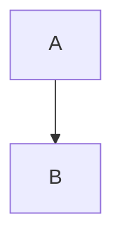

# Heading One

## Heading Two ^blockid

Paragraph with [[Note]], [[Nowhere]], [[Site]], #tag, #a/b, ==highlight==,
%%comment%%, `inline code`, $x^2$, and a footnote[^1].

[^1]: The footnote body.

- [ ] unchecked task
- [x] checked task
- plain item

1. ordered
2. list

> [!warning]+ Foldable callout
> body text

> [!note] Plain callout
> body

> [!DANGER]
> untitled, uppercase type

> plain blockquote

| a | b |
|---|---|
| 1 | 2 |

```ts
const x: number = 1
```



```base
filters: {}
```

$$
x^2 + y^2 = z^2
$$

![[Note]]

![[picture.png|300]]

![[Note#Heading Two]]

![[Note#^blockid]]


[link](https://example.com) and <https://autolink.example> and ~~struck~~.

---

<div align="center">raw html div</div>

<abbr title="x">abbr</abbr>

para ^blk2
