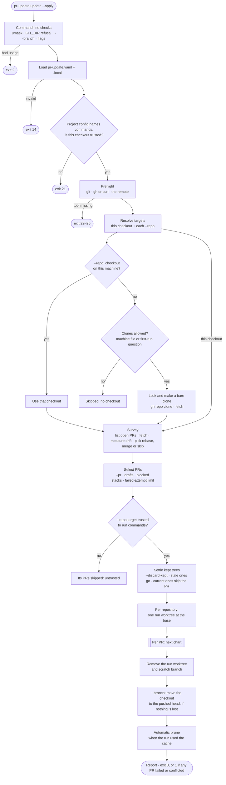
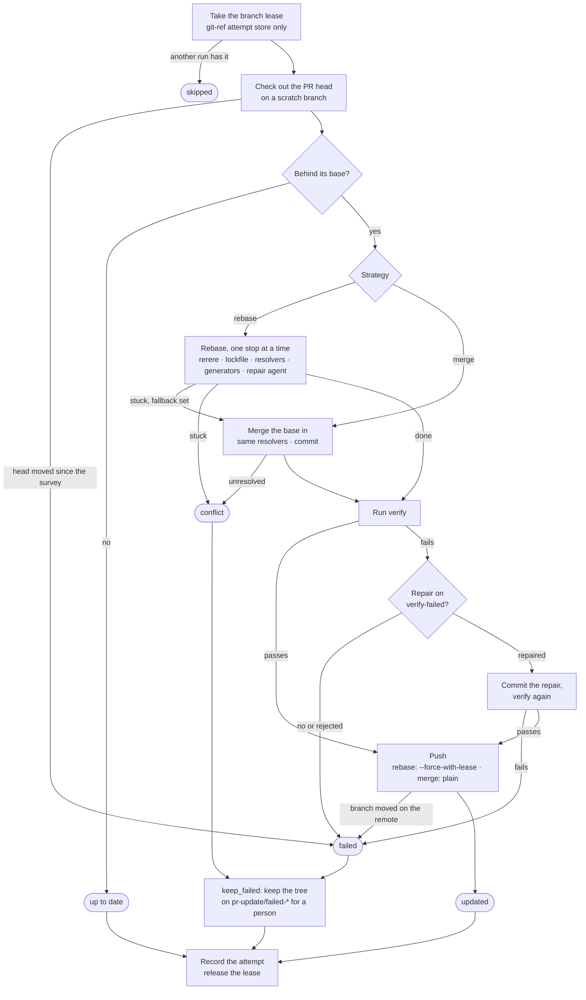

# How pr-update runs

pr-update brings open pull requests up to date with their base branch. For
each PR it rebases or merges, runs the verify command, optionally lets a repair
agent fix what broke, and pushes. This page follows `pr-update update --apply`
through the calls the code makes. It was mapped from the source at
`f5456df2`, not from the other docs; where the two disagreed, the code won and
the disagreement is listed under [Known problems](#known-problems).

File and line references are relative to `src/`.

## One run, start to finish

Without `--apply` the run goes through the same steps but pushes nothing,
keeps nothing and records nothing. It still makes worktrees, rebases or merges,
and runs resolvers and verify.

| Step | Where |
| --- | --- |
| Command-line checks | `cli.ts:161-179`, `preflight.ts:110-122`, `commands.ts:187-201`, `674-683` |
| Project config | `commands.ts:204-216`, `config-file.ts:46-72` |
| Project-root trust gate | `commands.ts:685-707`, `trust.ts:62-142` |
| Preflight | `commands.ts:399-414`, `preflight.ts:61-85` |
| Resolve targets, find checkouts | `survey.ts:671-737`, `992-1024`, `locate.ts:84-166` |
| Managed clones | `mirror.ts:778-1189` (`provide` `1042-1118`, `makeClone` `509-585`) |
| Survey | `survey.ts:1044-1257`, `strategy.ts:107-164` |
| Select PRs | `update.ts:165-285` |
| Per-target trust gate | `update.ts:719-730`, `trust.ts:151-203` |
| Settle kept trees | `update.ts:1140-1265`, `update/kept.ts` |
| Run worktree per repository | `update/execute.ts:1176-1228` |
| Cleanup of the run worktree | `update/execute.ts:1306-1318`, `update/registrations.ts` |
| `--branch` sync | `update.ts:511-533`, `869-881` |
| Automatic prune | `commands.ts:359-393`, `prune.ts:669-1142` |
| Report and exit code | `commands.ts:431-441`, `531-556`, `773-802` |

## Each pull request

A repair is accepted only if it did not move HEAD, create refs, give up, leave
conflict markers, or leave whitespace errors (`update/execute.ts:1061-1111`). A
failed attempt is recorded against the PR's head and base, so a PR that keeps
failing on the same commits is skipped next time unless `--retry-failed` is
given.

| Step | Where |
| --- | --- |
| Lease | `update/execute.ts:1230-1259`, `update/lease.ts` |
| Checkout and quick exits | `update/execute.ts:399-524` |
| Rebase through the resolvers | `update/execute.ts:561-652`, `update/resolvers.ts:102-131` |
| Merge | `update/execute.ts:670-773` |
| Verify and repair | `update/execute.ts:775-804`, `947-968`, `1061-1123`, `repair/` |
| Push | `update/execute.ts:806-898` |
| Keep a failed tree, record the attempt | `update/execute.ts:1266-1300`, `update/kept.ts:508-625`, `update.ts:835-845` |

## `survey` and `mirror`

`survey` runs the same target resolution and survey as `update`, with no trust
gate (it runs no project command) and no clone made. A clone it reads is locked
only for that read, without waiting; a busy clone is read without a fetch
(`mirror.ts:1120-1164`).

`mirror list` walks the clone folder and the run worktrees and changes
nothing. `mirror prune` removes dead run worktrees, leftover folders, and clones
past their age, with `--discard-kept` their kept trees too. Every removal first
passes one check: the owning clone lists it, its folder is safe, and the
clone's lock is held. Anything that cannot be read stays and is reported. The
automatic prune at the end of `update --apply` is `mirror prune` with no flags.

## Where each thing lives

Paths are the macOS and Linux defaults with no variable set.

| Thing | Where | Lasts |
| --- | --- | --- |
| Project config | `<checkout>/pr-update.yaml`, `pr-update.local.yaml` | the person's |
| Machine file (clone consent, clone folder, maximum age) | `~/.config/osdlc/pr-update/config.yaml` | the person's |
| Checkout search roots | `~/.config/osdlc/repositories.yaml` | the person's |
| Trust grants | `~/.local/state/osdlc/pr-update/trusted/` | until revoked |
| Managed clones | `~/.cache/osdlc/pr-update/repos/<host>/<owner>/<name>.git` | until pruned |
| Run worktrees | the project root: `.pr-update/<pid>.<ms>`; other targets: `~/.cache/osdlc/pr-update/worktrees/<host>/<owner>/<name>/` | the run |
| Kept trees | the project root: `.pr-update/failed/`; other targets: `~/.local/state/osdlc/pr-update/kept/<host>/<owner>/<name>/` | until discarded, retried, or the PR moves |
| Attempt records | `.pr-update/attempts/`, `~/.local/state/osdlc/pr-update/attempts/<host>/<owner>/<name>/`, or refs on the remote | until the PR succeeds, or 30 days |
| Branch lease | `refs/pr-update/lock/<head>` on the remote (git-ref store only) | one PR |

## Modules

Lines at `f5456df2`, against `main` before the clone-cache work. In total `src/`
went from 6,579 lines to 12,172.

| Area | File | Lines (on `main`) | Job |
| --- | --- | --- | --- |
| Entry | `bin.ts`, `cli.ts` | 21, 179 (127) | process entry, signal forwarding, command tree, umask |
| Commands | `commands.ts` | 806 (598) | `survey` and `update` commands, flags, the run environment, report, automatic prune, exit code |
| Config | `config.ts`, `config-file.ts`, `config-cli.ts` | 330, 72, 361 | the `pr_update` schema, layered loading, `config` commands |
| Preflight | `preflight.ts` | 122 (83) | tool and remote checks, the `GIT_DIR` refusal |
| Survey | `survey.ts`, `strategy.ts`, `code-host.ts` | 1,337 (896), 164, 87 (44) | targets, PR listing, fetch, drift, stack order, strategy |
| Update | `update.ts` | 1,367 (843) | the run: selection, grouping, trust, verify lists, kept trees, attempt routing, output |
| Executor | `update/execute.ts`, `update/resolvers.ts` | 1,361 (1,213), 151 | per-repository worktree loop, per-PR rebase, merge, verify, repair, push; also the target git environment |
| Records | `update/attempts.ts`, `update/ref-attempts.ts`, `update/lease.ts` | 118, 153, 118 | attempt stores and the branch lease |
| Kept trees | `update/kept.ts`, `update/registrations.ts` | 653 (204), 98 (new) | kept-tree records, checks, keep and discard; how a worktree is forgotten |
| Repair | `repair/agents.ts`, `repair/seat.ts`, `repair/prompt.ts` | 155, 97, 58 | headless agent, interactive and tmux repair, the prompt |
| Ports | `ports.ts`, `defaults.ts`, `index.ts` | 269 (179), 268 (158), 162 | the `Ports` contract, the standalone ports, library exports |
| Targets | `locate.ts`, `trust.ts`, `machine.ts` | 192 (new), 203 (127), 168 (new) | finding a checkout, trust gates, the machine file and directories |
| Clones | `mirror.ts`, `mirror-cli.ts`, `clone-maintenance.ts` | 1,189, 307, 44 (all new) | consent, locks, making and checking clones, `mirror` commands |
| Cleanup | `prune.ts`, `folders.ts` | 1,157, 209 (both new) | `mirror list` and `mirror prune`, the folder rule |

The largest functions are `pruneMirror` (474 lines), `managedClones` (412),
`updateRun` (293), `updateCommand` (243) and `surveyWithTargets` (214). There
are no import cycles.

## Known problems

Found while mapping the flow at `f5456df2`. Each was checked against the lines
given.

### Behaviour

1. One repository can stop the whole run. `releaseStaleScratch` and
   `git worktree add` sit outside `updateAll`'s `try`
   (`update/execute.ts:1221-1226`), and `updateRun` does not catch around
   `updateAll`. A missing base ref in one repository skips every later one,
   though the executor's design note says one stuck PR must not end the run.
2. A `--repo` target is cloned and fetched before its trust gate runs
   (`update.ts:623-625` against `719-730`), so an untrusted target costs a full
   clone that the run then skips.
3. Signal forwarding is installed only when `update` is the first argument
   (`bin.ts:19`). With a leading flag, such as `--output json update`, an
   agent started by the run gets no forwarded Ctrl-C.
4. What the automatic prune removes appears only as notes
   (`commands.ts:379-391`). It is in neither the JSON output nor `--report`.
5. Two answers to "is this run alive?": the executor checks the pid
   (`update/execute.ts:1346`), prune the pid and its start time
   (`prune.ts:130`). A reused pid makes them disagree.
6. `--keep-failed` and `--discard-kept` are checked for a missing `--apply`
   only after the survey's listings and fetches (`update.ts:677-680`).
7. A probe folder left by a hard kill in the project root's `.pr-update/` is
   outside every prune walk (`update/kept.ts:456-457`, `prune.ts:847-870`).

### Structure

8. `pruneMirror` and `managedClones` are each one function of over 400 lines,
   built from nested closures.
9. One clone lock's life spans four files: declared in `survey.ts:176-229`,
   built in `mirror.ts`, adapted in `update.ts:914-922`, used in
   `update/execute.ts`.
10. The rules for running git outside the project root (hooks off, repository
    variables cleared, absolute `PATH`) live in the executor
    (`update/execute.ts:989-1028`), so survey, locate, mirror and prune import
    the executor for them.
11. The rule that a kept tree a person touched is theirs is applied in three
    places: `settleKept`, the keep step of `updateAll` with `keepWorktree`, and
    prune.
12. Flag checks are split between `commands.ts`, the start of the run and after
    the survey, and the repair choice is worked out twice
    (`commands.ts:709-716`, `309-315`).
13. Most code reads the environment the CLI passes in, but four places read
    `process.env` directly (`preflight.ts:113`, `machine.ts:164`,
    `update/execute.ts:990`, `mirror.ts:599`). The terminal seam covers only the
    clone question.
14. `survey` builds the whole update environment, repair and attempt stores
    included, and uses none of it (`commands.ts:491`).

### Docs that disagree with the code

15. The `--apply` help says "Without it, nothing is written"
    (`commands.ts:579`). A rehearsal makes worktrees, scratch branches and
    commits, runs resolvers and verify, fetches, and takes clone locks.
16. Rerere is described as the first resolver, but nothing turned it on.
17. D-0005's trust bullet names fewer guarded settings than `trust.ts:151-159`
    checks, and its directory table shows a flat `attempts/` where the code
    nests by repository.
18. The README says `survey` always exits 0. A failed PR listing gives a
    non-zero exit.
19. `Ports.resolveVerifyVerbs` says every surveyed repository is asked; the code
    skips those the trust gate refused and those whose listing failed
    (`update.ts:742-747`).
