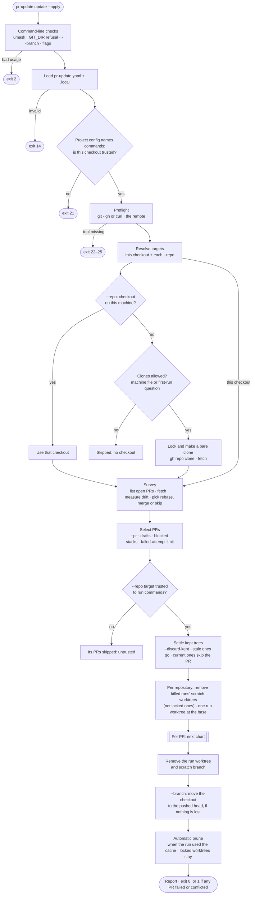
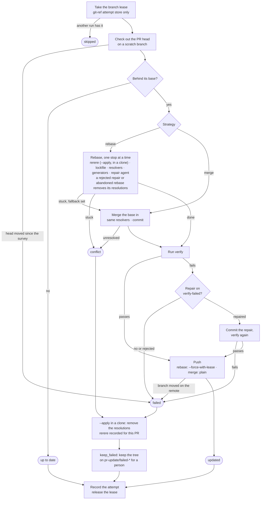

pr-update brings open pull requests up to date with their base branch. For
each PR it rebases or merges, runs the verify command, optionally lets a repair
agent fix what broke, and pushes. This page follows `pr-update update --apply`
through the calls the code makes. It was mapped from the source at
`f5456df2`, not from the other docs; where the two disagreed, the code won and
the disagreement is listed under [Known problems](#known-problems). Its line
references were brought up to date in S13, at `8b5404f40`.

File and line references are relative to `src/`.

## One run, start to finish

Without `--apply` the run goes through the same steps but pushes nothing,
keeps nothing and records nothing. It still fetches, takes clone locks, makes
worktrees, scratch branches and commits, and runs resolvers and verify. It
calls no repair and turns git's rerere off, even where the repository's config
turns it on, so it neither replays nor records a resolution. An `--apply` run
turns it off too, except in a managed clone (below).

| Step | Where |
| --- | --- |
| Command-line checks | `cli.ts:161-179`, `preflight.ts:110-122`, `commands.ts:187-201`, `680-689` |
| Project config | `commands.ts:204-216`, `config-file.ts:46-72` |
| Project-root trust gate | `commands.ts:691-713`, `trust.ts:62-142` |
| Preflight | `commands.ts:399-414`, `preflight.ts:61-85` |
| Resolve targets, find checkouts | `survey.ts:673-744`, `999-1040`, `locate.ts:104-200`; the folder rule and the port for a located checkout `locate.ts:227-283` |
| Managed clones | `mirror.ts:797-1219` (`provide` `1072-1148`, `makeClone` `528-604`; the port a clone serves, `cloneHostProblem` `197-213`) |
| Survey | `survey.ts:1060-1273`, `strategy.ts:107-164` |
| Select PRs | `update.ts:166-286` |
| Per-target trust gate | `update.ts:729-740`, `trust.ts:151-203` |
| Settle kept trees | `update.ts:1154-1284`, `update/kept.ts` |
| Run worktree per repository | `update/execute.ts:1617-1671`; killed runs' scratch worktrees `1774-1791`, locked ones skipped with `lockedByPerson` (`update/registrations.ts:57`); in a clone, a killed run's rerere ledger `1664` |
| Cleanup of the run worktree | `update/execute.ts:1750-1764`, `update/registrations.ts` (`ownedUnder` `69`, which leaves a locked worktree, or one whose lock or record cannot be read) |
| `--branch` sync | `update.ts:521-543`, `883-895` |
| Automatic prune | `commands.ts:359-393`, `prune.ts:726-1283` |
| Report and exit code | `commands.ts:431-441`, `531-556`, `779-808` |

## Each pull request

A repair is accepted only if it did not move HEAD, create refs, give up, leave
conflict markers, or leave whitespace errors (`update/execute.ts:1492-1549`).

git's rerere is used only in a managed clone, where pr-update owns
`rr-cache/`. In `--apply` there, unless `pr_update.rerere` is false, the
rebase, the merge and their `--continue`, abort and commit run with rerere on
and `autoUpdate` off (`integrationEnv`, `update/execute.ts:1133-1143`; whether
it is on, `rerereOn` `1109-1111`, set per group in `update.ts` from the
target's source). Everywhere else, the project root, a located checkout and
every rehearsal, they run with `rerere.enabled=false`, so the person's own
resolutions and rerere config are never used and no `rr-cache/` is made.

In a clone, a conflict git has a recorded resolution for is replayed but left
conflicted in the index. The replayed paths are the conflicted ones
`git rerere remaining` leaves out (`replayedPaths`, `1179-1199`). A replayed
path a resolver claims is planned and rebuilt as usual; any other is reported
in the outcome's `replayed`, the text report and the merge commit's message,
and only verify checks it (`planStop`, `1151-1167`). At each conflict the run
notes, from its worktree's `MERGE_RR`, the variant its resolution goes to and
whether that variant was already resolved (`rerereTracked`, `1238-1265`), and
lists each new one in a ledger in the clone's git directory,
`pr-update-rerere/<pid>.<ms>.json`, before anything can record a resolution
(`track` and `rerereLedger`, `1271-1377`). When a repair is rejected, a rebase
is abandoned, or the PR is not pushed (failed, conflicted, declined by the
person, or a throw), that variant's postimage, preimage and empty folder are
removed and it leaves the ledger (`dropNewResolutions`, `1291-1308`; called at
`574`, `578`, `654`, `1507` and `1511`). The next run served from the clone,
under its lock and before it integrates anything, removes what each dead
run's ledger lists (`dropDeadRunResolutions`, `1391-1426`). So only a PR that
is pushed leaves a resolution for the next one.

A failed attempt is recorded against the PR's head and base, so a PR that keeps
failing on the same commits is skipped next time unless `--retry-failed` is
given.

| Step | Where |
| --- | --- |
| Lease | `update/execute.ts:1673-1702`, `update/lease.ts` |
| Checkout and quick exits | `update/execute.ts:430-590` |
| Rebase through the resolvers | `update/execute.ts:627-743`, `update/resolvers.ts:106-135` |
| Merge | `update/execute.ts:761-876` |
| Rerere on, tracked, dropped | `update/execute.ts:1109-1426`, `574-578` |
| Verify and repair | `update/execute.ts:878-907`, `1054-1075`, `1492-1561`, `repair/` |
| Push | `update/execute.ts:909-1005` |
| Keep a failed tree, record the attempt | `update/execute.ts:1710-1744`, `update/kept.ts:529-706`, `update.ts:849-859` |

## `survey` and `mirror`

`survey` runs the same target resolution and survey as `update`, with no trust
gate (it runs no project command) and no clone made. A clone it reads is locked
only for that read, without waiting; a busy clone is read without a fetch
(`mirror.ts:1150-1194`).

`mirror list` walks the clone folder and the run worktrees and changes
nothing. `mirror prune` removes dead run worktrees, leftover folders, and clones
past their age, with `--discard-kept` their kept trees too. Every removal first
passes one check: the owning clone lists it, its folder is safe, and the
clone's lock is held. A worktree the clone's list shows as locked
(`git worktree lock`, any reason but git's own `initializing`) stays, even
when its folder is missing, and so does its clone (`lockedReason`,
`prune.ts:422`; read from the clone's list at `1067`). So does a kept worktree
whose folder is missing, locked or not. A clone also stays while its
`worktrees/` folder holds a record its list does not show, or a kept
worktree's record names it though its list does not show the tree, and while
it holds a local branch with commits no remote-tracking branch has, a stash or
notes (`personRefsIn`, `prune.ts:1292-1304`, asked before the dry run
returns). A kept tree a person locked is never removed by `update` either
(`keptTreeCheck`'s `locked`, `update/kept.ts:359-387`). A machine
file that cannot be read or is not valid removes no clone for its age.
Anything that cannot be read stays and is reported. `--dry-run` decides the
same way and reads the clone's lock as a claim would, without taking it. The
automatic prune at the end of `update --apply` is `mirror prune` with no flags.

## Where each thing lives

Paths are the macOS and Linux defaults with no variable set.

| Thing | Where | Lasts |
| --- | --- | --- |
| Project config | `<checkout>/pr-update.yaml`, `pr-update.local.yaml` | the person's |
| Machine file (clone consent, clone folder, maximum age) | `~/.config/osdlc/pr-update/config.yaml` | the person's |
| Checkout search roots | `~/.config/osdlc/repositories.yaml` | the person's |
| Trust grants | `~/.local/state/osdlc/pr-update/trusted/` | until revoked |
| Managed clones | `~/.cache/osdlc/pr-update/repos/<host>/<owner>/<name>.git` | until pruned |
| Run worktrees | the project root: `.pr-update/<pid>.<ms>`; other targets: `~/.cache/osdlc/pr-update/worktrees/<host>/<owner>/<name>/` | the run |
| Kept trees | the project root: `.pr-update/failed/`; other targets: `~/.local/state/osdlc/pr-update/kept/<host>/<owner>/<name>/` | until discarded, retried, or the PR moves |
| Attempt records | `.pr-update/attempts/`, `~/.local/state/osdlc/pr-update/attempts/<host>/<owner>/<name>/`, or refs on the remote | until the PR succeeds, or 30 days |
| Branch lease | `refs/pr-update/lock/<head>` on the remote (git-ref store only) | one PR |
| Recorded resolutions (rerere) | `rr-cache/` in a managed clone's git directory only; beside it, `pr-update-rerere/<pid>.<ms>.json`, a run's resolutions not yet accepted | until git's `gc` expires them (60 days by default), run by the clone's foreground maintenance; the ledger until its run ends, or the next run if it was killed |

## Modules

Lines in S13 (`8b5404f40`), against `main` at `88112cb4`, which does not have
the clone-cache work. In total `src/` went from 6,583 lines to 13,128. Files not listed (`detect.ts`, `devlink.ts`, `real-path.ts`,
`repair/names.ts`, `update/confirm.ts`, `version.generated.ts`) are small
helpers.

| Area | File | Lines (on `main`) | Job |
| --- | --- | --- | --- |
| Entry | `bin.ts`, `cli.ts` | 21, 179 (127) | process entry, signal forwarding, command tree, umask |
| Commands | `commands.ts` | 812 (598) | `survey` and `update` commands, flags, the run environment, report, automatic prune, exit code |
| Config | `config.ts`, `config-file.ts`, `config-cli.ts` | 336 (330), 72, 361 | the `pr_update` schema, layered loading, `config` commands |
| Preflight | `preflight.ts` | 122 (83) | tool and remote checks, the `GIT_DIR` refusal |
| Survey | `survey.ts`, `strategy.ts`, `code-host.ts` | 1,353 (896), 164, 87 (44) | targets, PR listing, fetch, drift, stack order, strategy |
| Update | `update.ts` | 1,387 (843) | the run: selection, grouping, trust, verify lists, kept trees, attempt routing, output |
| Executor | `update/execute.ts`, `update/resolvers.ts` | 1,808 (1,213), 155 (151) | per-repository worktree loop, per-PR rebase, merge, verify, repair, push; also the target git environment, and rerere in a clone with its ledger |
| Records | `update/attempts.ts`, `update/ref-attempts.ts`, `update/lease.ts` | 118 (117), 153 (150), 118 (115) | attempt stores and the branch lease |
| Kept trees | `update/kept.ts`, `update/registrations.ts` | 728 (204), 172 (new) | kept-tree records, checks, keep and discard; how a worktree is forgotten; what counts as a person's `git worktree lock` |
| Repair | `repair/agents.ts`, `repair/seat.ts`, `repair/prompt.ts` | 155 (152), 97 (89), 58 | headless agent, interactive and tmux repair, the prompt |
| Ports | `ports.ts`, `defaults.ts`, `index.ts` | 276 (179), 268 (158), 162 (153) | the `Ports` contract, the standalone ports, library exports |
| Targets | `locate.ts`, `trust.ts`, `machine.ts` | 290 (new), 203 (127), 168 (new) | finding a checkout and checking its folders and port, trust gates, the machine file and directories |
| Clones | `mirror.ts`, `mirror-cli.ts`, `clone-maintenance.ts` | 1,219, 309, 49 (all new) | consent, locks, making and checking clones, `mirror` commands; the clone marker |
| Cleanup | `prune.ts`, `folders.ts` | 1,319, 209 (both new) | `mirror list` and `mirror prune`, the folder rule |

The largest functions are `pruneMirror` (558 lines), `managedClones` (423),
`updateRun` (297), `updateCommand` (249) and `surveyWithTargets` (214). There
are no import cycles.

## Known problems

Items 1–19 were found while mapping the flow at `f5456df2`; 20–25 in the
final check of S12; 26–31 in S13, after the CI review of the omnibus at
`dbdb5d6e`. The open items give lines at `8b5404f40`; the fixed ones keep the
lines where the problem was. Those marked fixed were fixed in the commit
named: S12's, or S13's.

### Behaviour

1. One repository can stop the whole run. `releaseStaleScratch` and
   `git worktree add` sit outside `updateAll`'s `try`
   (`update/execute.ts:1662-1669`), and `updateRun` does not catch around
   `updateAll`. A missing base ref in one repository skips every later one,
   though the executor's design note says one stuck PR must not end the run.
2. A `--repo` target is cloned and fetched before its trust gate runs
   (`update.ts:633-635` against `729-740`), so an untrusted target costs a full
   clone that the run then skips.
3. Signal forwarding is installed only when `update` is the first argument
   (`bin.ts:19`). With a leading flag, such as `--output json update`, an
   agent started by the run gets no forwarded Ctrl-C.
4. What the automatic prune removes appears only as notes
   (`commands.ts:379-391`). It is in neither the JSON output nor `--report`.
5. Two answers to "is this run alive?": the executor checks the pid
   (`update/execute.ts:1793`), for a killed run's scratch worktree and, in a
   clone, its rerere ledger; prune checks the pid and its start time
   (`prune.ts:137`). A reused pid makes them disagree: a killed run's ledger
   whose pid now belongs to a live process is not swept until that process
   ends.
6. `--keep-failed` and `--discard-kept` are checked for a missing `--apply`
   only after the survey's listings and fetches (`update.ts:687-690`).
7. A probe folder left by a hard kill in the project root's `.pr-update/` is
   outside every prune walk (`update/kept.ts:477-478`, `prune.ts:912-935`).

### Structure

8. `pruneMirror` and `managedClones` are each one function of over 400 lines,
   built from nested closures.
9. One clone lock's life spans four files: declared in `survey.ts:177-230`,
   built in `mirror.ts`, adapted in `update.ts:928-936`, used in
   `update/execute.ts`.
10. The rules for running git outside the project root (hooks off, repository
    variables cleared, absolute `PATH`) live in the executor
    (`update/execute.ts:1099-1106`, `1429-1461`), so survey, locate, mirror and
    prune import the executor for them. The rerere helpers now sit between
    them.
11. The rule that a kept tree a person touched is theirs is applied in three
    places: `settleKept`, the keep step of `updateAll` with `keepWorktree`, and
    prune. S13 added two more ways a tree is theirs (locked, and in a clone a
    stash), each applied in all three.
12. Flag checks are split between `commands.ts`, the start of the run and after
    the survey, and the repair choice is worked out twice
    (`commands.ts:715-722`, `309-315`).
13. Most code reads the environment the CLI passes in, but five places read
    `process.env` directly (`preflight.ts:113`, `machine.ts:164`,
    `update/execute.ts:1100`, `1135`, `mirror.ts:618`). The terminal seam
    covers only the clone question.
14. `survey` builds the whole update environment, repair and attempt stores
    included, and uses none of it (`commands.ts:491`).

### Docs that disagree with the code

15. Fixed (`2d1482d8`). The `--apply` help said "Without it, nothing is
    written" (`commands.ts:579`). A rehearsal makes worktrees, scratch branches
    and commits, runs resolvers and verify, fetches, and takes clone locks.
16. Fixed (`92d63727`). Rerere was described as the first resolver, but
    nothing turned it on. `update --apply` now runs its merges and rebases with
    rerere on (`integrationEnv` in `update/execute.ts`).
17. Fixed (`2d1482d8`). D-0005's trust bullet named fewer guarded settings
    than `trust.ts:151-159` checks, and its directory table showed a flat
    `attempts/` where the code nests by repository.
18. Fixed (`2d1482d8`). The README said `survey` always exits 0. A failed PR
    listing gives a non-zero exit.
19. Fixed (`2d1482d8`). `Ports.resolveVerifyVerbs` said every surveyed
    repository is asked; the code skips those the trust gate refused and
    those whose listing failed (`update.ts:742-747`).

### Found in the final check

20. Fixed (`b57ecb481`). A replayed resolution is not named in the report. rerere stages it with
    `autoUpdate`, so no resolver or repair sees the path, and the outcome lists
    no resolved path for it; only verify checks it
    (`update/execute.ts:1074-1085`). A merge commit says rerere resolved it
    only when every conflicted path was replayed.
21. Fixed (`b57ecb481`). Removing a PR's resolutions removes only the `postimage` file of its
    variant (`update/execute.ts:1142-1146`). The `preimage` git writes at
    the conflict stays in `rr-cache/` until git's `gc` expires it (15 days by
    default for an unresolved entry). It is not replayed, but it takes space.
22. Fixed (`3722c693`). Two runs on one repository share its `rr-cache/`,
    and so does the person's own checkout. A removal took every new
    resolution of the conflict, so one recorded meanwhile by another run or by
    the person was lost. Each conflict is now tracked by its variant, which git
    keeps apart for each preimage, and only that variant's resolution goes.
23. A repair agent can write into a clone's `rr-cache/` itself, outside what
    pr-update tracks, and that resolution is replayed into later PRs of the
    clone. SECURITY.md says so. Since S13 rerere is off outside a clone, so an
    agent in the project root or a located checkout writes there to no
    effect on pr-update.
24. A dead run worktree that is locked and whose folder is missing shows up
    only in its clone's skip reason, not as an entry of its own
    (`prune.ts:1067-1071`, `1105-1110`). So does a kept tree whose folder is
    missing, and a clone's branch, stash or notes (S13).
25. The changesets list "Fixed:" entries for behaviour that is new in this
    release (the clone cache and `mirror prune`), so they read as fixes to
    released code.

### Found in S13

26. A run that is still going when a killed run's ledger is swept is not
    stopped from replaying that run's unaccepted resolution first: the sweep
    is in the next `updateAll` served from the clone, and a concurrent run
    already past that step integrates without it (`update/execute.ts:1664`,
    `dropDeadRunResolutions` `1391-1426`).
27. Prune and the kept-tree discard paths decide by themselves whether a
    worktree or branch is safe to delete (`pruneClone` in `prune.ts:1023-1242`,
    `settleKept`, `discardKept`, `keptIsTouched`, `personRefsIn`).
    `@osdlc/repo-cleaner` already does that, in `inspectWorktree` and its
    verdicts and risks: stashes and commits no remote has (abandon-unmerged),
    uncommitted files (discard-changes), locks and running processes
    (blocked), a missing folder, and a check again against what it saw before
    it deletes. The planned follow-up is for pr-update to keep only the
    clone-level decisions (the clone lock, the folder rule, removing the bare
    directory) and to ask repo-cleaner about each worktree and branch,
    extending repo-cleaner where it needs to (bare clones, never unlocking a
    person's lock). It is planned with the pure-cache clone change. S13's
    small prune and kept fixes are the safety net until then.
28. Two ports of one host share a clone path and a trust key, since both drop
    the port. A target on a second port is refused rather than given a clone
    of its own (`cloneHostProblem`, `mirror.ts:197-213`), so a person cannot
    serve both ports from clones. A located checkout with an ssh `origin` is
    not used for a target that names a port (`portProblem`,
    `locate.ts:264-283`).
29. A located checkout's folder rule covers its work tree, git directory and
    `config` file (`checkoutProblem`, `locate.ts:227-255`). A file that config
    pulls in with `include.path` or `includeIf`, and the global and system
    config, are not checked.
30. A located checkout's origin is read twice: by the locator's scan, and
    again for its port (`portProblem`), since the locator's `RemoteRepo` has
    no port.
31. A keep whose undo fails part-way, when the keep did not make its branch,
    leaves the run worktree at the kept path with no record; the next keep of
    that PR says the folder is in the way (`moveBack`,
    `update/kept.ts:654-678`).
