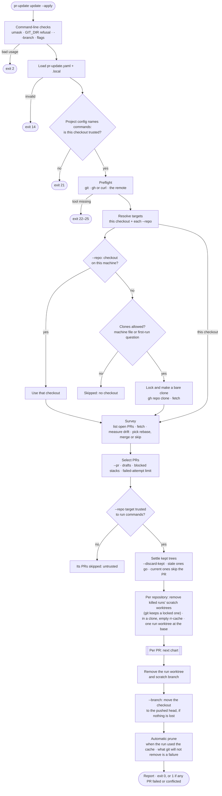
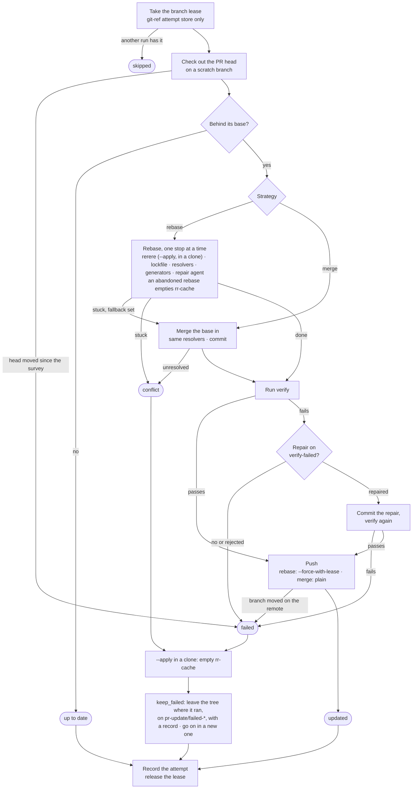

pr-update brings open pull requests up to date with their base branch. For
each PR it rebases or merges, runs the verify command, optionally lets a repair
agent fix what broke, and pushes. This page follows `pr-update update --apply`
through the calls the code makes. It was mapped from the source at
`f5456df2`, not from the other docs; where the two disagreed, the code won and
the disagreement is listed under [Known problems](#known-problems). Its line
references were brought up to date at the end of S13, at `ff0f4b6ef`, after
the ownership contract (D-0005, Build note "The ownership contract").

File and line references are relative to `src/`.

## One run, start to finish

Without `--apply` the run goes through the same steps but pushes nothing,
keeps nothing and records nothing. It still fetches, takes clone locks, makes
worktrees, scratch branches and commits, and runs resolvers and verify. It
calls no repair and turns git's rerere off, even where the repository's config
turns it on, so it neither replays nor records a resolution. An `--apply` run
turns it off too, except in a managed clone (below).

Everything a run makes lives in pr-update's own directories, the project
root's included (see [Where each thing lives](#where-each-thing-lives)); a
checkout gets only git's worktree records and `pr-update/*` branches. An old
`<projectRoot>/.pr-update/` is not read; the run notes it once
(`noteOldPlace`, `commands.ts:400-407`).

| Step | Where |
| --- | --- |
| Command-line checks | `cli.ts:164-182`, `preflight.ts:110-122`, `commands.ts:187-201`, `692-703` |
| Project config | `commands.ts:204-216`, `config-file.ts:46-72` |
| Project-root trust gate | `commands.ts:705-727`, `trust.ts:62-142` |
| Preflight | `commands.ts:413-428`, `preflight.ts:61-85` |
| Resolve targets, find checkouts | `survey.ts:673-744`, `999-1040`, `locate.ts:104-200`; the folder rule and the port for a located checkout `locate.ts:226-282` |
| Managed clones | `mirror.ts:798-1220` (`provide` `1073-1149`, `makeClone` `529-605`; the port a clone serves, `cloneHostProblem` `198-214`) |
| Survey | `survey.ts:1060-1273`, `strategy.ts:107-164` |
| Select PRs | `update.ts:163-283` |
| Per-target trust gate | `update.ts:728-739`, `trust.ts:151-203` |
| Settle kept trees | `update.ts:1124-1245`, `update/kept.ts` |
| Run worktree per repository | `update/execute.ts:1445-1504`; killed runs' scratch worktrees `releaseStaleScratch` `1610-1621`; in a clone, `rr-cache/` emptied `1494` |
| Cleanup of the run worktree | `update/execute.ts:1585-1599`, `update/registrations.ts` (`removeWorktree` `65-77`: one `git worktree remove --force`; a refusal is reported) |
| `--branch` sync | `update.ts:520-542`, `882-894` |
| Automatic prune | `commands.ts:359-393`, `prune.ts:725-1197` |
| Report and exit code | `commands.ts:445-455`, `545-570`, `794-826` |

## Each pull request

A repair is accepted only if it did not move HEAD, create refs, give up, leave
conflict markers, or leave whitespace errors (`update/execute.ts:1297-1351`).

git's rerere is used only in a managed clone, where pr-update owns
`rr-cache/`, and only within one run. In `--apply` there, unless
`pr_update.rerere` is false, the rebase, the merge and their `--continue`,
abort and commit run with rerere on and `autoUpdate` off (`integrationEnv`,
`update/execute.ts:1122-1132`; whether it is on, `rerereOn` `1097-1099`, set
per group in `update.ts:825` from the target's source). It stays off for a PR
while another live run has a worktree in the clone (`otherLiveRun`,
`1158-1169`). Everywhere else, the project root, a located checkout and every
rehearsal, they run with `rerere.enabled=false`, so the person's own
resolutions and rerere config are never used and no `rr-cache/` is made.

The clone's `rr-cache/` lives for one run (`clearRerere`, `1141-1149`): it is
emptied before the run integrates anything (`1494`), whenever a PR ends without
a push (`572`, `577`), when a rebase is abandoned (`647`), and at the end of the
run (`1598`). So a replayed resolution was made in this run, by a PR that was
pushed or by the PR in flight. A replayed conflict is left conflicted in the
index. A path counts as replayed only where git printed
`Resolved '<path>' using previous resolution.` for it (typed-git's
`rerereReplayed`) and the file has no conflict markers (`replayedPaths`,
`1208-1217`). A binary or `-merge` conflict rerere never tracks is a plain
conflict. A replayed path a resolver claims is planned and rebuilt as usual;
any other is reported in the outcome's `replayed`, the text report and the
merge commit's message, and only verify checks it (`planStop`, `1178-1194`).

A failed attempt is recorded against the PR's head and base, so a PR that keeps
failing on the same commits is skipped next time unless `--retry-failed` is
given.

| Step | Where |
| --- | --- |
| Lease | `update/execute.ts:1505-1545`, `update/lease.ts` |
| Checkout and quick exits | `update/execute.ts:432-587` |
| Rebase through the resolvers | `update/execute.ts:624-733`, `update/resolvers.ts:106-135` |
| Merge | `update/execute.ts:751-858` |
| Rerere on, and its one-run cache | `update/execute.ts:1097-1217`, `572-577`, `647` |
| Verify and repair | `update/execute.ts:860-889`, `1036-1057`, `1297-1372`, `repair/` |
| Push | `update/execute.ts:891-987` |
| Keep a failed tree, record the attempt | `update/execute.ts:1547-1579`, `update/kept.ts:413-499`, `update.ts:835-858` |

## `survey` and `mirror`

`survey` runs the same target resolution and survey as `update`, with no trust
gate (it runs no project command) and no clone made. A clone it reads is locked
only for that read, without waiting; a busy clone is read without a fetch
(`mirror.ts:1151-1195`).

`mirror list` walks the clone folder and the run worktrees and changes
nothing. `mirror prune` removes dead run worktrees, leftover folders, and clones
past their age, with `--discard-kept` their kept trees too. Everything in
pr-update's folders is its own, so what is in a tree or a clone never keeps it.
Every removal first passes one check (`mayRemove`, `prune.ts:787-808`): the
owning clone lists it, its folder is safe, and the clone's lock is held. A run
worktree a valid kept record names is a kept tree, not a dead run's, unless git
lists it on a scratch branch (`keptTrees` and `listedOnScratch`,
`prune.ts:895-920`; in a clone, `1068-1076`). A dead run's worktree goes with
its scratch branch and any other `pr-update/` branch it is on (`runBranches`,
`prune.ts:501-504`), so a keep that stopped before its record leaves nothing.
pr-update reads no worktree locks: a worktree is removed with one
`git worktree remove --force` (`removeWorktree`,
`update/registrations.ts:65-77`), and when git refuses (a locked one, say),
that is a failure, reported, and the clone stays (`prune.ts:1094-1100`). A dry
run cannot know git will refuse, so it reports such a tree as one it would
remove. A machine file that cannot be read or is not valid removes no clone for
its age. Anything that cannot be read stays and is reported. `--dry-run`
decides the same way and reads the clone's lock as a claim would, without
taking it. The automatic prune at the end of `update --apply` is
`mirror prune` with no flags.

`kept push` (`kept-cli.ts`) finds a kept tree through its record with
`findKept` (`update/kept.ts:251-259`), reads its commit from the worktree list
of the git directory the record names (it refuses a tree on a scratch branch,
as `keptTreeCheck` does, `update/kept.ts:324-342`), and pushes it with
`--force-with-lease` pinned to what `ls-remote` showed. No git runs in the
tree, and hooks are off in the repository pushed from. Before any git runs in
the owning git directory, it is checked as a run checks it: `checkClone` for a
managed clone, `gitDirProblem` (`locate.ts`) otherwise. Its default branch is
`kept/<owner>-<name>-<number>` (`keptPushBranch`), and a `--branch` under
`pr-update/` is refused, since pr-update makes and deletes those.

## Where each thing lives

Paths are the macOS and Linux defaults with no variable set.

| Thing | Where | Lasts |
| --- | --- | --- |
| Project config | `<checkout>/pr-update.yaml`, `pr-update.local.yaml` | the person's |
| Machine file (clone consent, clone folder, maximum age) | `~/.config/osdlc/pr-update/config.yaml` | the person's |
| Checkout search roots | `~/.config/osdlc/repositories.yaml` | the person's |
| Trust grants | `~/.local/state/osdlc/pr-update/trusted/` | until revoked |
| Managed clones | `~/.cache/osdlc/pr-update/repos/<host>/<owner>/<name>.git` | until pruned |
| Run worktrees, every target | `~/.cache/osdlc/pr-update/worktrees/<host>/<owner>/<name>/<pid>.<ms>` | the run |
| Kept trees | run worktrees left where they ran, in `worktrees/` above, on `pr-update/failed-<owner>-<name>-<number>` | until discarded, retried, the PR moves, the clone is pruned with `--discard-kept`, or a cache cleaner |
| Kept-tree records | `~/.local/state/osdlc/pr-update/kept/<host>/<owner>/<name>/<number>.json` | as long as the tree |
| Attempt records | `~/.local/state/osdlc/pr-update/attempts/<host>/<owner>/<name>/`, or refs on the remote | until the PR succeeds, or 30 days |
| Branch lease | `refs/pr-update/lock/<head>` on the remote (git-ref store only) | one PR |
| Recorded resolutions (rerere) | `rr-cache/` in a managed clone's git directory only | one run |

A project root whose remote names no host is filed under `github.com`.

## Modules

Lines at the end of S13 (`ff0f4b6ef`), against `main` at `88112cb4`, which
does not have the clone-cache work. In total `src/` went from 6,583 lines to
12,820. Files not listed (`detect.ts`, `devlink.ts`, `real-path.ts`,
`repair/names.ts`, `update/confirm.ts`, `version.generated.ts`) are small
helpers.

| Area | File | Lines (on `main`) | Job |
| --- | --- | --- | --- |
| Entry | `bin.ts`, `cli.ts` | 21, 182 (127) | process entry, signal forwarding, command tree, umask |
| Commands | `commands.ts`, `kept-cli.ts` | 830 (598), 285 (new) | `survey`, `update` and `kept push` commands, flags, the run environment, report, automatic prune, exit code |
| Config | `config.ts`, `config-file.ts`, `config-cli.ts` | 336 (330), 72, 361 | the `pr_update` schema, layered loading, `config` commands |
| Preflight | `preflight.ts` | 122 (83) | tool and remote checks, the `GIT_DIR` refusal |
| Survey | `survey.ts`, `strategy.ts`, `code-host.ts` | 1,353 (896), 164, 87 (44) | targets, PR listing, fetch, drift, stack order, strategy |
| Update | `update.ts` | 1,348 (843) | the run: selection, grouping, trust, verify lists, kept trees, attempt routing, output |
| Executor | `update/execute.ts`, `update/resolvers.ts` | 1,638 (1,213), 155 (151) | per-repository worktree loop, per-PR rebase, merge, verify, repair, push; also the target git environment, and rerere in a clone for one run |
| Records | `update/attempts.ts`, `update/ref-attempts.ts`, `update/lease.ts` | 113 (117), 153 (150), 118 (115) | attempt stores and the branch lease |
| Kept trees | `update/kept.ts`, `update/registrations.ts` | 499 (204), 77 (new) | kept-tree records, checks, keep and discard; how a worktree is removed and forgotten |
| Repair | `repair/agents.ts`, `repair/seat.ts`, `repair/prompt.ts` | 155 (152), 97 (89), 58 | headless agent, interactive and tmux repair, the prompt |
| Ports | `ports.ts`, `defaults.ts`, `index.ts` | 286 (179), 288 (158), 162 (153) | the `Ports` contract, the standalone ports, library exports |
| Targets | `locate.ts`, `trust.ts`, `machine.ts` | 293 (new), 203 (127), 170 (new) | finding a checkout and checking its folders and port, trust gates, the machine file and directories |
| Clones | `mirror.ts`, `mirror-cli.ts`, `clone-maintenance.ts` | 1,220, 309, 44 (all new) | consent, locks, making and checking clones, `mirror` commands; the clone marker |
| Cleanup | `prune.ts`, `folders.ts` | 1,212, 209 (both new) | `mirror list` and `mirror prune`, the folder rule |

The largest functions are `pruneMirror` (473 lines), `managedClones` (423),
`updateRun` (297), `updateCommand` (253) and `surveyWithTargets` (214). There
are no import cycles.

## Known problems

Items 1–19 were found while mapping the flow at `f5456df2`; 20–25 in the
final check of S12; 26–32 in S13, after the CI review of the omnibus at
`dbdb5d6e`; 33–34 with the ownership contract. The open items give lines at
`ff0f4b6ef`; the fixed and moot ones keep the lines where the problem was.
Those marked fixed were fixed in the commit named: S12's, or S13's. Those
marked moot describe code the ownership contract removed; their numbers are
kept.

### Behaviour

1. One repository can stop the whole run. `releaseStaleScratch` and
   `git worktree add` sit outside `updateAll`'s `try`
   (`update/execute.ts:1490-1504`), and `updateRun` does not catch around
   `updateAll`. A missing base ref in one repository skips every later one,
   though the executor's design note says one stuck PR must not end the run.
2. A `--repo` target is cloned and fetched before its trust gate runs
   (`update.ts:632-634` against `728-739`), so an untrusted target costs a full
   clone that the run then skips.
3. Signal forwarding is installed only when `update` is the first argument
   (`bin.ts:19`). With a leading flag, such as `--output json update`, an
   agent started by the run gets no forwarded Ctrl-C.
4. What the automatic prune removes appears only as notes
   (`commands.ts:379-391`). It is in neither the JSON output nor `--report`.
5. Two answers to "is this run alive?": the executor checks the pid
   (`isAlive`, `update/execute.ts:1623-1631`), for a killed run's scratch
   worktree and, in a clone, for whether another run is working there
   (`otherLiveRun`, `1158-1169`); prune checks the pid and its start time
   (`prune.ts:138-146`). A reused pid makes them disagree: the next run leaves
   a killed run's scratch worktree until that process ends (prune removes it),
   and keeps rerere off in that clone meanwhile. The rerere ledger this item
   first named is gone with the one-run cache.
6. `--keep-failed` and `--discard-kept` are checked for a missing `--apply`
   only after the survey's listings and fetches (`update.ts:688-691`).
7. Moot under the ownership contract (D-0005, Build note "The ownership contract"). A probe folder left by a hard kill in the project root's `.pr-update/`
   was outside every prune walk (`update/kept.ts:477-478`, `prune.ts:912-935`).
   Kept trees no longer move, so there is no probe, and nothing is written to
   `.pr-update/`.

### Structure

8. `pruneMirror` and `managedClones` are each one function of over 400 lines,
   built from nested closures.
9. One clone lock's life spans four files: declared in `survey.ts:177-230`,
   built in `mirror.ts`, adapted in `update.ts:924-932`, used in
   `update/execute.ts`.
10. The rules for running git outside the project root (hooks off, repository
    variables cleared, absolute `PATH`) live in the executor
    (`update/execute.ts:1084-1094`, `1234-1266`), so survey, locate, mirror and
    prune import the executor for them. The rerere helpers now sit between
    them.
11. Moot under the ownership contract (D-0005, Build note "The ownership contract"). The rule that a kept tree a person touched is theirs was applied in
    three places: `settleKept`, the keep step of `updateAll` with
    `keepWorktree`, and prune. A kept tree is pr-update's now, whatever is in
    it, so there is no such rule.
12. Flag checks are split between `commands.ts`, the start of the run and after
    the survey, and the repair choice is worked out twice
    (`commands.ts:729-736`, `309-315`).
13. Most code reads the environment the CLI passes in, but five places read
    `process.env` directly (`preflight.ts:113`, `machine.ts:166`,
    `update/execute.ts:1085`, `1124`, `mirror.ts:619`). The terminal seam
    covers only the clone question.
14. `survey` builds the whole update environment, repair and attempt stores
    included, and uses none of it (`commands.ts:505`).

### Docs that disagree with the code

15. Fixed (`2d1482d8`). The `--apply` help said "Without it, nothing is
    written" (`commands.ts:579`). A rehearsal makes worktrees, scratch branches
    and commits, runs resolvers and verify, fetches, and takes clone locks.
16. Fixed (`92d63727`). Rerere was described as the first resolver, but
    nothing turned it on. `update --apply` now runs its merges and rebases with
    rerere on, in a managed clone only (`integrationEnv` in
    `update/execute.ts`).
17. Fixed (`2d1482d8`). D-0005's trust bullet named fewer guarded settings
    than `trust.ts:151-159` checks, and its directory table showed a flat
    `attempts/` where the code nests by repository.
18. Fixed (`2d1482d8`). The README said `survey` always exits 0. A failed PR
    listing gives a non-zero exit.
19. Fixed (`2d1482d8`). `Ports.resolveVerifyVerbs` said every surveyed
    repository is asked; the code skips those the trust gate refused and
    those whose listing failed (`update.ts:742-747`).

### Found in the final check

20. Fixed (`b57ecb481`). A replayed resolution is not named in the report. rerere stages it with
    `autoUpdate`, so no resolver or repair sees the path, and the outcome lists
    no resolved path for it; only verify checks it
    (`update/execute.ts:1074-1085`). A merge commit says rerere resolved it
    only when every conflicted path was replayed.
21. Fixed (`b57ecb481`). Removing a PR's resolutions removes only the `postimage` file of its
    variant (`update/execute.ts:1142-1146`). The `preimage` git writes at
    the conflict stays in `rr-cache/` until git's `gc` expires it (15 days by
    default for an unresolved entry). It is not replayed, but it takes space.
22. Fixed (`3722c693`). Two runs on one repository share its `rr-cache/`,
    and so does the person's own checkout. A removal took every new
    resolution of the conflict, so one recorded meanwhile by another run or by
    the person was lost. Each conflict was then tracked by its variant, which
    git keeps apart for each preimage, and only that variant's resolution went.
    Since the end of S13 rerere is off outside a clone, and in a clone it is off
    while another run is working there and its cache lives for one run, so
    there is nothing to track.
23. A repair agent can write into a clone's `rr-cache/` itself, and that
    resolution can be replayed into later PRs of the same run, if the PR it
    repaired is pushed (a PR that is not pushed empties the cache). SECURITY.md
    says so. The cache is emptied at the end of the run, so it reaches no later
    run. rerere is off outside a clone, so an agent in the project root or a
    located checkout writes there to no effect on pr-update.
24. A dead run worktree git will not remove (a locked one) whose folder is
    missing shows up only in its clone's failure, not as an entry of its own
    (`prune.ts:1094-1100`). The kept-tree and person's-work cases this item
    also named (a kept tree whose folder is missing, a clone's branch, stash
    or notes) are moot under the ownership contract: they no longer keep a
    clone.
25. Fixed (`5bc57e2dc`). The changesets listed "Fixed:" entries for behaviour that is new in this
    release (the clone cache and `mirror prune`), so they read as fixes to
    released code. They are now plain statements; "Fixed:" is kept for
    changes to released behaviour.

### Found in S13

26. Moot: rerere's cache now lives for one run, so there is no ledger (D-0005, Build note "The ownership contract"). A run that was still going when a killed run's ledger was swept is not
    stopped from replaying that run's unaccepted resolution first: the sweep
    was in the next `updateAll` served from the clone, and a concurrent run
    already past that step integrated without it (`update/execute.ts:1664`,
    `dropDeadRunResolutions` `1391-1426`).
27. Moot under the ownership contract (D-0005, Build note "The ownership contract"). Prune and the kept-tree discard paths decided by themselves whether a
    worktree or branch is safe to delete (`pruneClone` in `prune.ts:1023-1242`,
    `settleKept`, `discardKept`, `keptIsTouched`, `personRefsIn`). Nothing in
    pr-update's places is a person's work now, so there is nothing to decide;
    the follow-up below is dropped.
    `@osdlc/repo-cleaner` already does that, in `inspectWorktree` and its
    verdicts and risks: stashes and commits no remote has (abandon-unmerged),
    uncommitted files (discard-changes), locks and running processes
    (blocked), a missing folder, and a check again against what it saw before
    it deletes. The planned follow-up is for pr-update to keep only the
    clone-level decisions (the clone lock, the folder rule, removing the bare
    directory) and to ask repo-cleaner about each worktree and branch,
    extending repo-cleaner where it needs to (bare clones, never unlocking a
    person's lock). It is planned with the pure-cache clone change. S13's
    small prune and kept fixes are the safety net until then.
28. Two ports of one host share a clone path and a trust key, since both drop
    the port. A target on a second port is refused rather than given a clone
    of its own (`cloneHostProblem`, `mirror.ts:198-214`), so a person cannot
    serve both ports from clones. A located checkout with an ssh `origin` is
    not used for a target that names a port (`portProblem`,
    `locate.ts:263-282`).
29. A located checkout's folder rule covers its work tree, git directory and
    `config` file (`checkoutProblem`, `locate.ts:226-254`). A file that config
    pulls in with `include.path` or `includeIf`, and the global and system
    config, are not checked.
30. A located checkout's origin is read twice: by the locator's scan, and
    again for its port (`portProblem`), since the locator's `RemoteRepo` has
    no port.
31. Moot under the ownership contract (D-0005, Build note "The ownership contract"). A keep whose undo failed part-way, when the keep did not make its
    branch, left the run worktree at the kept path with no record; the next
    keep of that PR said the folder was in the way (`moveBack`,
    `update/kept.ts:654-678`). Nothing moves now: a keep that stops before its
    record leaves a run worktree on its failed branch, which prune removes as
    a dead run's, with the branch.
32. The project root is matched without a port. A `--repo` naming the root's
    `owner/name` on another port of its host (`ghe.example:9443/o/r` for a
    root at `ghe.example:8443`) is taken for the project root and updated
    through the root's `origin` (`isRoot`, `survey.ts:699`), and a target on
    another port of the root's host is listed through the root's code host
    (`onRootHost`, `survey.ts:1119`). Found from reading the code at the end of
    S13 and not changed: `rootHost` also feeds `GH_HOST` and the root target's
    host. The fix would compare `withWebPort(rootHost, <root's origin>)`
    there.

### Found with the ownership contract

33. A `git worktree add` that is killed leaves git's own `initializing` lock.
    pr-update reads no locks, so git refuses to remove that worktree, the
    prune reports a failure each time, and its clone stays, until a person runs
    `git worktree unlock` (or `git worktree remove -f -f`) in the clone
    (`removeWorktree`, `update/registrations.ts:65-77`). Before the contract,
    prune treated `initializing` as no lock.
34. A dry run cannot tell that git will refuse a removal (a locked worktree),
    so `mirror prune --dry-run` lists such a tree, and its clone, as ones it
    would remove, and the real prune then reports a failure
    (`prune.ts:32-34`).
