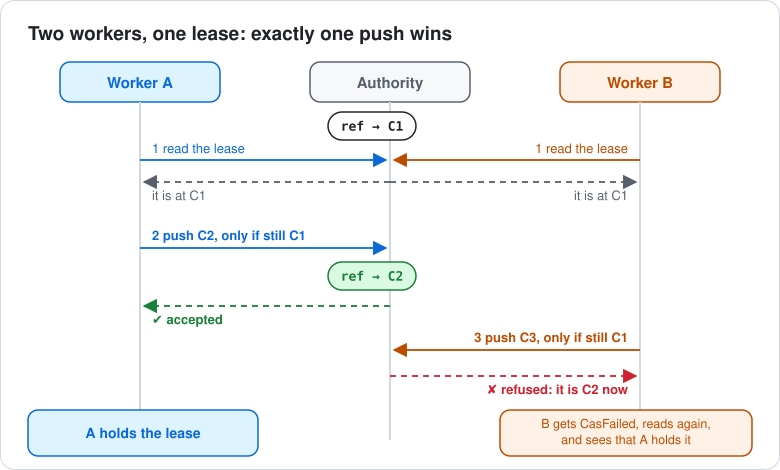

## The problem

Two workers must not do the same job at once: two CI runners deploying the same service, two agents
working the same task, two cron hosts running the same nightly import. They need a lock that every
one of them can see, and that cannot be taken twice.

If they all push to one git remote already, that remote can be the lock. No lock server, no
database: a ref and a push.

## The idea in one picture



- A **lease** is a ref, such as `refs/locks/deploy-api`. Its commit holds your payload as JSON.
- Every change is a **compare-and-swap**: "move the ref to my new commit, but only if it still
  points at the commit I read". git's `push --force-with-lease=<ref>:<sha>` does exactly that, and
  the remote checks it. Two workers racing can never both win.
- The **authority** is the remote everyone pushes to: `origin`, a URL, or a bare repository path.

[How it works, in pictures](./how-it-works.md) walks through each piece.

## Set up an authority

Any git remote you can push to works. To try it locally, make a bare repository, and a repository
to run from:

```sh
git init --bare /tmp/locks.git
git init /tmp/worker
```

The library runs git in the worker repository (`cwd`). That repository holds the lease commits
before they are pushed, and a local copy of each lease ref after a write or a fetch.

## Your first lease

From [examples/lease-lifecycle.test.ts](../../examples/lease-lifecycle.test.ts):

<!-- snippet: quick-start -->
```ts
import {
  buildLeaseCommit,
  casCreate,
  casDelete,
  casReplace,
  CasFailed,
  fetchNamespace,
  fetchRef,
  RefNotFound,
} from '@osdlc/ref-lease'

interface CacheLease {
  holder: string
  expiresAt: string
}

const decode = (v: unknown): CacheLease => {
  const o = v as Partial<CacheLease>
  if (typeof o.holder !== 'string' || typeof o.expiresAt !== 'string') {
    throw new TypeError('not a cache lease')
  }
  return { holder: o.holder, expiresAt: o.expiresAt }
}

/** Claim `ref` for `holder`, or return the current holder when someone else has it. */
function claim(authority: string, ref: string, holder: string, cwd: string): string {
  const sha = buildLeaseCommit({ holder, expiresAt: '2026-11-07T12:00:00Z' }, { cwd })
  try {
    casCreate(authority, ref, sha, { cwd })
    return holder
  } catch (e) {
    if (!(e instanceof CasFailed)) throw e
    return fetchRef(authority, ref, { cwd, decode }).payload.holder
  }
}
```

`claim` returns the holder: you, if the create succeeded, or whoever got there first.

- `buildLeaseCommit` writes your payload into a commit in the worker repository. Nothing is pushed
  yet.
- `casCreate` pushes it as a new ref, only if no such ref exists. If one exists, it throws
  `CasFailed`.
- `fetchRef` reads the current lease. `decode` checks the JSON and gives it your type.

## Look at it with git

The leases are ordinary git objects, so git can show them:

```sh
git ls-remote /tmp/locks.git 'refs/locks/*'          # every lease and its commit
git -C /tmp/worker log --oneline refs/locks/deploy   # the lease's history, newest first
git -C /tmp/worker show refs/locks/deploy:lease.json # the payload
```

## Next

- [Recipes](./recipes.md): expiry, renewal, release and a retrying update.
- [Errors and retries](./errors-and-retries.md): which failures to retry.
