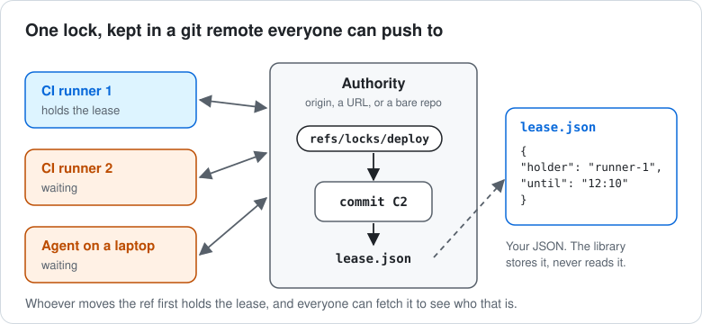
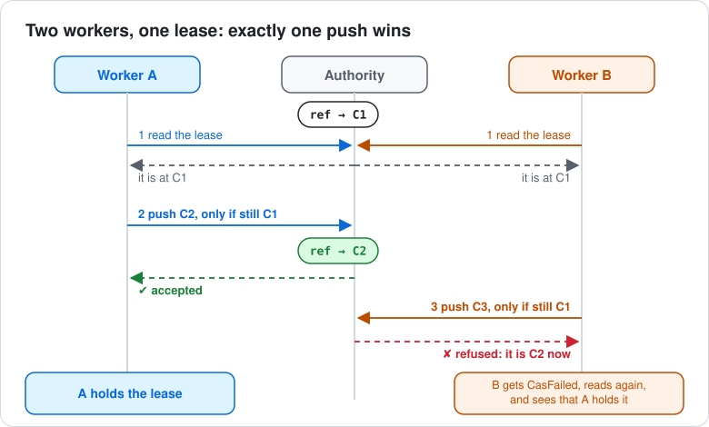
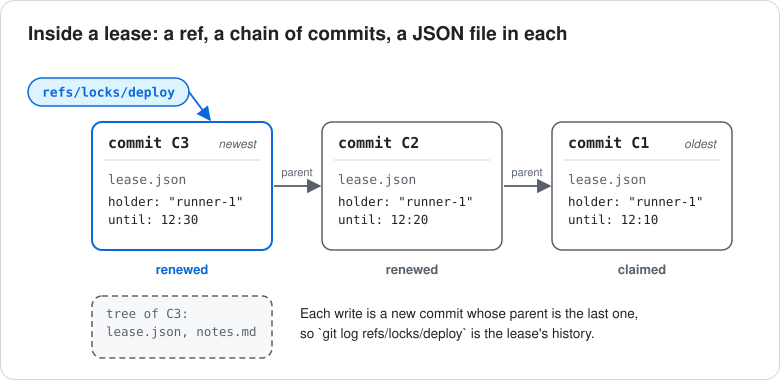
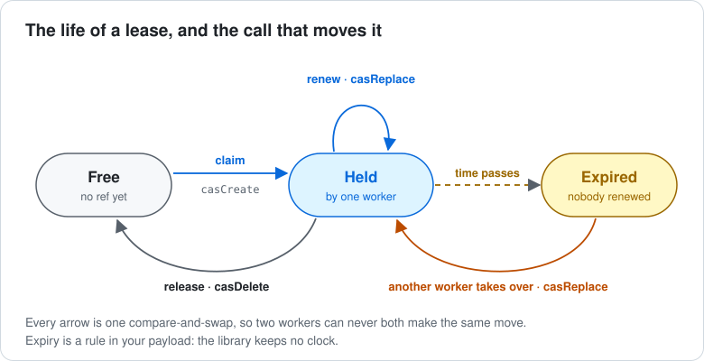
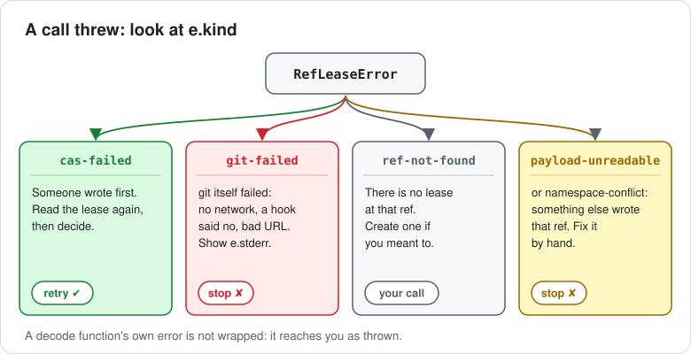

ref-lease lets several machines take turns on a job using nothing but a git remote they all push
to. This page explains how, one picture at a time. No git knowledge is needed beyond "a remote is a
shared repository".

## The short version

- A **lease** is a named pointer in a git remote, such as `refs/locks/deploy`. It points at a
  commit that holds a small JSON file you write: who holds the lease, until when.
- To take or change a lease, you push a new commit, **but only if the pointer still points where
  you last saw it**. The remote checks that, so when two workers race, exactly one wins.
- The library does the git work. You decide what goes in the JSON and what to do when you lose.

## An everyday picture

Think of a sign-up sheet pinned to one shared board. To take the slot, you cross out the name you
saw and write yours. The board has one rule: it only accepts your edit if the name you crossed out
is still the one written there. If someone changed it while you walked over, your edit is refused,
and you look again.

The board is the git remote, the sheet is the ref, and "the name you saw" is the commit you read.

## The pieces



| Piece | What it is |
|---|---|
| **Authority** | The git remote every worker pushes to: `origin`, a URL, or a bare repository on disk. Whatever it says is the truth. |
| **Lease ref** | A ref under a name you choose, such as `refs/locks/deploy`. Refs outside `refs/heads/` are not branches, so they stay out of branch lists and CI triggers. |
| **Lease commit** | The commit the ref points at. Its files are the lease's content. |
| **Payload** | `lease.json` inside the commit: your JSON, in any shape. The library writes it and hands it back, and never reads it. |
| **Worker** | Any program that takes leases: a CI job, an agent, a cron script. It runs git in a local repository (`cwd`). |

## Two workers, one lease



1. Both workers read the lease and see the ref at commit `C1`.
2. Worker A pushes a new commit `C2` with the condition "only if the ref is still `C1`". It is, so
   the remote moves the ref to `C2`. A now holds the lease.
3. Worker B pushes `C3` with the same condition. The ref is `C2` now, so the remote refuses. B's
   call throws `CasFailed`. B reads the lease again and sees that A holds it.

The condition is git's own `push --force-with-lease=<ref>:<sha>`, checked by the remote. It holds
however many workers race and however slow their networks are.

In code, step 2 is `casReplace(authority, ref, 'C1', 'C2')`, and `casCreate` is the same thing for
a lease that does not exist yet ("only if there is no ref"). See
[Getting started](./getting-started.md) for a full example.

## What is inside a lease



Every change is a new commit whose parent is the previous one, so the lease keeps its own history.
You can read it with plain git:

```sh
# Every lease, and the commit each points at
git ls-remote origin 'refs/locks/*'
# This lease's history, newest first
git log --oneline refs/locks/deploy
# What it says now
git show refs/locks/deploy:lease.json
```

Equal payloads are written as identical bytes (`canonicalJson` sorts the keys), so the same lease
written on two machines gives the same file.

## The life of a lease



| Move | Call | Succeeds only if |
|---|---|---|
| Claim | `casCreate(authority, ref, newSha)` | there is no lease yet |
| Renew | `casReplace(authority, ref, mySha, newSha)` | the lease is still the one you wrote |
| Take over an expired lease | `casReplace(authority, ref, theirSha, newSha)` | the lease is still the expired one you read |
| Release | `casDelete(authority, ref, mySha)` | the lease is still the one you wrote |
| Look | `fetchRef(authority, ref)`, `fetchNamespace(authority, 'refs/locks')` | always |

"Expired" is your rule, not the library's: you store an expiry time in the payload and compare it
with the clock. [Recipes](./recipes.md) has a complete claim-or-take-over function.

## When a call fails



The most important difference is between the first two:

- **`cas-failed`** is normal. It means you lost a race. Read the lease again and decide what to do.
- **`git-failed`** means git itself could not do the push or fetch: the network is down, a server
  hook said no, the URL is wrong. Retrying will not help. `e.stderr` has git's own message.

[Errors and retries](./errors-and-retries.md) has a ready-made handler.

## Who does what

| The library does | You decide |
|---|---|
| Builds the lease commit and pushes it with the "only if" condition | What goes in the payload |
| Fetches leases and parses the JSON | How to check it (`decode`) |
| Tells a lost race (`CasFailed`) from a broken push (`GitFailed`) | Whether and when to retry |
| Keeps the local copy of each ref up to date after a write | When a lease expires, and how long to hold one |
| Writes the same bytes for the same payload | The ref names (`refs/locks/...`) and the remote |

## Words used in these guides

| Word | Meaning |
|---|---|
| Ref | A named pointer to a commit. Branches and tags are refs; so is `refs/locks/deploy`. |
| sha | A commit's id, such as `9fceb02`. |
| Compare-and-swap (CAS) | "Change it to X, but only if it is still Y." The whole library rests on it. |
| Authority | The git remote whose refs are the truth. |
| Payload | The JSON you store in a lease. |
| Mirror | The copy of a lease ref in your local repository. |
