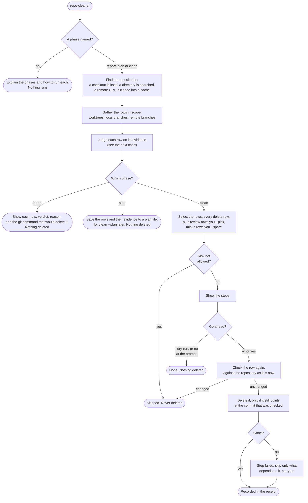
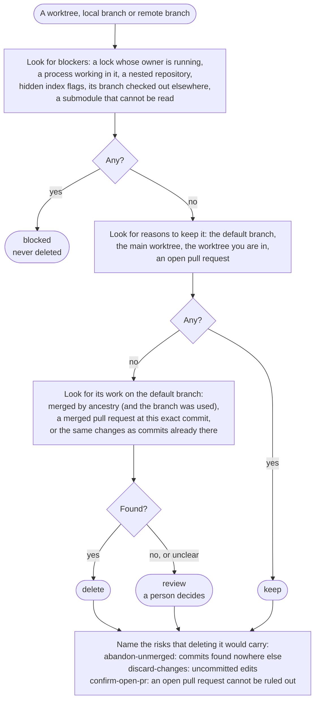

# D-4CE9: The CLI, by use case

## Why this record

The CLI grew one flag at a time, and it shows. "Remote" means three things
(judge remote branches, use the network, look up pull requests), `--only`
takes a comma list of internal kind names, and there is no single obvious
way to say "clean my local branches", "clean the remote" or "clean both".
And a bare `repo-cleaner` quietly runs one phase, the report, so a first
run never learns that there are phases at all.

This record designs the CLI from what people come to it to do, ignoring
the current flags, then maps the current CLI onto it. Each use case below is
meant to become a recipe in the README and an executable test, so the
documentation and the behaviour cannot drift apart.

## The model in one paragraph

`repo-cleaner` works in named phases, and does nothing until one is named.
`report` looks at a repository and sorts what can go into four verdicts:
`delete` (its work is already on the default branch), `review` (unclear),
`keep` (still in use) and `blocked` (cannot be removed). `plan` saves what
the report found, to run later or hand to someone. `clean` deletes the
`delete` rows, after checking them again, showing them and asking. Only
`clean` deletes. Everything else is a question of **where** to look (which
repositories), **what** to clean (worktrees, local branches, remote
branches), **how sure** to be (the network, pull requests) and **which rows**
to act on.

| Phase | Command | Deletes? |
|---|---|---|
| Look | `repo-cleaner report` | Never |
| Save (optional) | `repo-cleaner plan` | Never |
| Delete | `repo-cleaner clean` | Only what is safe, after asking |

## How it works

Every phase looks the same way. `report` stops there, `plan` saves what it
found, and only `clean` goes on to delete, checking everything again first.
With no phase named, nothing runs.



How one row gets its verdict:



## Use cases

Each use case is a sentence a person would say, the command, and what
happens. A `$` line is a command to type.

### Starting out

**U0. "What is this, and how do I use it?"**

```console
$ repo-cleaner
repo-cleaner finds worktrees and branches whose work has landed, and deletes them safely.

It works in phases. Nothing is deleted until clean, and only what is safe.

  1. report   Look: each worktree and branch, with a verdict and the reason.
                $ repo-cleaner report            this repository
                $ repo-cleaner report --all      local and remote branches
  2. plan     Optional: save what the report found, to run later or hand on.
                $ repo-cleaner plan --all > plan.json
  3. clean    Delete what is safe: checks each row again, shows the steps, asks.
                $ repo-cleaner clean             asks first
                $ repo-cleaner clean -y          does not ask

Nothing ran. Name a phase; `repo-cleaner <phase> --help` shows its options.
```

Exits 2, so a script that expected a report from the bare command fails
loudly instead of quietly getting none. `repo-cleaner --help` prints the
same overview with the shared options, and exits 0.

### Looking

**U1. "What can I clean up here?"**

```console
$ repo-cleaner report
```

Reports this repository's worktrees and local branches, with a verdict, the
reason and the exact git command for each. Deletes nothing. Run from any
directory inside the checkout.

**U2. "…and on the remote too."**

```console
$ repo-cleaner report --remote   # remote branches only
$ repo-cleaner report --all      # local and remote
```

Fetches first and looks up pull requests, because a remote branch can only
be judged against the remote as it is now.

**U3. "Across every project I have."**

```console
$ repo-cleaner report ~/Developer
```

A directory that is not a checkout is searched for checkouts. Every command
takes the same targets.

### Cleaning

**U4. "Just clean it up." (immediate, still safe)**

```console
$ repo-cleaner clean -y
```

Deletes every local row judged `delete`, without asking. `review`, `keep`
and `blocked` rows are never touched. Before each delete it checks the row
again and deletes only the commit it saw.

**U5. "Clean, but show me first."**

```console
$ repo-cleaner clean
```

Shows the steps and asks `Delete 3 rows? [y/N]`. With no terminal to ask on
(a script, an agent), it refuses unless `-y` is given.

**U6. "Only the remote", "only local", "both".**

```console
$ repo-cleaner clean --local -y     # worktrees and local branches (the default)
$ repo-cleaner clean --remote -y    # remote branches only
$ repo-cleaner clean --all -y       # both
```

Narrower still: `--worktrees`, `--branches`. The scope flags combine:
`--worktrees --remote` is worktrees and remote branches.

**U7. "I just merged my PR: clean up that branch everywhere."**

```console
$ repo-cleaner clean --branch feat/login --all -y
$ repo-cleaner clean --branch HEAD --all -y      # the branch checked out here
```

Its worktree, its local branch and its remote branch, if each is `delete`.

**U8. "What exactly would it do?"**

```console
$ repo-cleaner clean --all --dry-run
```

The same checks and the same step list as a real run; deletes nothing.

### Deciding the unclear ones

**U9. "Delete this one too; I've checked it."**

```console
$ repo-cleaner clean --pick feat/spike -y
```

A `review` row runs only when named. A row that would lose something carries
a named risk and is skipped until allowed:

```console
$ repo-cleaner clean --pick feat/spike --allow abandon-unmerged -y
```

| Risk | What would be lost |
|---|---|
| `abandon-unmerged` | Commits that are on no remote and not on the default branch |
| `discard-changes` | Uncommitted edits in a worktree |
| `confirm-open-pr` | An open pull request, which deleting its branch closes |

**U10. "Never touch these."**

```console
$ repo-cleaner clean --all --spare 'release/*' --spare staging -y
```

`--spare` takes a row or a glob.

**U11. "Let me choose." (new)**

```console
$ repo-cleaner clean -i
```

A checklist of the rows, `delete` rows ticked, `review` rows unticked,
`blocked` rows shown but not selectable. Risky rows ask for the risk by name
when ticked.

### Working with others and with machines

**U12. "Plan now, run later, or hand it to someone."**

```console
$ repo-cleaner plan --all > plan.json
$ repo-cleaner clean --plan plan.json -y
```

The plan records each row's evidence. `clean` re-checks every row against
the repository as it is then, and drops any that changed.

**U13. "An agent or a script needs to read it."**

```console
$ repo-cleaner report --json
$ repo-cleaner clean --all -y --json
```

No prompts without a terminal, a JSON report or receipt on stdout, and
exit codes that say what happened (below).

**U14. "No network."**

```console
$ repo-cleaner report --all --offline
```

Judges from what is on disk. `clean` of remote branches still asks the
remote before deleting, and refuses if it cannot.

**U15. "A remote I have no checkout of."**

```console
$ repo-cleaner clean https://github.com/acme/app.git --dry-run
```

Remote branches only, through a clone kept in a cache.

## The grammar

```text
repo-cleaner                                                           explain the phases; run nothing
repo-cleaner report  [target...] [scope] [network] [output]            look
repo-cleaner plan    [target...] [scope] [network]                     save a plan
repo-cleaner clean   [target...] [scope] [network] [select] [confirm]  delete
repo-cleaner cache   [list | remove <url>...]                          the clone cache
```

| Group | Flags | Default |
|---|---|---|
| target | paths or remote URLs | the directory you are in |
| scope | `--local`, `--remote`, `--all`; narrower: `--worktrees`, `--branches` | `--local` |
| network | `--fetch`, `--offline`, `--provider <auto\|github\|gitlab\|none>` | local: no network; remote: fetch and look up PRs |
| select | `--branch <name\|HEAD>`, `--pick <row>`, `--spare <row\|glob>`, `--allow <risk>[=<row>]`, `-i` | every `delete` row in scope |
| confirm | `-y`, `--dry-run`, `--plan <file>` | ask; refuse without a terminal |
| output | `--json`, `--format <text\|json\|summary\|commands>`, `--all-rows` | text |

A row is named `branch:<name>`, `worktree:<path>`, `remote:<remote>/<name>`,
or just `<name>` when that is unambiguous.

### Rules that keep it safe

1. Nothing runs until a phase is named. `report` and `plan` never delete.
   Only `clean` does, and only `delete` rows, unless a `review` row is
   picked.
2. A risk is never accepted by default; it is named with `--allow`.
3. `clean` re-checks every row just before acting, and each delete is
   compare-and-swap on the commit it saw.
4. Without a terminal and without `-y`, `clean` refuses instead of
   guessing.
5. A narrower flag never widens: `--branch` and `--pick` select within the
   scope, never outside it.

### Exit codes

| Code | Meaning |
|---|---|
| 0 | Looked, or cleaned, or nothing to do, or the prompt was declined |
| 1 | The state found refused it: an unreadable plan, a row not in it |
| 2 | Cannot run as typed: no phase named, an unknown flag, a refused combination |
| 10 | No target named a repository |
| 11 | A step failed; the receipt says which, and what was skipped because of it |

## From 0.20 to this

| 0.20 | Proposed | Note |
|---|---|---|
| `repo-cleaner` (runs the report) | `repo-cleaner report` | **Breaking:** the bare command explains the phases, runs nothing and exits 2. |
| `--remote` (adds remote branches) | `--all` | **Breaking:** `--remote` now means remote branches only. Safe direction: a script that passed `--remote` cleans less, not more. |
| `--only remote` | `--remote` | |
| `--only worktree,branch` | `--local` (default) | |
| `--only worktree` / `--only branch` | `--worktrees` / `--branches` | `--only` is removed. |
| `--all` (show keep rows) | `--all-rows` | `--all` is reused for scope. |
| `--offline` | same | |
| (none) | `--fetch` | Refresh before judging local rows. |
| `--format json` | `--json` | `--format` stays. |
| `--spare <row>` | also takes a glob | |
| (none) | `-i` | New. |
| `clean --yes` | `clean -y` | Both spellings stay. |

## How this drives development

- Each use case becomes a recipe in the README, in this order, replacing the
  option-by-option tour. The option reference stays in `--help --extended`.
- Each recipe has a test in `tests/recipes.test.ts` that builds a small
  repository, runs the command exactly as the README writes it, and checks
  the outcome, the way `@osdlc/file-lock` runs its README examples. A recipe
  that stops working fails the build.
- Work is split into tasks: the scope flags (U2, U6, the breaking change),
  `--fetch`, `--spare` globs, `--json`, `-i`, and the recipes and their
  tests.

## Open questions

1. **Scope flag names.** `--local` / `--remote` / `--all` reads well, but
   `--all` is taken today for "show keep rows". The alternative,
   `--scope local|remote|all`, avoids reuse but is longer to type.
2. **Should local cleaning fetch by default?** Without a fetch, a branch
   merged on the remote since the last fetch reads as unmerged. That is safe
   (it is kept) but incomplete. Fetching every time is slower and needs the
   network. The proposal keeps local offline and adds `--fetch`.
3. **The look phase's name.** `report` matches what the docs already call
   its output. `status` is familiar from git; `scan` says what it does. The
   proposal uses `report`.
4. **`-i` now or later.** It is the most useful addition for people and the
   least for agents.

## Reopen if

A use case comes up that none of the above covers without a new concept.
